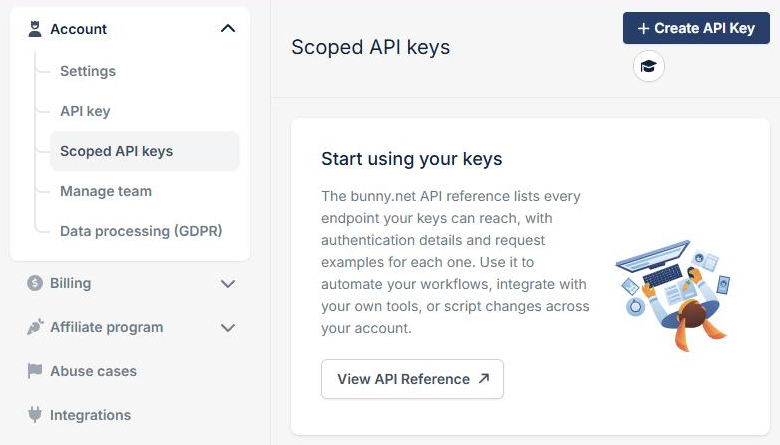
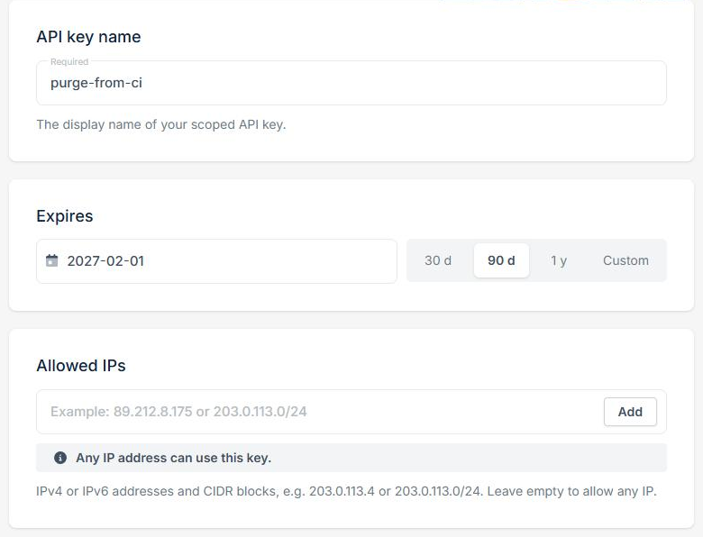
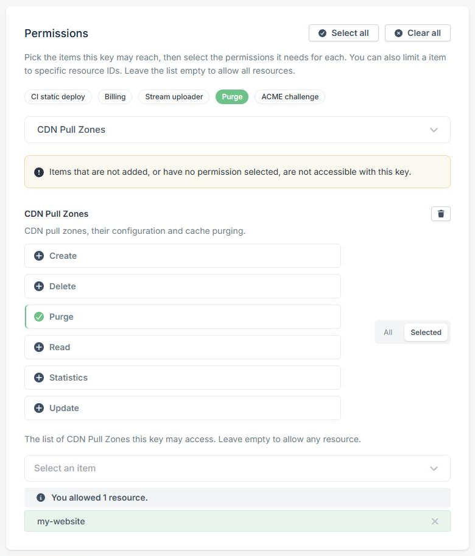
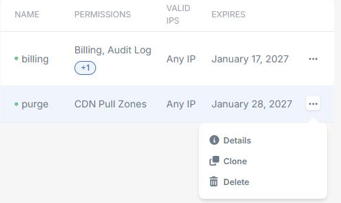

A scoped API key gives a script, CI job, or integration access to the [bunny.net API](/api-reference) without handing over your whole account. You choose what the key can do, which resources it can touch, which IP addresses can use it, and when it expires.

You can manage your scoped API keys at [Account > Scoped API keys](https://dash.bunny.net/account/scoped-api-keys).

<Frame></Frame>

## Create a scoped API key

<Steps>
  <Step title="Start a new key">
    Go to [Account > Scoped API keys](https://dash.bunny.net/account/scoped-api-keys) and click **Create API Key**.
  </Step>

  <Step title="Name the key and set its limits">
    - **API key name**: A name that tells you where the key is used, such as `purge-from-ci`.
    - **Expires**: Pick **30 d**, **90 d**, or **1 y**, or choose a custom date. The key stops working after this date.
    - **Allowed IPs**: Add the IPv4 or IPv6 addresses or CIDR blocks that can use the key. Leave the list empty to allow any IP address.

    <Frame></Frame>

  </Step>

  <Step title="Choose permissions">
    Under **Permissions**, add each product the key needs and select its permissions. Click a [preset](#use-a-preset) to fill in a common combination.

    For each product, choose **All** to allow every resource, or **Selected** to limit the key to specific resources.

    <Frame></Frame>

    The key can't reach products you don't add, or products with no permission selected.

  </Step>

  <Step title="Copy your key">
    Click **Create API Key**, then copy the key and store it somewhere safe.

    <Warning>
      The key is shown only once. If you lose it, delete the key and create a new one.
    </Warning>

  </Step>
</Steps>

## Permissions

Each permission pairs a product with an action, such as `PullZone.Purge` or `DnsZone.Read`. The dashboard shows every product and action you can grant. To call the API with your key, see [Authenticate with Scoped API Keys](/api-reference/scoped-api-keys).

### Use a preset

Presets select the permissions for common uses, such as purging the cache or deploying a static site from CI. Click a preset to fill in its permissions, then review the products and permissions it selected under **Permissions**, and add or remove any before you create the key. A preset replaces any permissions you've already selected, and it doesn't limit the key to specific resources by default.

### Limit a key to specific resources

Choose **Selected** for a product to limit the key to the resources you pick, such as a single pull zone. Leave the list empty to allow all resources of that product.

Some actions always apply to all resources of a product, such as creating a resource or listing every resource. A key limited to selected pull zones can't list every pull zone, but it can still fetch each of those pull zones by ID.

### Grant all permissions and resources

Turn on **Grant all permissions and resources** to skip permission and resource checks. The key then works like your [account API key](/account/api-keys) on every endpoint that accepts scoped API keys. It still expires, and it still only works from the IP addresses you allow.

<Warning>
  Anyone with this key can manage and delete your resources. Use it only when the permissions above can't cover your use case.
</Warning>

## Manage your keys

Click the menu next to a key to manage it.

<Frame></Frame>

- **Details**: See the key's permissions, resources, allowed IPs, and expiry date.
- **Clone**: Create a new key with the same permissions, resources, and allowed IPs. You choose a new name and expiry date.
- **Delete**: Revoke the key. Any application using it stops working immediately.

You can't change a key after you create it. To change what a key can do, create a new key and delete the old one.

We email you when a key is created, when it's about to expire, and when it has expired.

## Team members

[Team members](/account/team-management) can create scoped API keys too. A team member can only grant permissions for the products their own [team permissions](/account/team-management/permissions) cover, and can't turn on **Grant all permissions and resources**.

## Keep your keys safe

Give each script or integration its own key with only the permissions it needs, and set the shortest expiry that works for you. Never share a key publicly or commit it to version control.
