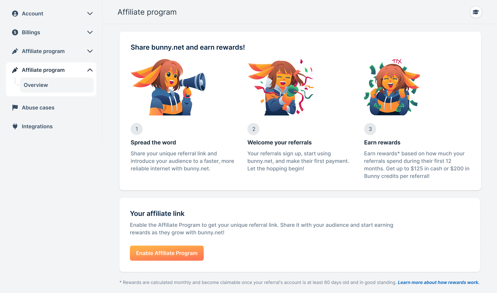
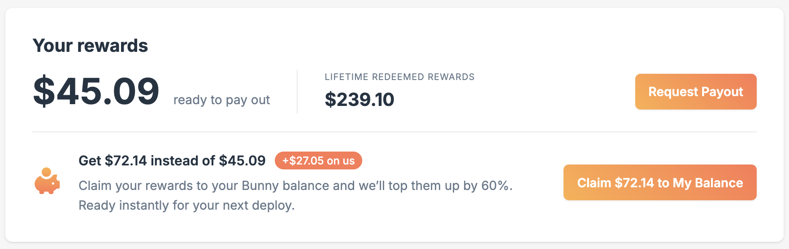
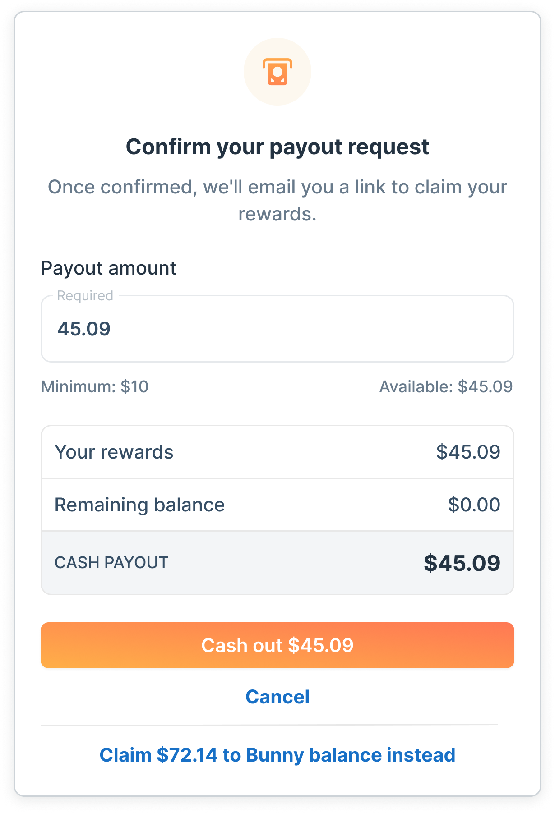

The Bunny Affiliate Program pays you for every customer you refer to bunny.net. Turn it on in your dashboard, share your referral link, and you earn rewards based on what each referred customer spends during their first 12 months.

## Who is eligible for the Bunny Affiliate Program?

Every bunny.net customer can join.

## How do I join the Affiliate Program?

Log in to your bunny.net account, click your profile icon in the top-left corner, and open the **Affiliate Program** page. Enable the program there and copy your referral link.

<Frame>

</Frame>

## How much can I earn for every customer I refer?

You can earn up to \$125 in cash per referral, based on what the referred customer spends during their first 12 months. If you claim your rewards as Bunny credits instead, we add 60% (up to \$75), so a referral can earn you up to \$200 in credits.

Only actual payments count. Free trial credits and promotional balances don't contribute to your earnings.

## Is there a limit on how much commission I can earn?

There's no limit to how many customers you can refer. The limit applies per referral: \$125 in cash or \$200 in Bunny credits.

## When can I claim my rewards?

We calculate rewards monthly. They become claimable once the referred customer's account is at least 60 days old and in good standing.

If the referred customer has unpaid invoices, their rewards stay on hold until the invoices are settled. You can't claim rewards while the referred account is suspended or disabled.

Once rewards are available, you can claim them whenever you want. There's no scheduled payout date.

## Can I create my own marketing materials?

Yes. You can design your own assets, write your own copy, and build your own banners, as long as they follow our [brand guidelines](/billing/affiliate-guidelines).

For official logos and graphics, use the [Bunny promo assets in Figma](https://www.figma.com/design/hXVOrM9Jg4IlVw3femLqXr/Bunny-Promo-Assets?node-id=0-1&p=f&t=SSxrOuUXIJnLV3r3-0).

## How do I track my referrals and earnings?

Open the **Affiliate Program** section in your bunny.net dashboard.

The **Overview** page has a chart of clicks, signups, and conversions over time.

Under **Your referrals**, you can see each referral's earnings, how close they are to the \$125 cash maximum, which rewards are pending or available, and when each referral's earning period ends. Filter the list with **Active**, **Pending**, **Released**, and **All**.

<Frame>

</Frame>

## What is considered a valid referral?

A valid referral is someone who clicks your link, signs up for bunny.net, and becomes a paying customer.

Only paid usage counts toward your rewards, whether the customer pays by card or cryptocurrency. Free trial credits and promotional balances are excluded.

## What are the rules for promoting my affiliate link?

Keep your promotion honest and clear, and don't use spam or aggressive ads. A good test is to share the link the way you'd want someone to share a product with you. The [Affiliate Guidelines](/billing/affiliate-guidelines) list what's allowed and what isn't.

## How are my affiliate rewards calculated?

You earn 50% of what each referred customer spends during their first 12 months, on the first \$250 they spend. Spending beyond \$250 doesn't add to your rewards.

You choose how to claim them:

- **Cash:** up to \$125 per referral, paid through Tremendous.
- **Bunny credits:** we add 60% to your reward, for up to \$200 per referral.

For example, if your referral spends \$100, you earn \$50 in cash. Claim it as Bunny credits and we add \$30, so you get \$80 in credits.

## How do payouts work?

You can collect your rewards in two ways.

<Frame>

</Frame>

### Bunny credits

You can convert your affiliate balance into Bunny credits at any time, with no minimum. We add a 60% bonus, so converting \$50 puts \$80 in credits into your bunny.net account.

<Frame>

</Frame>

### Cash

A cash payout needs at least \$10 in rewards. Once you reach it, request the payout from the **Affiliate Program** page.

We send cash payouts through our partner [Tremendous](https://www.tremendous.com/). Tremendous offers methods such as PayPal or a virtual Visa card. Which methods you can pick, and the currency you get paid in, depend on where you are. Tremendous checks your location when you redeem your reward and shows the options it supports there. To see what your region gets, read [Sending international rewards](https://help.tremendous.com/hc/en-us/sections/41475572352275-Sending-international-rewards).

<Frame>

</Frame>

<Warning>
  Tremendous can't deliver a reward to every recipient. Check [Tremendous recipient restrictions](https://help.tremendous.com/hc/en-us/articles/41472341152019-Understand-recipient-restrictions) before you count on a cash payout.

  If a cash payout isn't available to you, you can still convert your balance into Bunny credits.
</Warning>

## What happens if a referred customer's account is closed?

If a referred customer's account closes, we cancel any unclaimed rewards from that account.

## What happens to referrals made before the new program launched?

Referrals made before the update still follow the original reward rules. You keep getting the original one-time \$20 reward for each of them, rather than rewards based on their spending.

You can still claim any rewards earned under the old program in full, following the original payout rules. Referrals made after the launch follow the new reward system.

## Can I participate from any location?

Yes. The Affiliate Program is open to all bunny.net customers.

Tremendous handles cash payouts, so the payout methods depend on your region and some recipients can't receive them. See [How do payouts work?](#how-do-payouts-work) for details.

Converting your balance into Bunny credits works everywhere.
