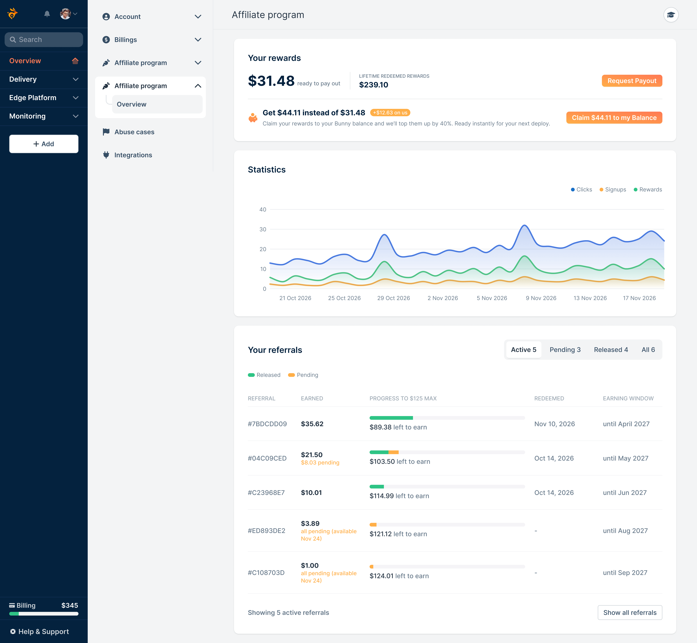
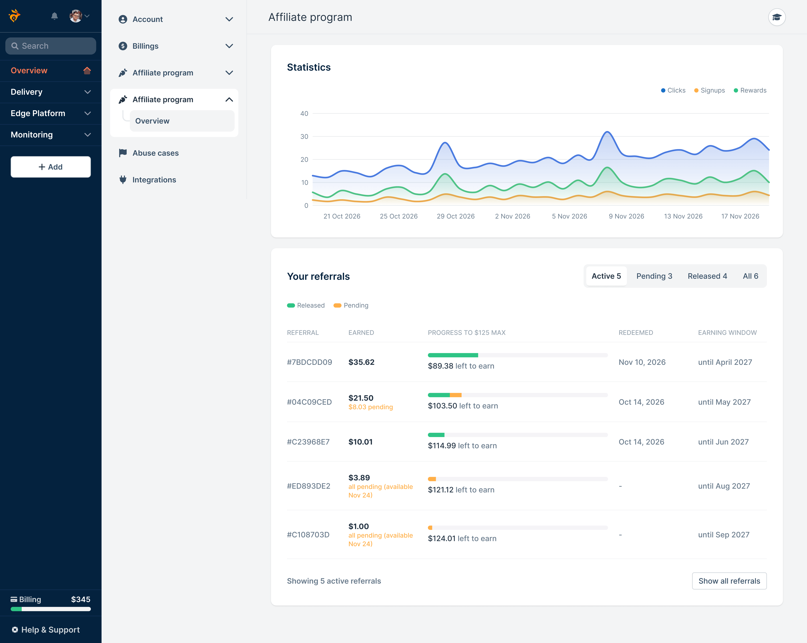
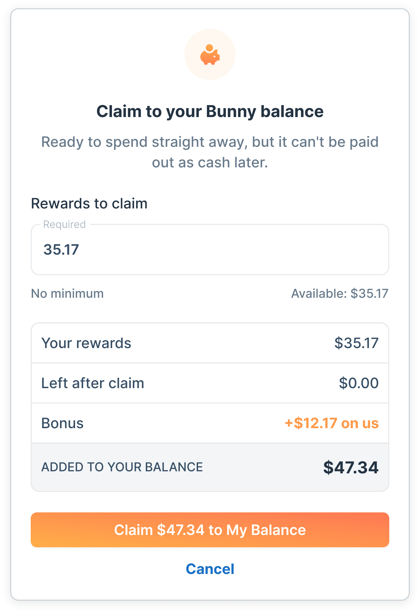

You know bunny.net. You love bunny.net. Why not get rewarded for sharing it? Sign up, grab your unique referral link, and share it with your friends, followers, or fellow developers. As your referrals start using bunny.net, you'll earn rewards based on how much they spend during their first 12 months. Help others discover bunny.net, and we'll make it worth your while!

### Who is eligible for the Bunny Affiliate Program?

If you're a bunny.net customer, you're in! The program is open to anyone already hopping with us.

### How do I join the Affiliate Program?

Easy! Just log in to your bunny.net account, click your profile icon in the top-left corner, and hop to the Affiliate Program page. Enable it with one click, grab your unique link, and you're ready to start sharing.

### How much can I earn for every customer I refer?

Earn up to **\$125 in cash per referral**, based on how much your referred customers spend during their first 12 months.

Want up to \$200 per referral? **Claim your rewards as Bunny credits and get 60% extra** (up to \$75)!

Only actual payments count. Free trial credits and promotional balances don't contribute to your earnings.

### Is there a limit on how much commission I can earn?

**There's no limit to how many customers you can refer.** Each referral can earn you up to **\$125 in cash or \$200 in Bunny credits.**

Keep spreading the Bunny magic and watch your rewards grow.

### When can I claim my rewards?

Rewards are calculated monthly and become claimable **once your referred customer's account is at least 60 days old and in good standing.**

If your referral has unpaid invoices, their rewards stay on hold until the invoices are settled. Rewards also cannot be claimed while the referred account is suspended or disabled.

Once your rewards are available, you can claim them whenever you're ready. No need to wait for a scheduled payout!

### Can I create my own marketing materials?

Yes please! We love seeing your creativity hop to life! You're free to design your own assets, write your own copy, or build your own banners. Just make sure everything follows our [brand guidelines](/billing/affiliate-guidelines) so it still feels unmistakably bunny.net.

We've got plenty of official logos, graphics, and other goodies to help you spread the word. [Grab what you need here!](https://www.figma.com/design/hXVOrM9Jg4IlVw3femLqXr/Bunny-Promo-Assets?node-id=0-1&p=f&t=SSxrOuUXIJnLV3r3-0)

### How do I track my referrals and earnings?

Head to the **Affiliate Program** section in your bunny.net dashboard to see how your referrals are doing.

The **Overview** page gives you a clear picture of your progress, with a chart showing clicks, signups, and conversions over time.

Under **Your referrals**, you can track each referral's earnings, see how close they are to the \$125 maximum cash reward, and check which rewards are pending or available. You'll also see when each referral's earning period ends.

Use the **Active**, **Pending**, **Released**, and **All** filters to explore your referrals and keep track of your progress.

### What is considered a valid referral?

It starts with your link. Someone clicks it, signs up for [bunny.net](https://bunny.net/), and becomes a paying customer.

You'll earn rewards based on their spending during their first 12 months, with up to **\$125 in cash per referral**. Choose Bunny credits instead, and we'll add a 60% bonus to your reward, giving you **up to \$200 in Bunny credits per referral!**

Only paid usage counts toward your rewards, whether paid by card or cryptocurrency. Free trial credits and promotional balances are excluded.

<Note>
  If your referral has unpaid invoices, their rewards stay on hold until the invoices are settled. Rewards also cannot be claimed while the referred account is suspended or disabled.
</Note>

### What are the rules for promoting my affiliate link?

We're all for creativity. In fact, we love seeing the unique ways you share bunny.net.

Just keep it kind, clear, and honest. No spam. No shady shortcuts. And no aggressive ads.

Here's the rule of thumb: share the way _you'd_ want someone to share with you. For more tips on what's cool (and what's not), check out the full [Affiliate Guidelines](/billing/affiliate-guidelines).

### How are my affiliate rewards calculated?

Your rewards grow based on how much your referred customers spend during their first 12 months.

You can choose how to claim your rewards:

- **Cash:** Earn 50% of your referral's spending, up to **\$125 per referral**, paid via Tremendous.
- **Bunny credits:** Choose Bunny credits instead of cash, and we'll add 60% extra to your reward, bringing your total to **up to \$200 per referral**.

**Here's an example:**

If your referral spends \$100, you earn \$50 in cash rewards. Choose Bunny credits instead, and we'll add 60% extra (\$30), giving you **\$80 in Bunny credits.**

You earn rewards on the first \$250 each referred customer spends during their first 12 months. Rewards become available once their account is at least 60 days old and in good standing. Spending beyond \$250 doesn't generate additional rewards.

There's no limit to how many customers you can refer!

### How do payouts work?

Once you've earned rewards, you've got two ways to collect them.

**Want instant credit?** You can convert your affiliate balance into Bunny credits anytime. No minimum required. We'll even boost it with a **60% bonus**. Add \$50 and we'll drop \$80 in credits into your [bunny.net](https://bunny.net/) account. Just like that.

**Prefer a monetary payout?** You'll need at least **\$10** in rewards before requesting one. Once you hit the threshold, just hop over to your Affiliate Program page to request your payout.

We send monetary payouts through our partner [Tremendous](https://www.tremendous.com/). They offer a range of methods, such as PayPal or a virtual VISA card, and the ones you can pick depend on where you are. So does the currency you get paid in. Tremendous checks your location when you redeem your reward, then shows the options it supports there. To see what your region gets, read [Sending international rewards](https://help.tremendous.com/hc/en-us/sections/41475572352275-Sending-international-rewards).

<Warning>
  Tremendous cannot deliver a reward to every recipient. Certain limitations apply on their side, so check [Tremendous recipient restrictions](https://help.tremendous.com/hc/en-us/articles/41472341152019-Understand-recipient-restrictions) before you count on a monetary payout.

  If a monetary payout isn't available to you, you can still convert your balance into Bunny credits.
</Warning>

### What happens if a referred customer's account is closed?

If a referred customer's account closes, any unclaimed rewards from that account are cancelled.

Rewards may also be held while the account has unpaid invoices or is suspended or disabled.

### What happens to referrals made before the new program launched?

Don't worry, your existing referrals are still rewarded!

Referrals made before the update still follow the original reward rules. You'll continue to receive the original one-time \$20 reward for those referrals, rather than rewards based on their spending.

**You can still claim any rewards earned under the old program in full, following the original payout rules.** All new referrals made after the launch follow the updated reward system.

### Can I participate from any location?

Yes, the Affiliate Program is available to all bunny.net customers.

Cash payouts are handled through Tremendous, so available payout methods depend on your region, and certain limitations apply on their side. See [How do payouts work?](#how-do-payouts-work) before you count on a monetary payout.

Converting your balance into Bunny credits works everywhere, so there's always a way to spend what you earn.
