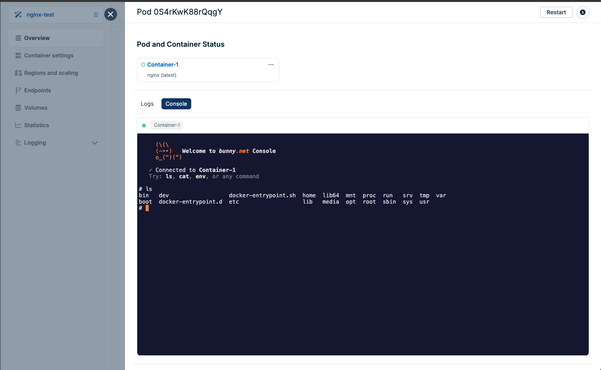

The Console gives you a terminal inside a running container so you can explore files, run commands, and check application state without redeploying or adding debug tooling.

<Frame>
  
</Frame>

## Opening a console session

<Steps>
  <Step title="Go to Overview">
    Open your application and click **Overview** in the left-side menu.
  </Step>
  <Step title="Expand a pod">
    Scroll down to the pod list and click the pod you want to inspect.
  </Step>
  <Step title="Switch to the Console tab">
    Below the pod's container list, click the **Console** tab next to Logs.
  </Step>
</Steps>

The terminal connects automatically and drops you into a shell. Type any command your container's image supports — `ls`, `cat`, `env`, `ps`, `curl`, or anything else installed in the image.

If your application has [multiple containers](/magic-containers/multi-container), use the container dropdown at the top of the terminal to switch between them.

## What you can do

The Console is useful when logs alone are not enough to explain what is happening:

- **Check environment variables** — run `env` to verify your variables are set correctly.
- **Inspect files** — browse the filesystem with `ls` and `cat` to check config files, mounted volumes, or generated output.
- **Test network connectivity** — use `curl`, `wget`, or `ping` (if installed) to verify that your container can reach external services or other containers.
- **Check running processes** — run `ps` or `top` to see what is running inside the container.
- **Debug startup issues** — look at config files or test commands that fail during startup.

## Session limits

| Limit | Value |
| --- | --- |
| Session idle timeout | 2 minutes |
| Maximum session duration | 60 minutes |
| Concurrent sessions per account | 5 per node |

A session ends automatically after 2 minutes of inactivity or after 60 minutes regardless of activity. Click **Reconnect** to start a new session when one ends.

<Info>
  The Console opens a shell session inside your running container. Any changes you make to the filesystem are temporary — they are lost when the container restarts or redeploys. To make permanent changes, update your Docker image or use [environment variables](/magic-containers/environment-variables).
</Info>

## Troubleshooting

<AccordionGroup>
  <Accordion title="Console tab is not visible">
    The Console tab appears only when a pod has at least one running container. If the tab is missing, check that your pod is running by looking at its status on the Overview page.
  </Accordion>
  <Accordion title="Connection fails or times out">
    The session token is valid for 60 seconds. If the connection takes longer, the token expires and you see an error. Click **Reconnect** to try again. If the problem persists, the pod may have been rescheduled — refresh the page and try a different pod.
  </Accordion>
  <Accordion title="Command not found">
    The commands available depend on what is installed in your container image. Minimal images like `alpine` or `distroless` may not include common tools. If you need a specific tool for debugging, add it to your Dockerfile or use a base image that includes it.
  </Accordion>
  <Accordion title="Session ends immediately">
    If the container does not have a shell (`sh` or `bash`), the session cannot start. This happens with distroless or scratch-based images that do not include a shell binary.
  </Accordion>
</AccordionGroup>
