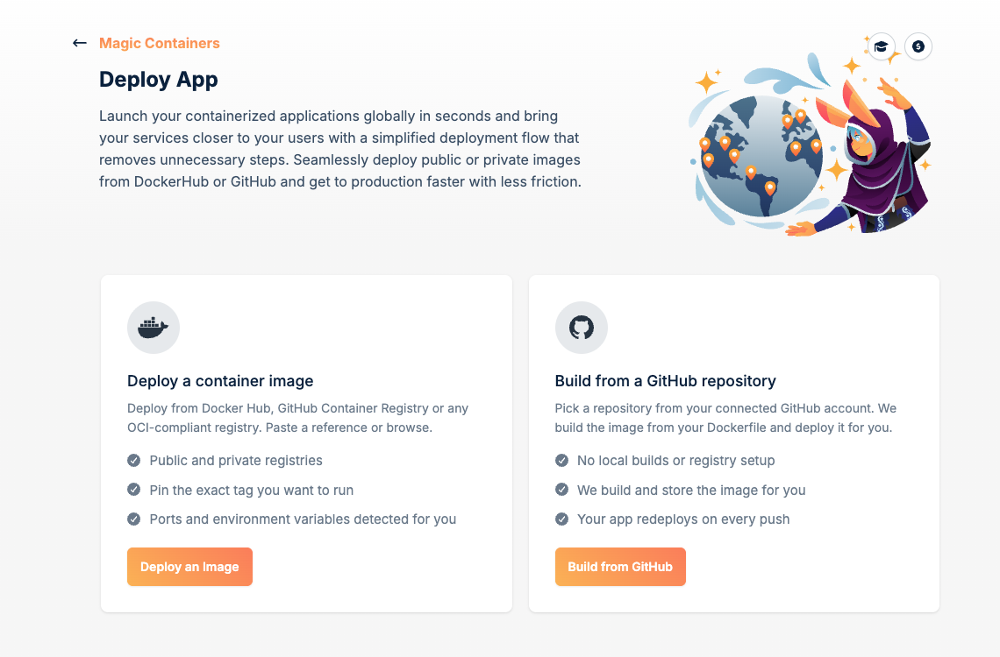
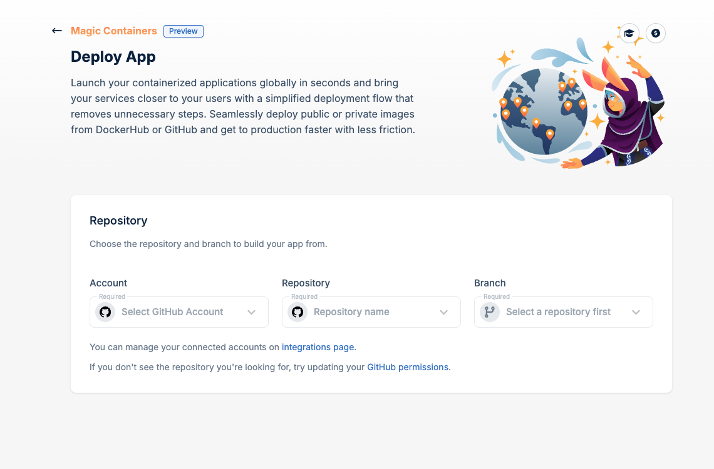
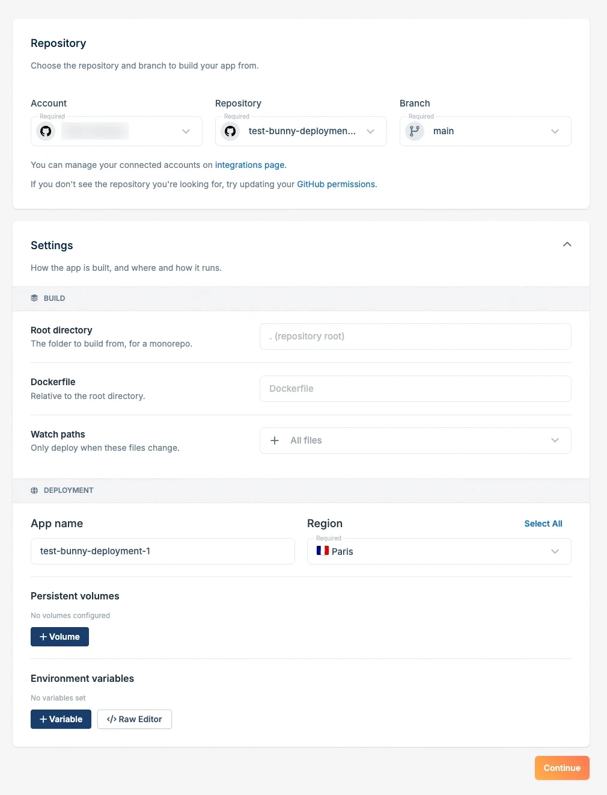
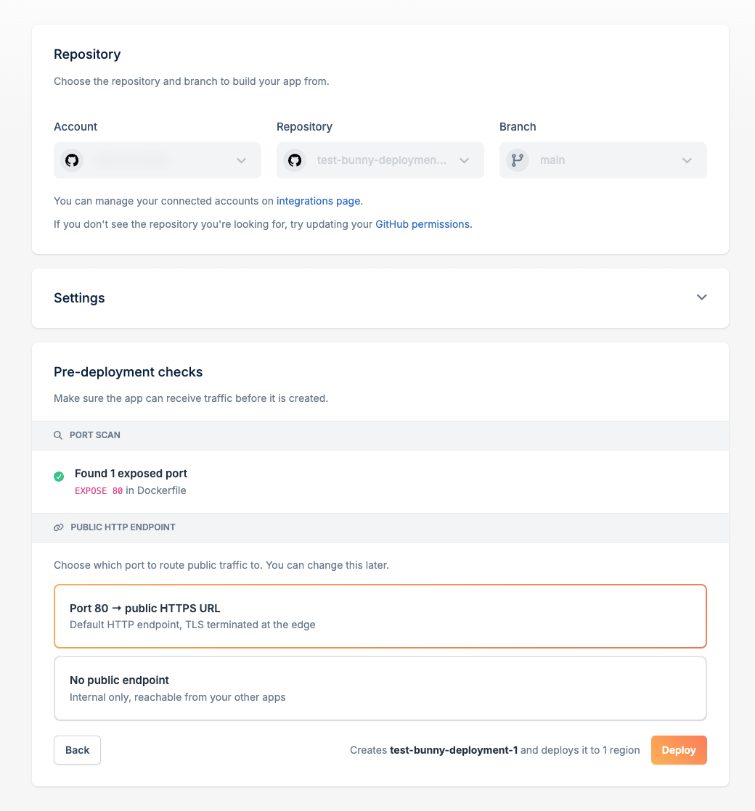
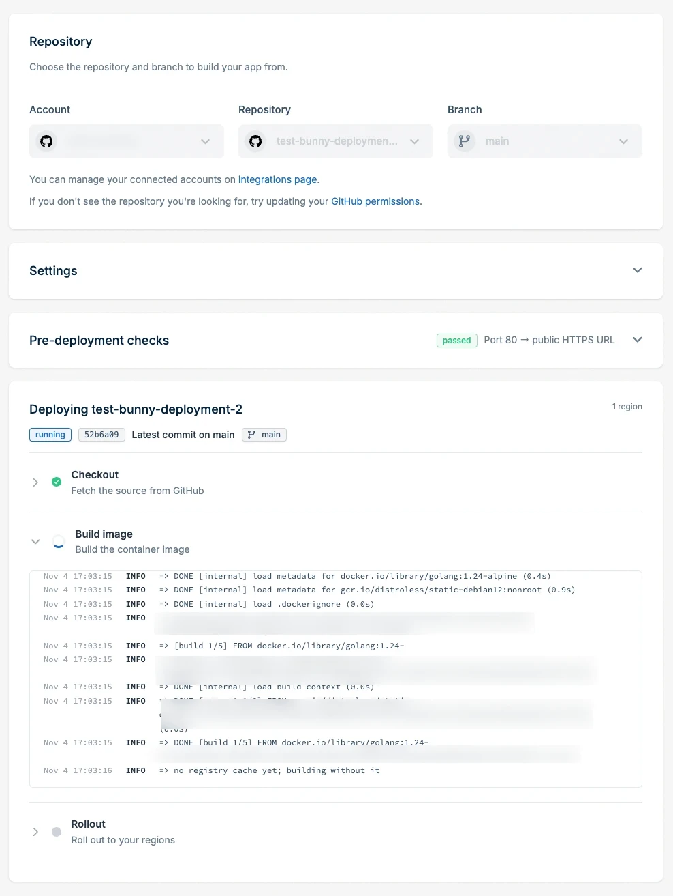
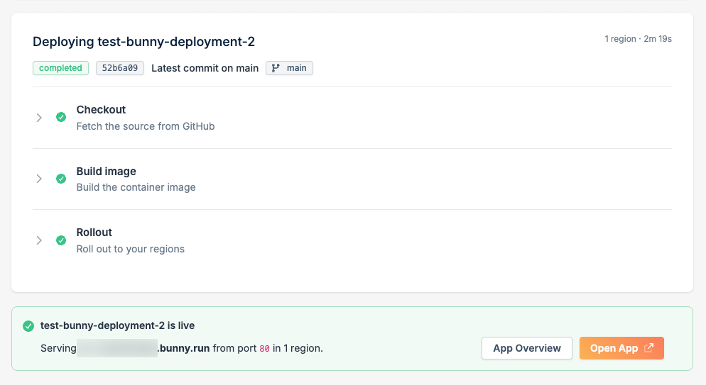

<Note>
  Deploying from GitHub is in **Preview**. Features may change. See [Product Release Stages](/product-release-stages) for details.
</Note>

Deploy an app to Magic Containers straight from a GitHub repository. You pick a repository and branch, and bunny.net builds the image from your Dockerfile, stores it, and rolls it out to your regions. You don't need to build locally or set up a registry. After the first deploy, your app redeploys every time you push to the branch.

If you already have a built image in a registry, see [Deploy an App](/magic-containers/deploy) instead.

## Prerequisites

- A GitHub account connected to bunny.net. You can connect one while you deploy.
- A repository with a `Dockerfile`. Add an `EXPOSE` instruction for the port your app listens on, so the port can be detected for you.

## Deploy your app

<Steps>
  <Step title="Choose to build from GitHub">
    In the [bunny.net dashboard](https://dash.bunny.net), go to **Magic Containers** and click **+ Add App**. Then click **Build from GitHub**.

    <Frame>
      
    </Frame>
  </Step>

  <Step title="Select a repository and branch">
    Under **Repository**, choose the source to build from:

    - **Account**: the GitHub account or organization that owns the repository.
    - **Repository**: the repository to build.
    - **Branch**: the branch to build and deploy. New pushes to this branch trigger a redeploy.

    <Frame>
      
    </Frame>

    To connect another GitHub account, use the **integrations page** link. If a repository is missing from the list, click **GitHub permissions** and give bunny.net access to it.
  </Step>

  <Step title="Configure the build">
    Once you select a branch, the **Settings** section opens. Under **Build**, set how the image is built:

    - **Root directory**: the folder to build from. Leave it empty to build from the repository root. Set it when your app lives in a subfolder of a monorepo.
    - **Dockerfile**: the path to the Dockerfile, relative to the root directory. Defaults to `Dockerfile`.
    - **Watch paths**: the files that trigger a redeploy when they change. Defaults to all files. Narrow it down to skip redeploys for changes that don't affect the app, such as documentation.

    <Frame>
      
    </Frame>
  </Step>

  <Step title="Configure the deployment">
    Under **Deployment**, set how and where the app runs:

    - **App name**: the name of the app. The repository name is pre-filled.
    - **Region**: the regions to deploy to. Click **Select All** to deploy to every region. See [Regions](/magic-containers/regions).
    - **Persistent volumes** (optional): click **+ Volume** to keep data across restarts and redeploys. See [Persistent Volumes](/magic-containers/persistent-volumes).
    - **Environment variables** (optional): click **+ Variable** to add one at a time, or **Raw Editor** to paste several in `KEY=value` form. See [Environment Variables](/magic-containers/environment-variables).

    Click **Continue**.
  </Step>

  <Step title="Review the pre-deployment checks">
    Before the app is created, Magic Containers scans your Dockerfile for exposed ports. Each `EXPOSE` instruction it finds is listed under **Port scan**.

    Under **Public HTTP endpoint**, choose how traffic reaches the app:

    - **Port → public HTTPS URL**: routes public traffic to that port through a default HTTP endpoint. TLS is terminated at the edge.
    - **No public endpoint**: the app is internal only. Your other containers can still reach it.

    <Frame>
      
    </Frame>

    You can change endpoints after the app is deployed. See [Endpoints](/magic-containers/endpoints).

    <Warning>
      Only expose services that are meant to be public, such as web servers or APIs. **Do not expose private services** such as databases, caches, or internal APIs.
    </Warning>
  </Step>

  <Step title="Deploy">
    Click **Deploy**. The deployment runs in three steps:

    1. **Checkout**: fetches the source from GitHub.
    2. **Build image**: builds the container image from your Dockerfile.
    3. **Rollout**: rolls the new image out to your regions.

    Click a step to expand its logs and follow progress, or to find out why a build failed.

    <Frame>
      
    </Frame>
  </Step>

  <Step title="Open your app">
    When all steps complete, the app is live. If you chose a public endpoint, the URL of your app and the port it serves from are shown. Click **Open App** to visit it, or **App Overview** to manage it.

    <Frame>
      
    </Frame>
  </Step>
</Steps>

## Redeploy on push

Every push to the deployed branch builds a new image and rolls it out to your regions. If you set **Watch paths**, only pushes that change matching files trigger a redeploy.

To change the branch or build settings, turn off automatic deployments, view build logs, or redeploy an earlier build, see [Deployments](/magic-containers/deployments).

To control how new versions replace running instances, see [Rolling Updates](/magic-containers/rolling-updates).

<Info>
  Trial accounts must add valid payment card details before deploying, and are limited to one application, three regions, and three instances per region. See [Limits](/magic-containers/limits#trial-accounts).
</Info>
