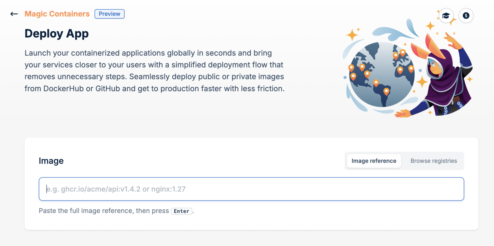
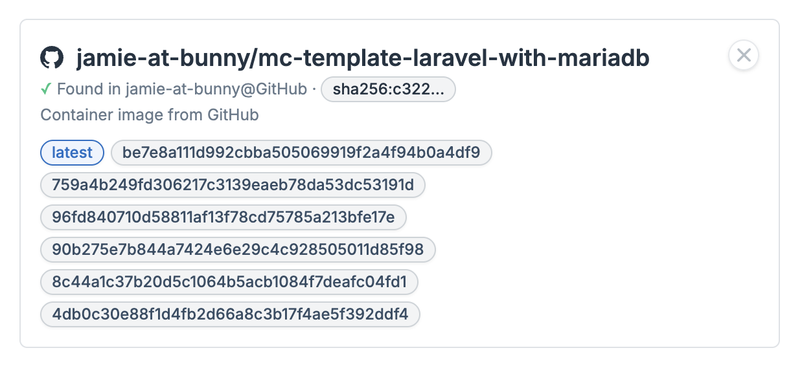
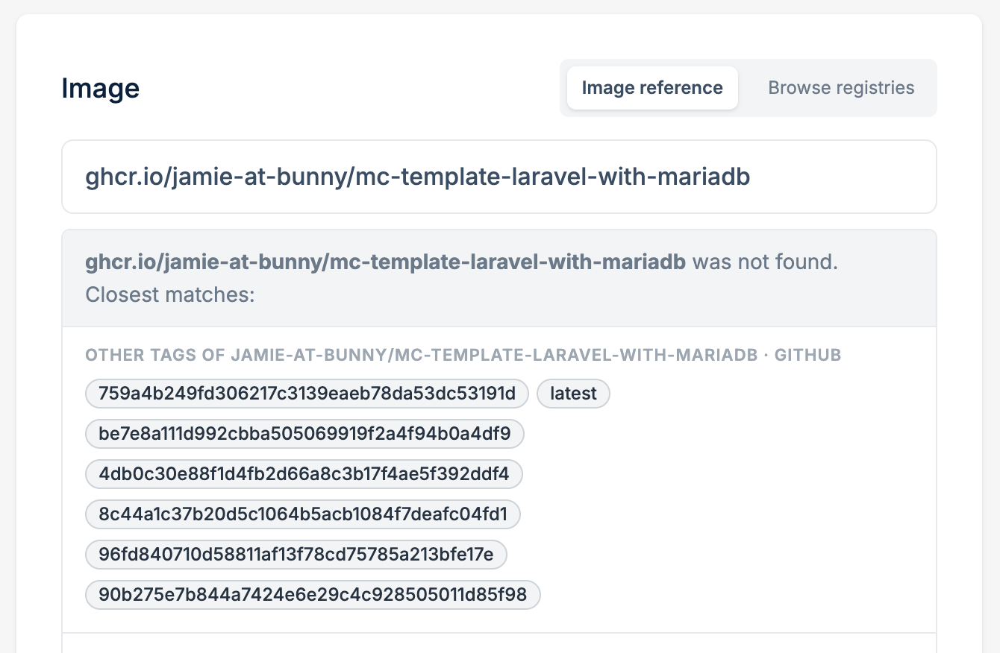
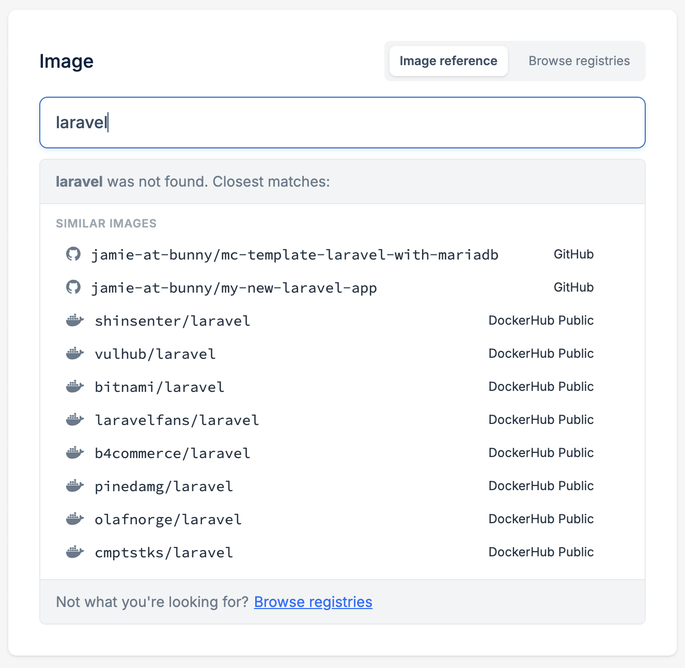
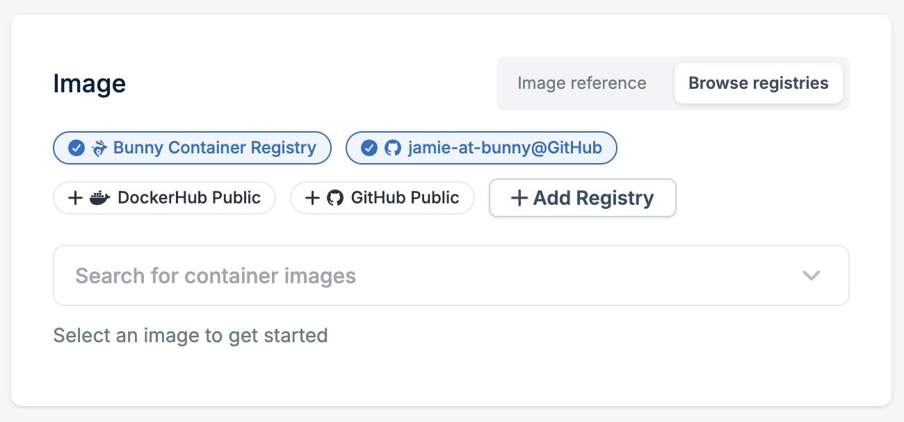
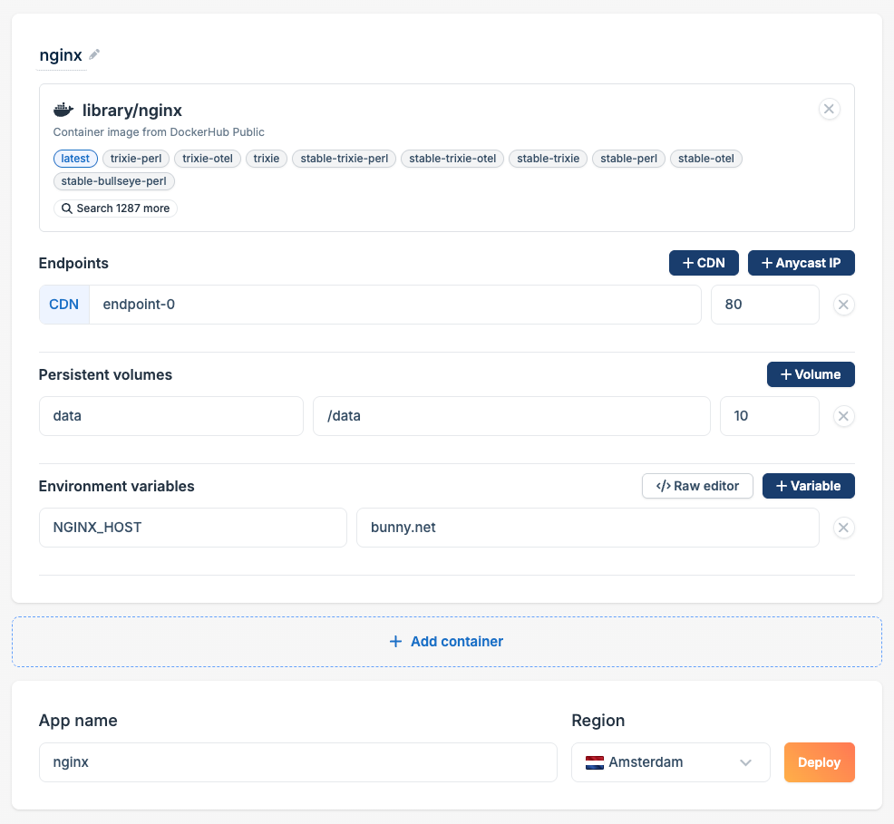
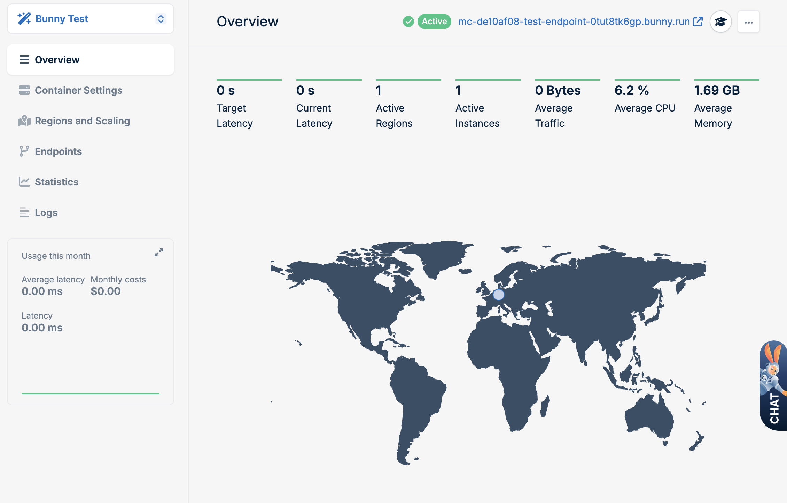

Deploying to Magic Containers happens on a single page. You pick a container image, configure the container, choose a region, and click **Deploy**. If you need more regions or different scaling settings, you can configure them after your app is deployed.

Public images from Docker Hub and GitHub Container Registry work without any setup. To deploy a private image, connect its registry first. Magic Containers works with any OCI-compliant registry, including GitLab, Harbor, and Quay. See [Image Registries](/magic-containers/image-registries).

<Steps>
  <Step title="Open the Deploy App page">
    In the [bunny.net dashboard](https://dash.bunny.net), go to **Magic Containers** and click **+ Add App**.

    <Frame>
      
    </Frame>

    The page opens on the **Image reference** tab. Once you pick an image, the dashboard names the container after it. Click the pencil icon next to the name to change it.
  </Step>

  <Step title="Select a container image">
    Paste the full image reference into the **Image** field, for example `ghcr.io/acme/api:v1.4.2` or `nginx:1.27`, and press **Enter**. Magic Containers checks every registry connected to your account, then shows the registry that has the image, its digest, and its tags before anything deploys. Click a tag to switch to it.

    <Frame>
      
    </Frame>

    Leave the tag off and the dashboard asks you to pick one. Plenty of GitHub Container Registry images never publish a `latest` tag, so choosing here saves you a failed pull at deploy time.

    A typo or a tag that doesn't exist gets you the closest matches: other tags of the same image, or images with a similar name. Click one to use it.

    <Columns cols={2}>
      <Frame>
        
      </Frame>
      <Frame>
        
      </Frame>
    </Columns>

    A registry that rejects your saved credentials, for example after a token expires, shows **Unauthorized** in the results. Update the credentials under [Image Registries](/magic-containers/image-registries) and paste the reference again.

    To pick an image by hand, open the **Browse registries** tab. The chips above the search field show which registries the search covers. Click a chip with a plus sign to include that registry, or click **+ Add Registry** to connect a private registry without leaving the page.

    <Frame>
      
    </Frame>

    <Info>
      Magic Containers only supports images built for the **linux/amd64** architecture.
    </Info>
  </Step>

  <Step title="Configure endpoints">
    <Frame>
      
    </Frame>

    Endpoints define how your container is reachable from the internet. Two endpoint types are available:

    - **CDN**: routes traffic through bunny.net's CDN edge network. Best for HTTP(S) services that benefit from caching and global distribution.
    - **Anycast IP**: exposes your container directly on a globally anycast IP. Better suited for non-HTTP protocols or latency-sensitive TCP and UDP services.

    Click **+ CDN** or **+ Anycast IP** to add an endpoint, then give it a name and set the container port. This is the port your application listens on inside the container. Add more endpoints if your app exposes multiple ports.

    When an image declares known ports, an endpoint is pre-filled for you. Review it before deploying.

    <Warning>
      Endpoints make your container publicly accessible. Only create endpoints for services that are meant to be public-facing, such as web servers or APIs. **Do not expose private services** such as databases, caches, or internal APIs through an endpoint.
    </Warning>

    See [Endpoints](/magic-containers/endpoints) for details on each endpoint type.
  </Step>

  <Step title="Add persistent volumes (optional)">
    If your container needs to write data that should survive restarts and redeployments, click **+ Volume** under **Persistent volumes**. Give the volume a name, set the mount path inside the container, and set its size in GB.

    Leave this section empty if your container is stateless. See [Persistent Volumes](/magic-containers/persistent-volumes) for how volumes behave across regions and instances.
  </Step>

  <Step title="Set environment variables">
    Under **Environment variables**, configure any runtime settings your container needs. Click **+ Variable** to add a key and value one at a time, or click **Raw editor** to paste multiple variables in `KEY=value` form.

    For public Docker Hub images, Magic Containers inspects the image metadata and pre-fills known environment variables with their default values. Review each one before deploying. Pay special attention to:

    - **Passwords and secrets**: replace any placeholder values with strong, unique secrets. Never leave default or example passwords in production.
    - **Paths and ports**: confirm that pre-filled values match your actual container configuration.

    See [Environment Variables](/magic-containers/environment-variables) for more.
  </Step>

  <Step title="Add more containers (optional)">
    Click **+ Add container** to add another container to the same app. Each container gets its own image, endpoints, volumes, and environment variables.

    All containers in an app run in the same pod and share a network namespace, so they can reach each other on `localhost`. They must listen on different ports. See [Multi-Container Apps](/magic-containers/multi-container).
  </Step>

  <Step title="Name your app and pick a region">
    Under **App name**, enter a name for the app. The name of the first image is pre-filled as a default.

    Under **Region**, the region geographically closest to you is selected automatically. Change it if you need to deploy closer to your users or a specific data source. See [Regions](/magic-containers/regions) for the full list.

    After deploying, you can add regions and configure scaling from the app's **Regions and Scaling** settings. See [Autoscaling](/magic-containers/autoscaling).
  </Step>

  <Step title="Deploy">
    Once everything looks good, click **Deploy**. Your app is created, the containers are scheduled, and the endpoints are activated.

    You'll be taken to the app overview where you can monitor the deployment status.

    <Frame>
      
    </Frame>
  </Step>
</Steps>

<Info>
  Trial accounts must add valid payment card details before deploying, and are limited to one application, three regions, and three instances per region. See [Limits](/magic-containers/limits#trial-accounts).
</Info>
