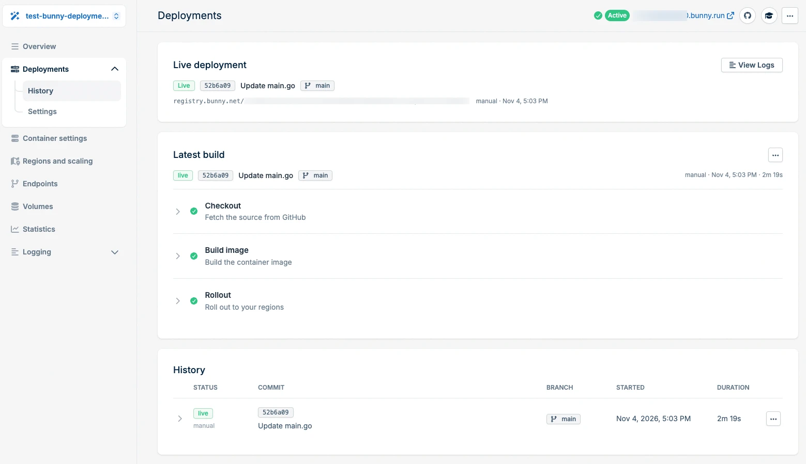
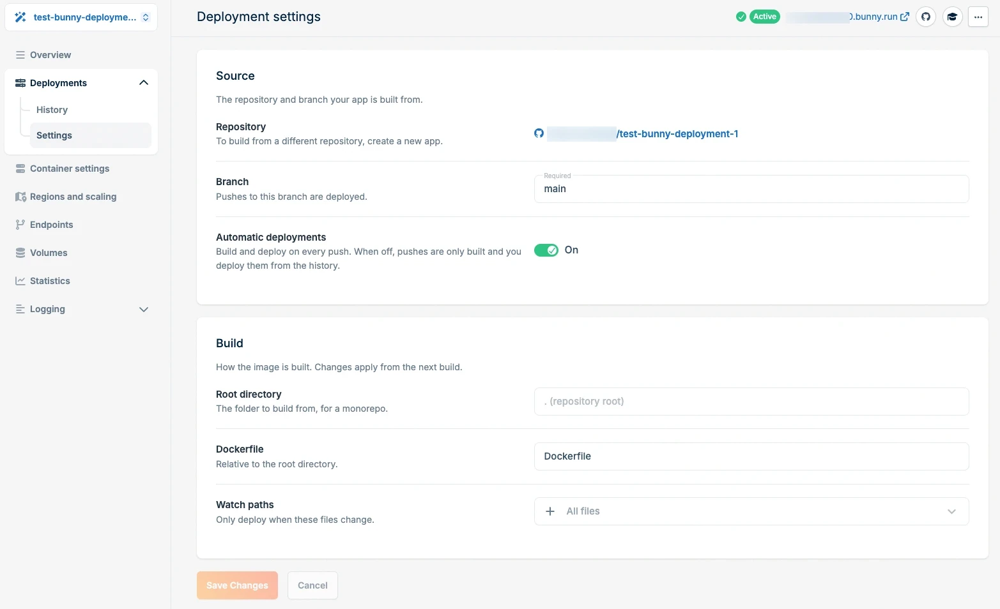

<Note>
  Deploying from GitHub is in **Preview**. Features may change. See [Product Release Stages](/product-release-stages) for details.
</Note>

Apps you [deploy from GitHub](/magic-containers/deploy-from-github) have a **Deployments** section in the left-side menu of the app. It has two pages:

- **History**: the live deployment, the latest build, and every earlier build. Use it to view build logs and redeploy.
- **Settings**: the branch the app deploys from, automatic deployments, and the build settings.

## Deployment history

Go to **Deployments > History** to see what is running and what was built.

<Frame>
  
</Frame>

The page has three sections:

- **Live deployment**: the build that is currently running. It shows the commit, the branch, the image it runs, what triggered it, and when. Click **View Logs** to open its logs.
- **Latest build**: the most recent build, with its **Checkout**, **Build image**, and **Rollout** steps. Click a step to expand its logs.
- **History**: every build of the app, with its status, commit, branch, start time, and duration. Click the arrow next to a build to expand its steps and logs.

<Info>
  Build logs are kept for **5 days**.
</Info>

### Redeploy a build

You can redeploy the latest build, or roll back to any earlier build:

- To redeploy the latest build, click the **...** menu on the right of **Latest build**.
- To redeploy an earlier build, find it under **History** and click the **...** menu on the right of its row.

Magic Containers rolls the build out to your regions again. To control how new instances replace running ones, see [Rolling Updates](/magic-containers/rolling-updates).

## Deployment settings

Go to **Deployments > Settings** to change how and when your app is built.

<Frame>
  
</Frame>

### Source

- **Repository**: the GitHub repository the app is built from. You can't change it. To build from a different repository, [create a new app](/magic-containers/deploy-from-github).
- **Branch**: the branch the app deploys from. Pushes to this branch are built and deployed.
- **Automatic deployments**: when on, every push to the branch is built and deployed. When off, pushes are only built, and you deploy them yourself from the history. See [Redeploy a build](#redeploy-a-build).

### Build

These settings apply from the next build.

- **Root directory**: the folder to build from. Leave it empty to build from the repository root. Set it when your app lives in a subfolder of a monorepo.
- **Dockerfile**: the path to the Dockerfile, relative to the root directory.
- **Watch paths**: the files that trigger a redeploy when they change. Defaults to all files.

Click **Save Changes** to apply your changes.
