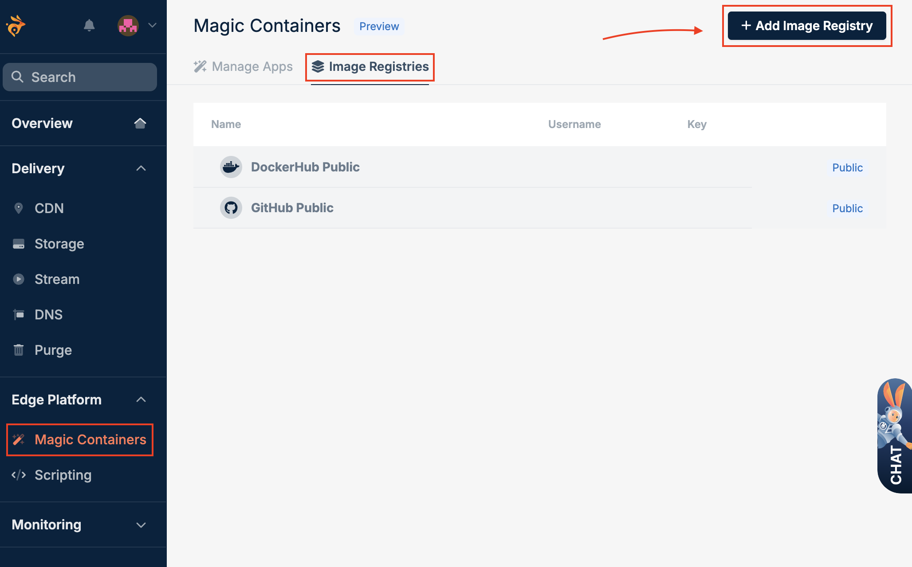
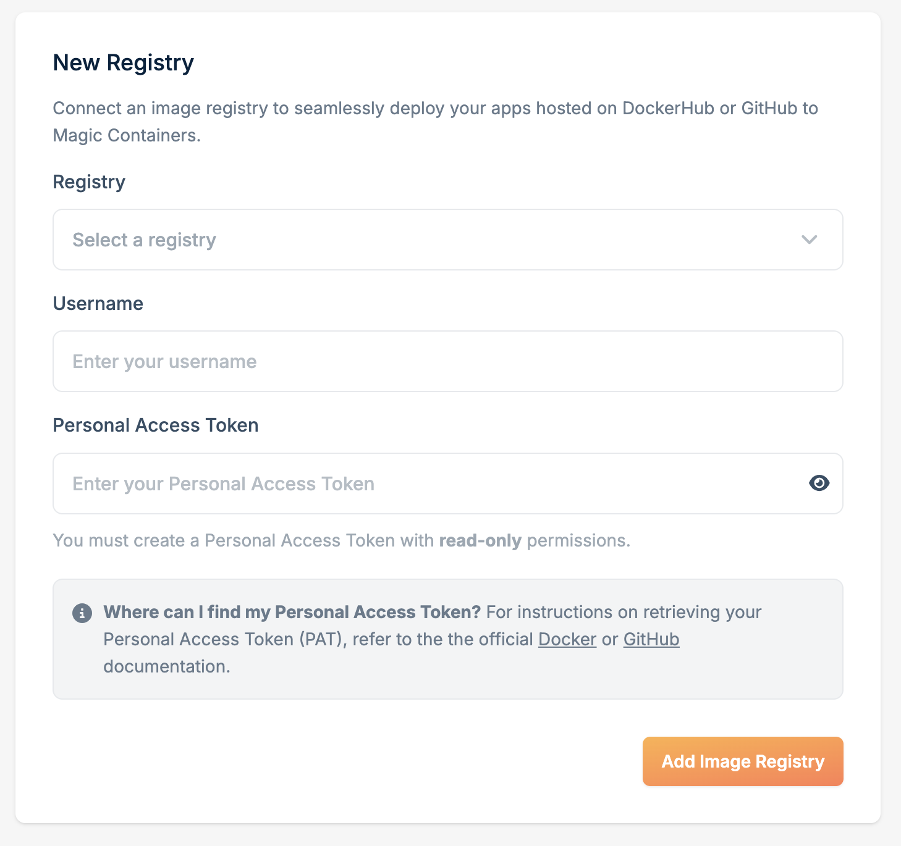

Magic Containers deploys images from Docker Hub, GitHub Container Registry, and any registry that follows the [OCI Distribution spec](https://github.com/opencontainers/distribution-spec), such as Harbor, GitLab, or Quay.

<Info>
Magic Containers only supports images built for the **linux/amd64** architecture. Build your image with `--platform linux/amd64`.
</Info>

## Public registries

Public images on Docker Hub and GitHub Container Registry work without any setup.

## Private registries

To deploy private images, add your registry credentials.

<Steps>
  <Step title="Navigate to Image Registries">
    In the bunny.net dashboard, go to **Magic Containers** and select **Image Registries**.
  </Step>
  <Step title="Add Image Registry">
    Click **Add Image Registry**.

    <Frame>
      
    </Frame>
  </Step>
  <Step title="Configure registry credentials">
    Fill in the following fields:

    <Frame>
      
    </Frame>

    - **Registry**: **DockerHub**, **GitHub**, or **OCI-compliant registry**.
    - **Registry host**: only for an OCI-compliant registry. Enter the host name, for example `registry.example.com`, or the host with a namespace path, as Scaleway and Oracle show it, for example `rg.fr-par.scw.cloud/my-namespace`. The registry must be reachable over HTTPS.
    - **Username**: your username or organization name.
    - **Personal Access Token** or **Password or access token**: credentials with read-only (pull) access. On GitHub, use a classic token with the `read:packages` and `read:org` scopes.
  </Step>
  <Step title="Save">
    Click **Add Image Registry**.
  </Step>
</Steps>

<Info>
To create a personal access token, see the official [GitHub](https://docs.github.com/en/packages/working-with-a-github-packages-registry/working-with-the-container-registry#authenticating-with-a-personal-access-token-classic) or [Docker](https://docs.docker.com/security/for-developers/access-tokens/#create-an-access-token) documentation.
</Info>

## OCI-compliant registries

When you deploy from an OCI-compliant registry, you pick the image in one of two ways:

- **Image reference**: paste the full reference, for example `registry.example.com/team/api:1.4.2`. Your credentials only need pull access.
- **Browse registries**: Magic Containers lists the repositories in your registry. It reads them from the registry's catalog endpoint (`/v2/_catalog`), which many registries only open to admins.

If your registry refuses the catalog request, the image list stays empty. Give your credentials catalog access, or deploy with the image reference.

### Harbor

Harbor only lists repositories to system admins and to system robot accounts with the **Catalog** permission. A robot account that you create inside a project can pull images, but it can't list them.

To browse your Harbor images in Magic Containers, create a system robot account. You need Harbor admin rights.

<Steps>
  <Step title="Create a system robot account">
    In Harbor, go to **Administration** > **Robot Accounts** and click **New Robot Account**. Enter a name and an expiration time.
  </Step>
  <Step title="Add the catalog permission">
    Under **System Permissions**, select **Read** for **Catalog**.
  </Step>
  <Step title="Add pull access to your projects">
    Under **Project Permissions**, select the projects that hold your images, and select **Pull** for **Repository**.
  </Step>
  <Step title="Copy the credentials">
    Finish the wizard and copy the secret. Harbor shows it only once.
  </Step>
  <Step title="Add the registry in Magic Containers">
    Add an image registry as in [Private registries](#private-registries):

    - **Registry**: **OCI-compliant registry**.
    - **Registry host**: your Harbor host, for example `harbor.example.com`.
    - **Username**: the full robot account name that Harbor shows, for example `robot$magic-containers`.
    - **Password or access token**: the robot account secret.
  </Step>
</Steps>

<Warning>
The **Catalog** permission lists the repository names in every Harbor project, also in projects that the robot account can't pull from. If those names are private, skip the catalog permission and deploy with the image reference.
</Warning>

If **Catalog** isn't in the list of system permissions, your Harbor version doesn't support it. Use a project robot account with pull access, and deploy with the image reference.
