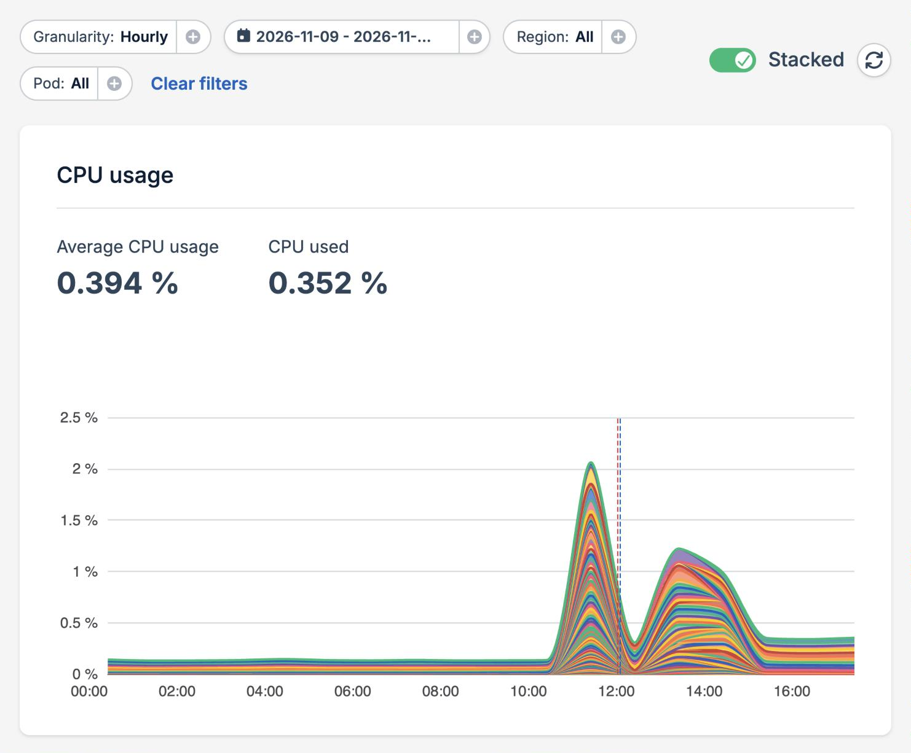
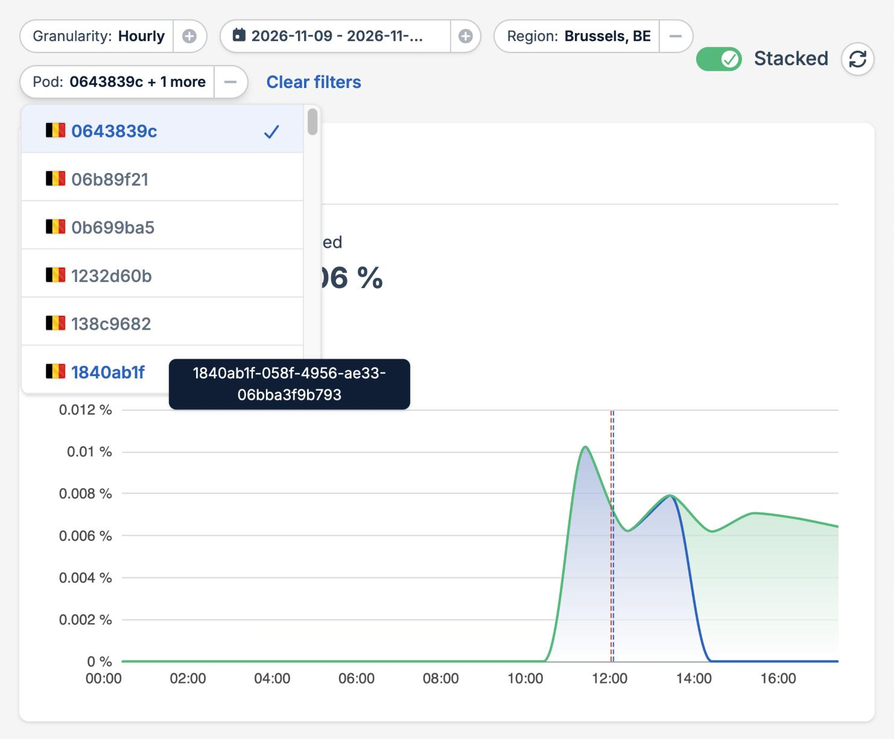
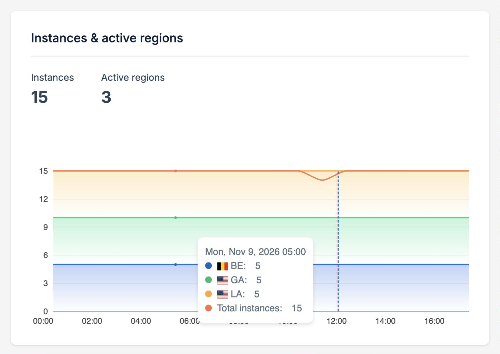
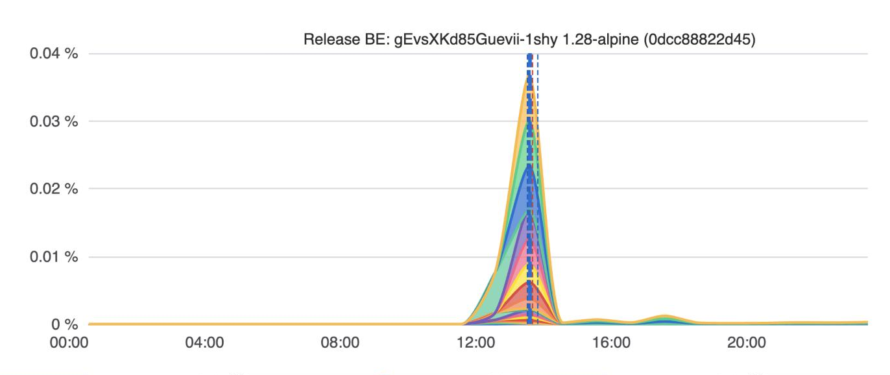

The **Statistics** page of a Magic Containers application shows how your application uses its resources over time. Every chart draws a line for each pod, so you can tell a single busy pod from load spread across the whole application. Filter the charts by region and pod to narrow down a problem, and use the release markers to see what changed after a deployment.

To open it, select your application in the dashboard, then select **Statistics** in the left-side menu.

<Frame>
  
</Frame>

The filter bar at the top applies to every chart on the page:

- **Granularity** shows one data point per hour or per day.
- **Date range** sets the days to show.
- **Region** and **Pod** narrow the charts to part of your application. See [Filter by region and pod](#filter-by-region-and-pod).
- **Clear filters** shows every region and pod again.
- **Stacked** switches between stacked and separate lines. See [Stacked and separate lines](#stacked-and-separate-lines).
- The refresh button loads the latest data.

## Choose a time period

By default, the page shows yesterday and today with hourly data. Pick other days in the date range picker to look further back.

The granularity follows the range you pick. A range of one or two days switches to **Hourly**, and a range longer than a week switches to **Daily**. Pick a granularity yourself to keep it whatever range you choose. Hourly data covers up to 7 days, so switching to **Hourly** on a longer range narrows it to the last 7 days.

The selected period is part of the page URL, so you can bookmark it or share it with your team.

## Filter by region and pod

Use the **Region** filter to show only the pods that run in some of your regions. Narrowing the charts down to one region is a quick way to check whether a problem is limited to one location.

Use the **Pod** filter to show only some pods. The list holds every pod that ran in the selected period and regions, including pods that were replaced since. Each pod is listed by the first 8 characters of its ID, and hovering over it shows the full ID.

<Frame>
  
</Frame>

You can select several regions and several pods. The filters apply to the charts as follows:

- **CPU usage**, **Memory usage**, **Traffic served**, and **Ephemeral storage** show the selected pods in the selected regions.
- **Persistent volume** shows the volumes in the selected regions. When you select pods, it shows the volumes those pods used.
- **Instances & active regions** follows the region filter only.

## Stacked and separate lines

With **Stacked** on, the lines of the selected pods are stacked on top of each other, so the top edge of the chart is the total of your selection. The numbers above each chart describe that total.

Turn **Stacked** off to draw each line on its own. Separate lines make it easier to compare pods and to spot a single pod that behaves differently from the rest. The numbers above each chart then describe an average pod.

Hover over a chart to see the value of each line at that time. Pods that weren't running at that time are left out of the list.

## Charts

| Chart                          | What it shows                                                                         | Numbers above the chart                                 |
| ------------------------------ | ------------------------------------------------------------------------------------- | ------------------------------------------------------- |
| **CPU usage**                  | CPU used by each pod                                                                  | Average CPU usage over the period, and the latest value |
| **Memory usage**               | Memory used by each pod                                                               | Average memory usage over the period, and the latest value |
| **Traffic served**             | Data served by each pod                                                               | Average traffic per data point, and the total over the period |
| **Ephemeral storage**          | Space each pod uses on its local disk, which is lost when the pod is replaced         | Latest usage                                            |
| **Persistent volume**          | Space used on each volume instance, with the total volume size drawn as a line over it | Latest volume size and usage                           |
| **Instances & active regions** | Number of running instances in each region                                            | Latest number of instances and of active regions        |

A chart with nothing recorded for the selected period, regions, and pods shows **No data** instead of empty axes. For example, the **Persistent volume** chart stays empty for an application without [persistent volumes](/magic-containers/persistent-volumes).

### Instances and regions

The **Instances & active regions** chart draws a line for each region, so you can see where your application ran at any time and how [autoscaling](/magic-containers/autoscaling) changed the number of instances. With no region selected, it also draws the total number of instances of your application.

<Frame>
  
</Frame>

## Release markers

Each release of your application is marked on every chart with a dashed vertical line, one for each region it was rolled out to. A blue line marks a completed [rolling update](/magic-containers/rolling-updates). A red line marks a release that was rolled back, for example because its new pods didn't become healthy in time.

Hover over a marker to see its region and the image tag and digest of each container it deployed.

<Frame>
  
</Frame>

Release markers help you connect a change in your application's behavior to the deployment that caused it. If CPU or memory usage changes right after a marker, the new release is a good place to start looking. Then check the [logs](/magic-containers/logs) of the affected pods for details.

The markers follow the region filter. When you select only pods, the markers of their regions are shown.
