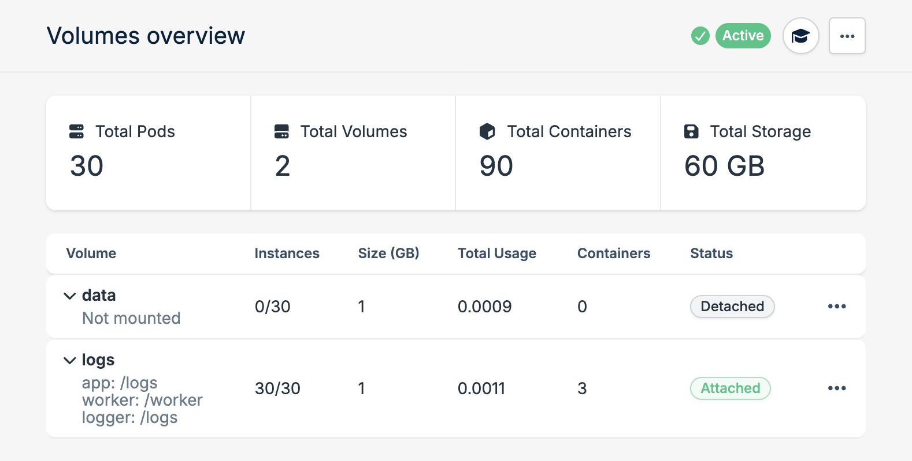
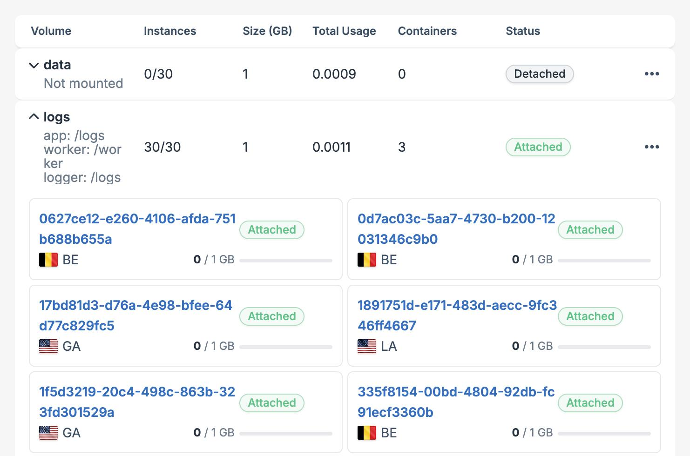
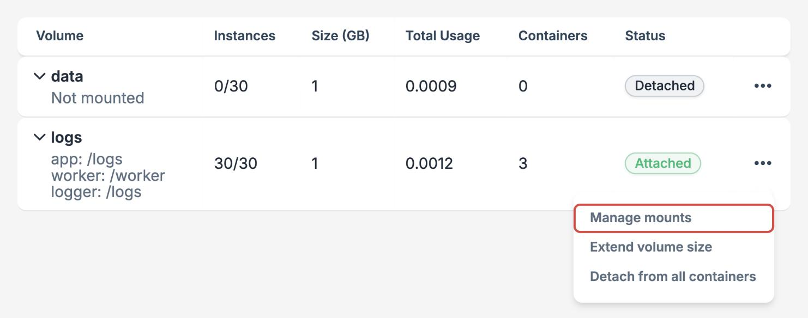
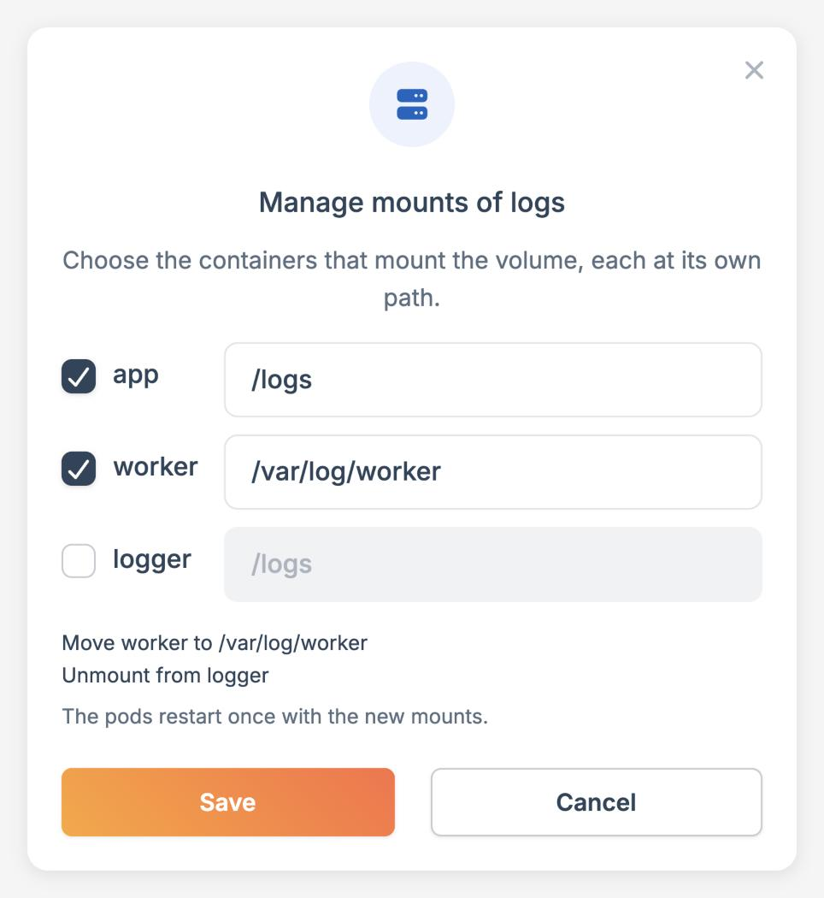

Persistent Volumes provide durable storage that persists across restarts and redeployments. Attach a volume directly to your Magic Containers application to keep your data safe, secure, and accessible as your application scales globally.

- **Auto-scaling** - Volumes automatically scale up with regional pod deployments and detach when scaling down
- **Encrypted by default** - All persistent data is AES encrypted
- **Flexible storage** - Each volume can expand up to 100GB (standard accounts) or 30GB (trial accounts), but can only be extended, never reduced
- **Dedicated volumes** - Each pod generates its own unique blank volume with no data duplication
- **Shared access** - Containers within the same pod can share the same volume
- **Automatic reattachment** - Detached volumes reattach automatically if your app scales up regionally
- **Unique mount paths** - Mount paths are unique to the application

## Regional behavior

Volumes are tied to specific regions. This means:

- If your app runs in multiple regions (e.g., EU, US, APAC), each region gets its own independent volumes
- A pod in one region cannot access volumes from another region
- When scaling to a new region, new volumes are automatically provisioned in that region
- Each pod within the same region gets its own dedicated blank volume (no data duplication between pods)

## Scaling behavior

When your application scales up, new volume instances are created and attached to pods on available nodes. When it scales down, those volume instances are detached but not deleted automatically.

Detached volumes remain in your account and continue to reserve storage capacity. It is your responsibility to delete them from the **Volumes** tab if they are no longer needed.

When your application scales back up, the platform will attempt to reuse existing detached volume instances. However, since workloads are scheduled dynamically, pods may be placed on nodes that do not host your previous volume instances, which means reattachment cannot be guaranteed and new empty volumes may be provisioned instead.

<Warning>
  Keep this behavior in mind when scaling applications with persistent volumes. Scaling down leaves detached volumes that persist until deleted, and a subsequent scale-up may not restore access to the same data if your pods are placed on different nodes.
</Warning>

## Node unavailability

Persistent volumes are bound to specific nodes within a region. If a node becomes temporarily unavailable (for example, due to maintenance or infrastructure changes), the platform preserves your volume and pod association so data remains intact when the node returns:

- **Volume retention** - The persistent volume stays safely on its node, preserving all data during the outage
- **Pod association** - The pod remains associated with its volume, ensuring it resumes exactly where it left off once the node recovers
- **Automatic resumption** - When the node returns to service, your pod restarts automatically with the existing volume and all data intact

### Recovery options

If you need your pod running sooner, you have two paths forward:

<CardGroup cols={2}>
  <Card title="Wait for node recovery" icon="clock">
    The recommended option when your data matters. Once the node is back, your pod resumes automatically with the existing volume and all data intact — no action required.
  </Card>
  <Card title="Redeploy with a fresh volume" icon="refresh">
    If the data is not needed, delete the detached volume from the **Volumes** tab. The pod will be scheduled to a healthy node in the same region and start fresh with a new empty volume.
  </Card>
</CardGroup>

### Hardware failure

In the rare event that a node requires a disk replacement, the affected volume is recreated as a new empty volume once the node is restored.

<Note>
  Persistent volumes do not currently support automatic backups or replication. For critical data, implement a backup strategy within your application (for example, periodic exports to object storage) so you can restore quickly if needed.
</Note>

## Quickstart

<Steps>
  <Step title="Add volume details">
    During container setup, add your volume details including the mount path and
    initial size.
  </Step>
  <Step title="Save settings">
    Select **Update Container** and save your settings.
  </Step>
</Steps>

Your application now has scalable persistent volumes attached to each container. Manage your volumes from the dedicated [**Volumes** tab](#manage-volumes).

## Manage volumes

The **Volumes** tab of your application shows every volume, where it is mounted, and the state of its instances. Use it to change mounts, extend volumes, and delete volumes you no longer need.

<Frame>
  
</Frame>

The summary at the top shows the total number of pods, volumes, containers, and the storage reserved by all volume instances. Each row in the table describes one volume:

| Column          | Description                                                                                |
| --------------- | ------------------------------------------------------------------------------------------ |
| **Volume**      | The volume name and each container that mounts it, with its mount path, or **Not mounted** |
| **Instances**   | Instances in use by a running pod, out of all instances of the volume                      |
| **Size (GB)**   | Size of each volume instance                                                               |
| **Total Usage** | Space used across all instances, in GB                                                     |
| **Containers**  | Number of containers that use the volume in running pods                                   |
| **Status**      | The state of the volume, see [Volume status](#volume-status)                               |

### Volume status

Mount changes are saved immediately, but running pods only pick them up when they restart. Until every pod has restarted, the status shows that the volume is in transition.

| Status                 | Meaning                                                                                     |
| ---------------------- | ------------------------------------------------------------------------------------------- |
| **Attached**           | Every instance is in use by a running pod, in every container that mounts the volume       |
| **Attaching**          | The volume is mounted, but no pod uses it yet. The pods are restarting with the new mounts |
| **Partially attached** | Some instances are in use, others are waiting for their pods to restart or be scheduled     |
| **Detaching**          | No container mounts the volume anymore, but some pods still use it until they restart       |
| **Detached**           | No container mounts the volume and no pod uses it. The volume can be deleted                |
| **Deleting**           | The volume and its instances are being deleted                                              |

### Volume instances

Select a volume to list its instances. Each pod has its own instance, so a volume has one instance per pod in every region your application runs in. For each instance, you can see its ID, status, region, and how much of its size is used.

<Frame>
  
</Frame>

Instances that are no longer used by any pod, for example after a [scale down](#scaling-behavior), show as **Detached**. Delete a single detached instance from its **...** menu to free its storage.

### Manage mounts

A volume belongs to the pod, so every container in the pod can mount it, each at its own path. To change which containers mount a volume:

<Steps>
  <Step title="Open the mounts of the volume">
    Select **...** next to the volume, then select **Manage mounts**.

    <Frame>
      
    </Frame>
  </Step>
  <Step title="Choose the containers and paths">
    Check each container that should mount the volume and enter its mount path. Uncheck a container to unmount the volume from it, or edit a path to move the mount.

    The dialog lists your changes before you save them.

    <Frame>
      

    </Frame>
  </Step>
  <Step title="Save the changes">
    Select **Save**. All changes are applied together, so your pods restart once with the new mounts, following a [rolling update](/magic-containers/rolling-updates#applications-with-persistent-volumes).
  </Step>
</Steps>

Mount paths must be absolute, for example `/data`, and each path can be used by only one volume in a container. If a change can't be applied, for example because the path is already used by another volume, nothing is changed and the dialog stays open so you can fix it.

Unchecking every container detaches the volume from the application. Its instances and data are kept until you delete the volume.

### Other actions

The **...** menu of a volume also offers:

- **Extend volume size** - Increase the size of every instance of the volume, up to the [maximum volume size](#limits). Volumes are extended in place, without restarting your pods, and can't be reduced afterwards.
- **Detach from all containers** - Unmount the volume from every container in one step. This is the same as unchecking every container in **Manage mounts**.
- **Delete volume** - Permanently delete the volume and all its instances. This is only available once the volume is **Detached**: no container mounts it and no pod uses it.

<Warning>
  Deleting a volume permanently deletes the data in all of its instances. This can't be undone.
</Warning>

## Limits

| Feature                 | Standard account | Trial account |
| ----------------------- | ---------------- | ------------- |
| Volumes per application | 2                | 1             |
| Maximum volume size     | 100GB            | 30GB          |
| Read throughput         | 10 MB/s          | 10 MB/s       |
| Write throughput        | 10 MB/s          | 10 MB/s       |

<Note>
Throughput limits are defined in the pod cgroup and apply to each volume individually. If a pod has two volumes attached, each volume receives its own 10 MB/s read and 10 MB/s write limits.
</Note>

## File permissions

When multiple containers in a pod share a volume, their ability to read, modify, or delete each other's files depends on which user each container runs as.

**Which user does a container run as?** By default, if no `USER` instruction is present in your Dockerfile, the container runs as root (`uid=0`). If a `USER` instruction is specified, the container runs as that user.

```dockerfile
# Runs as root (no USER specified)
FROM ubuntu:22.04
CMD ["myapp"]

# Runs as a non-root user
FROM ubuntu:22.04
USER 1000
CMD ["myapp"]
```

<Note>
  Volumes are only shared between containers within the same pod. Containers from different pods cannot access each other's volumes.
</Note>

### Root creates files, non-root accesses them

| Operation | Result |
|-----------|--------|
| Read      | ✅     |
| Modify    | ❌     |
| Delete    | ❌     |

Files created by a root process can be read but not modified or deleted by non-root containers.

### Non-root creates files, root accesses them

| Operation | Result |
|-----------|--------|
| Read      | ✅     |
| Modify    | ✅     |
| Delete    | ✅     |

Root always has full access regardless of file permissions.

### Both containers run as the same non-root user

| Operation | Result |
|-----------|--------|
| Read      | ✅     |
| Modify    | ✅     |
| Delete    | ✅     |

Full access as both containers are the file owner.

### Each container runs as a different non-root user

| Operation | Result |
|-----------|--------|
| Read      | ✅     |
| Modify    | ❌     |
| Delete    | ❌     |

The accessing container is not the file owner. It can read files but cannot modify or delete them.

### Summary

| Scenario                               | Read | Modify | Delete |
|----------------------------------------|------|--------|--------|
| Root creates, non-root accesses        | ✅   | ❌     | ❌     |
| Non-root creates, root accesses        | ✅   | ✅     | ✅     |
| Same non-root user                     | ✅   | ✅     | ✅     |
| Different non-root users               | ✅   | ❌     | ❌     |

### A note on deletion

On Linux, whether a process can delete a file is determined by write permission on the **directory** containing the file, not by the file's own permissions. Because all pod containers share write access to the volume directory, a non-root container would ordinarily be able to delete any file inside it regardless of who created it. To prevent this, the volume directory is configured with the **sticky bit** — the same mechanism used by shared system directories such as `/tmp`. With the sticky bit set, only the file's owner or root can delete or rename a file, even with directory write access. The `Delete ❌` entries in the tables above rely on this.

## FAQ

<AccordionGroup>
  <Accordion title="Will I still be charged while my volume is detached from the container?">
    Yes, you are charged while the volume exists even if it's detached, as it
    still reserves storage capacity.
  </Accordion>
  <Accordion title="How do volumes scale down?">
    The default behavior means the volume will detach when scaling down.
  </Accordion>
  <Accordion title="Can I reduce the size of my volume?">
    No, you cannot reduce the size of your volume. You can only extend it to
    make it larger.
  </Accordion>
  <Accordion title="Why is my pod not running when a node is unavailable?">
    Persistent volumes are bound to specific nodes. If a node becomes unavailable
    (due to maintenance or other issues), your pod cannot be rescheduled to
    another node because it remains bound to the volume on the unavailable node.
    You can either wait for the node to recover, or delete the volume to allow
    the pod to reschedule with a new volume.
  </Accordion>
  <Accordion title="Are persistent volumes backed up?">
    No, persistent volumes do not currently support automatic backups or
    replication. If the underlying hardware fails and the disk is replaced,
    all data on that volume will be lost. For critical data, you should
    implement your own backup strategy within your application.
  </Accordion>
</AccordionGroup>

## Pricing

Pricing is \$0.10 per GB/month, charged based on the allocated (provisioned) volume size.
