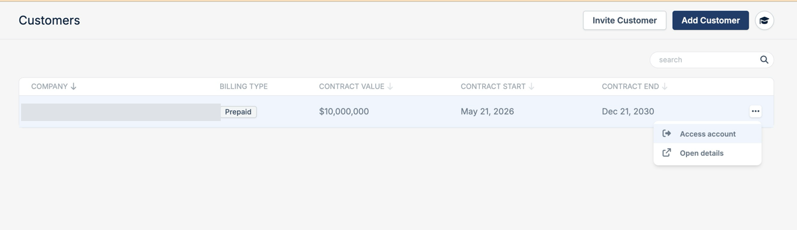

MSP Partners can open a customer's bunny.net dashboard to configure their setup or help them troubleshoot.

<Note>
  This is only available to [MSP Partners](/partners/partner-types#msp-partner).
</Note>

## From your customer list

Open the menu at the end of the customer's row and select **Access account**.

<Frame>
  
</Frame>

## From the customer's details

Select **Access account** at the top of any tab on the [customer details](/partners/customer-details) page.
