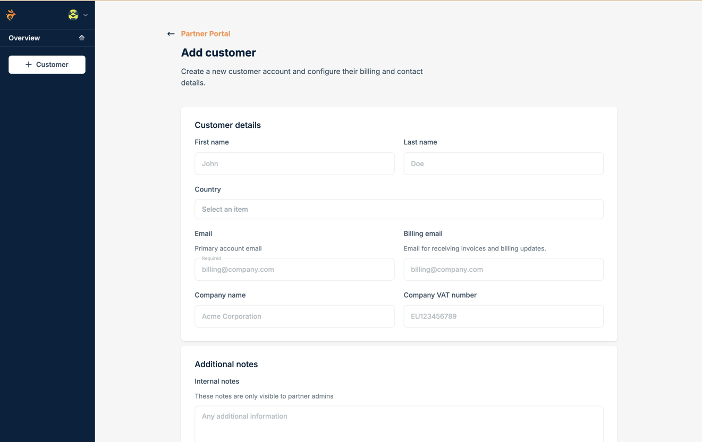
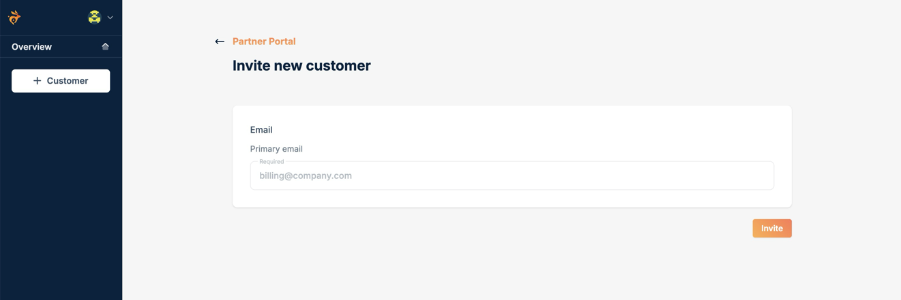
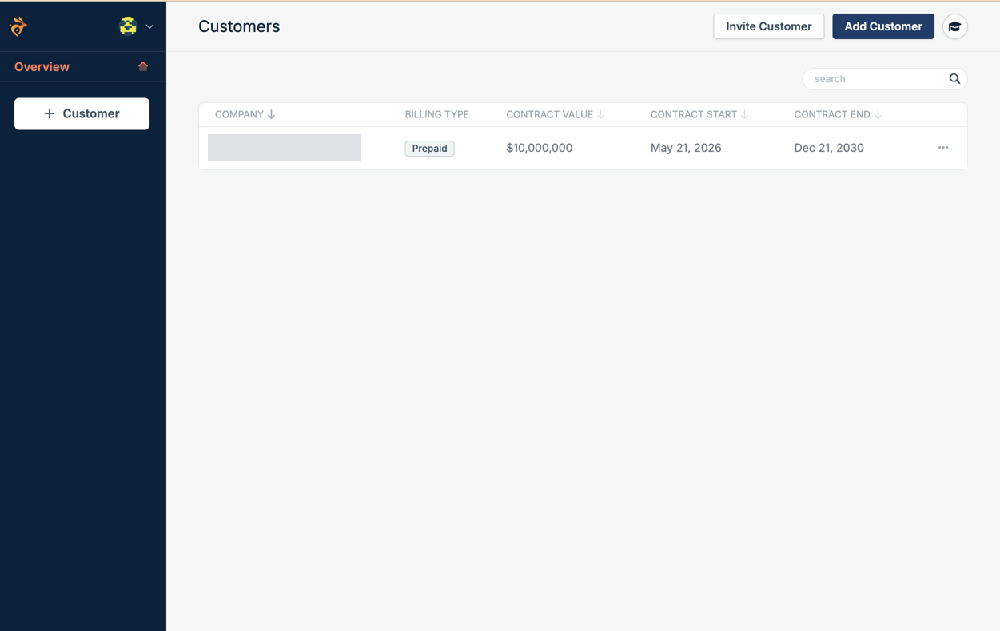

Create a new bunny.net account for your customer, or invite the account they already have. Either way, the customer shows up in your Customers list once their account is linked to yours.

<Tabs>
  <Tab title="Create a customer">
    Use this for customers who are new to bunny.net.

    <Steps>
      <Step title="Open the form">
        Go to Customers in the Partner Portal and select **Add Customer**.
      </Step>
      <Step title="Enter the customer's details">
        | Field          | Description                                         |
        | -------------- | --------------------------------------------------- |
        | First and last name | The account holder's name.                     |
        | Country        | The customer's country.                             |
        | Email          | The primary account email. Required.                |
        | Billing email  | Where invoices and billing updates are sent.        |
        | Company name   | The customer's company.                             |
        | VAT number     | The company's VAT number.                           |
        | Internal notes | Notes only partner admins can see.                  |

        <Frame>
          
        </Frame>
      </Step>
      <Step title="Create the account">
        Submit the form. bunny.net creates the account, links it to yours, and emails the customer a link to set their password.
      </Step>
    </Steps>

    To create customers from your own systems, call [Create Customer](/api-reference/partner/customers/create-customer):

    ```bash
    curl --request POST \
      --url https://api.bunny.net/partner/customers \
      --header 'AccessKey: YOUR_API_KEY' \
      --header 'Content-Type: application/json' \
      --data '{
        "Email": "owner@example.com",
        "FirstName": "Ada",
        "LastName": "Lovelace",
        "Country": "GB",
        "BillingEmail": "billing@example.com",
        "CompanyName": "Example Ltd"
      }'
    ```

    The response includes the new `CustomerUserId`.
  </Tab>
  <Tab title="Invite a customer">
    Use this for customers with an existing bunny.net account.

    <Steps>
      <Step title="Open the form">
        Go to Customers in the Partner Portal and select **Invite Customer**.
      </Step>
      <Step title="Send the invite">
        Enter the email of the customer's bunny.net account and select **Invite**.

        <Frame>
          
        </Frame>
      </Step>
      <Step title="Wait for the customer to accept">
        The customer gets an email with the invitation. When they accept, bunny.net links their account to yours and adds it to your Customers list.
      </Step>
    </Steps>

    To send invites from your own systems, call [Invite Customer](/api-reference/partner/customers/invite-customer):

    ```bash
    curl --request POST \
      --url https://api.bunny.net/partner/customers/invite \
      --header 'AccessKey: YOUR_API_KEY' \
      --header 'Content-Type: application/json' \
      --data '{ "Email": "owner@example.com" }'
    ```
  </Tab>
</Tabs>

## Your customer list

Every linked customer appears in the Customers list with their billing type, contract value, and contract dates. Select a customer to open their [details](/partners/customer-details).

<Frame>
  
</Frame>

<Note>
  You can't add your own bunny.net account as a customer. See [Limitations](/partners/limitations).
</Note>
