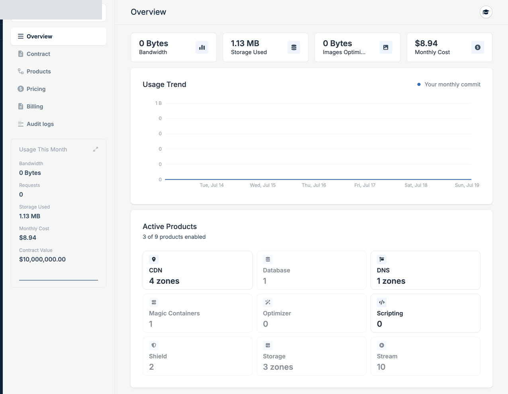
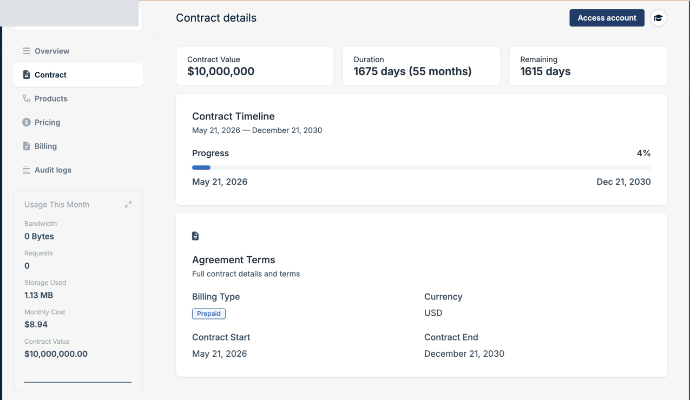
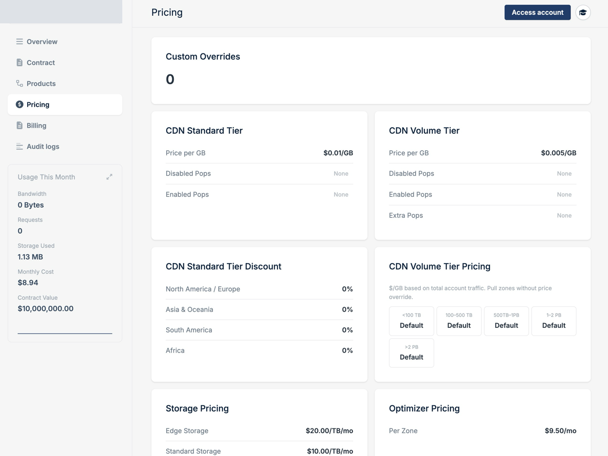
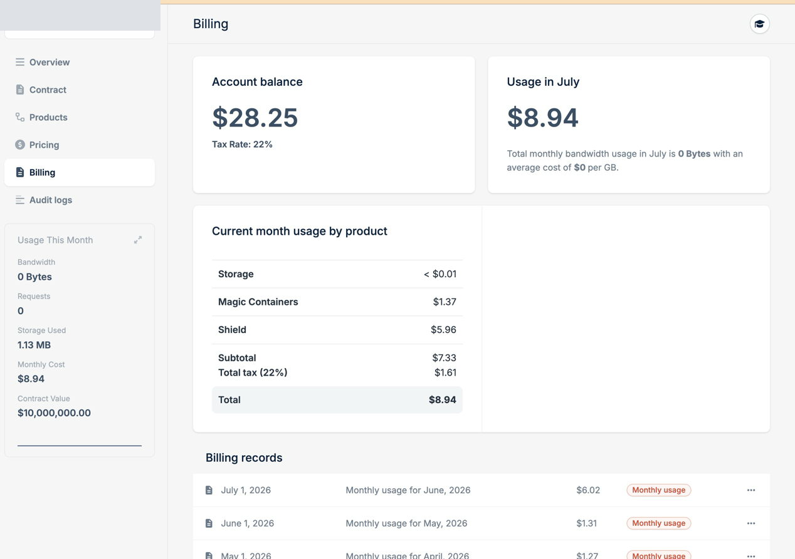
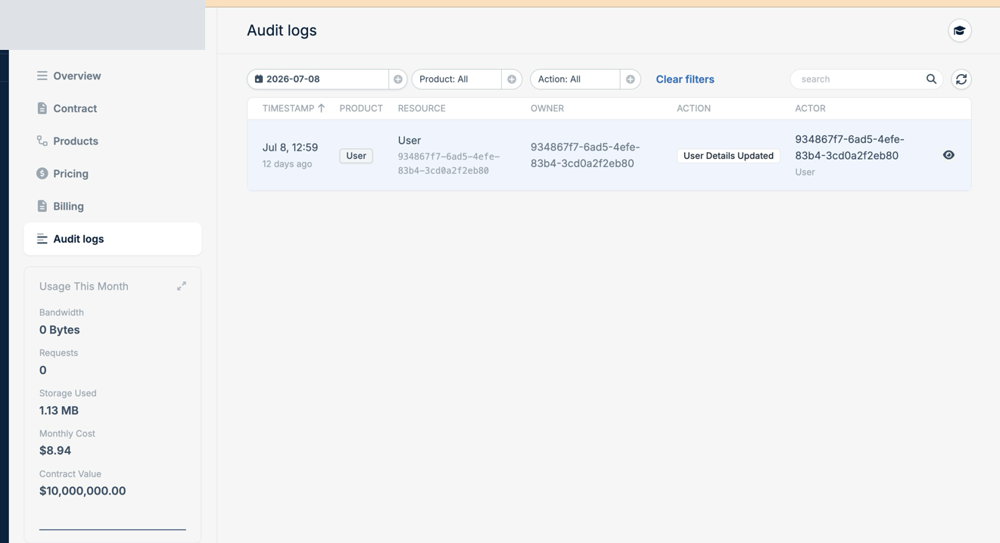

Select a customer in your Customers list to open their details. The tabs are read-only, and the Usage This Month panel on the left stays in view on each one with the customer's bandwidth, requests, storage used, monthly cost, and contract value.

## Overview

The landing tab sums up the account with bandwidth, storage, Optimizer usage, and monthly cost. The usage trend plots daily usage against the customer's monthly commit, and the panel below lists the products they use.

<Frame>
  
</Frame>

## Contract

Shows the customer's agreement: contract value, duration, days remaining, billing type, currency, and start and end dates.

<Frame>
  
</Frame>

## Pricing

Lists the prices this customer pays, with a count of any custom overrides at the top. It covers CDN Standard and Volume tier rates, regional discounts, volume brackets, Storage, and Optimizer.

<Frame>
  
</Frame>

## Billing

Shows the account balance and tax rate, this month's usage split by product, and past billing records.

<Frame>
  
</Frame>

To pull invoices into your own systems, use [Download Invoice PDF](/api-reference/partner/billing/download-invoice-pdf).

## Audit logs

Records each change on the customer's account with the resource, owner, action, and the person who made it. Filter by date, product, and action, or search the results.

<Frame>
  
</Frame>
