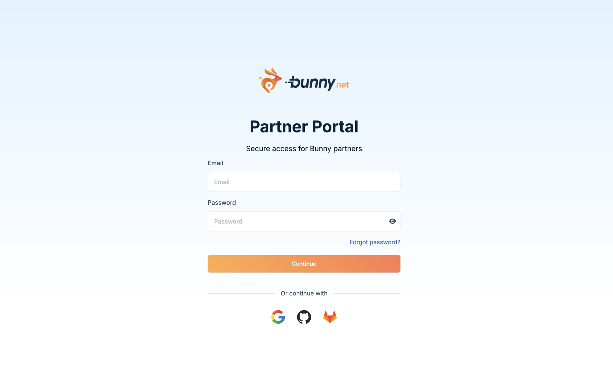

<Steps>
  <Step title="Add billing details">
    Add billing details to the bunny.net account you use as your partner account.
  </Step>
  <Step title="Turn on multi-factor authentication">
    Set up [multi-factor authentication](/account/two-factor-authentication) on the same account.
  </Step>
  <Step title="Sign in">
    Sign in to the Partner Portal with the same method you use for the bunny.net dashboard: email and password, Google, GitHub, GitLab, or SSO.

    <Frame>
      
    </Frame>
  </Step>
</Steps>

Once you're in, [add your first customer](/partners/add-a-customer).
