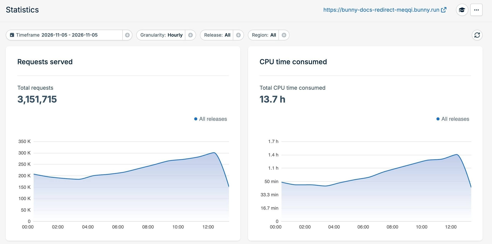
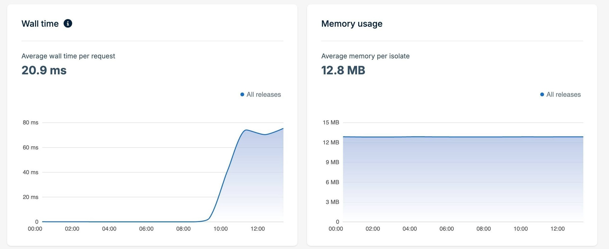
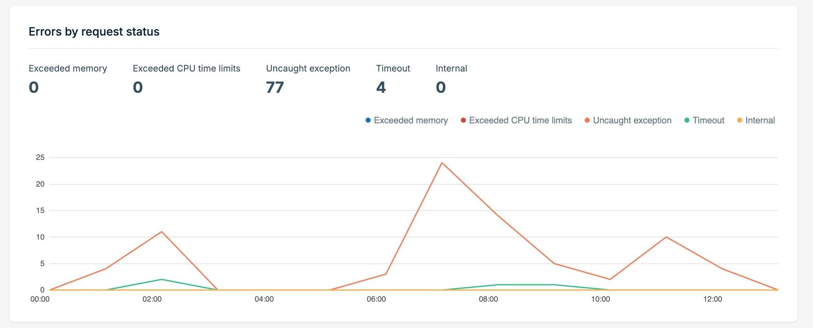

The **Statistics** tab shows how your script performs in production. Use it to track traffic and resource usage, spot errors, and compare releases after a deployment.

To open it, select your script and then select **Statistics** in the navigation pane.

## Filter the data

Every panel on the page uses the filters at the top:

- **Timeframe**: The date range to show.
- **Granularity**: The size of each data point on the charts, such as hourly.
- **Release**: Show data for every release, or for a single [deployment](/scripting/deployments).
- **Region**: Show data for every region, or for a single [region](/scripting/regions).

Select the refresh button on the right to load the latest data.

## Requests and CPU time

<Frame>
  
</Frame>

- **Requests served**: The total number of requests your script handled in the timeframe.
- **CPU time consumed**: The total CPU time your script used to run your code. Time spent waiting on network calls doesn't count. CPU time is the basis for [billing](/scripting/pricing).

## Wall time and memory usage

<Frame>
  
</Frame>

- **Wall time**: The average time from the start of a request to the end of a request, which includes time spent waiting on subrequests and other I/O. A high wall time with a low CPU time usually means that your script is waiting on a slow origin.
- **Memory usage**: The average memory used by each isolate running your script. Compare this value with the [memory limit](/scripting/limits).

## Subrequests

The **Subrequests** table lists every origin your script called with `fetch()`. For each origin, it shows the number of requests, a breakdown by status code class (`2XX`, `3XX`, `4XX`, `5XX`), and the average request duration. Use the search box to find an origin.

This table helps you find out which upstream service is slow or is returning errors.

## Errors by request status

<Frame>
  
</Frame>

This panel counts the requests that failed, grouped by cause:

| Status                     | Meaning                                                                            |
| -------------------------- | ---------------------------------------------------------------------------------- |
| Exceeded memory            | The script went over the [memory limit](/scripting/limits).                        |
| Exceeded CPU time limits   | The script went over the [CPU time limit](/scripting/limits#cpu-time).             |
| Uncaught exception         | The script threw an error that it did not catch.                                   |
| Timeout                    | The script did not finish in time.                                                 |
| Internal                   | An error happened in the platform.                                                 |

To find out what caused an uncaught exception, look at the [logs](/scripting/logs) for the same timeframe.

## Release comparison

The **Release comparison** panel shows how each release performed. When more than one release served requests in the timeframe, you can compare them side by side. Use this panel after a deployment to make sure that the new release is not slower or more expensive than the previous release.

The table shows these values for each release:

- **Release**: The deployment ID.
- **Requests**: The number of requests the release served.
- **CPU time**: The total CPU time the release used.
- **CPU time / request**: The average CPU time for each request.
- **Avg wall time / request**: The average wall time for each request.
- **Avg memory / isolate**: The average memory used per isolate.
- **Cold start rate**: The percentage of requests that had to start a new isolate.
- **Startup time**: The average time to start the script on a cold start.

If a new release performs worse, you can [publish a previous deployment](/scripting/deployments#publishing-previous-deployments) to roll back.
