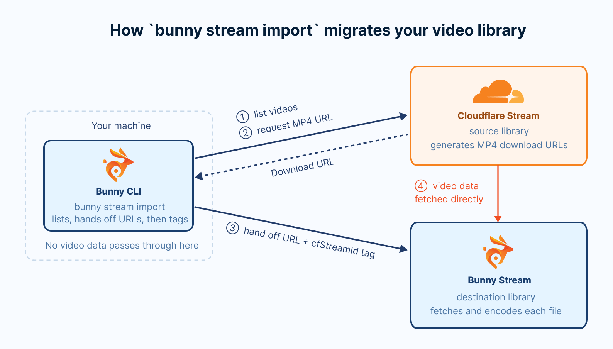
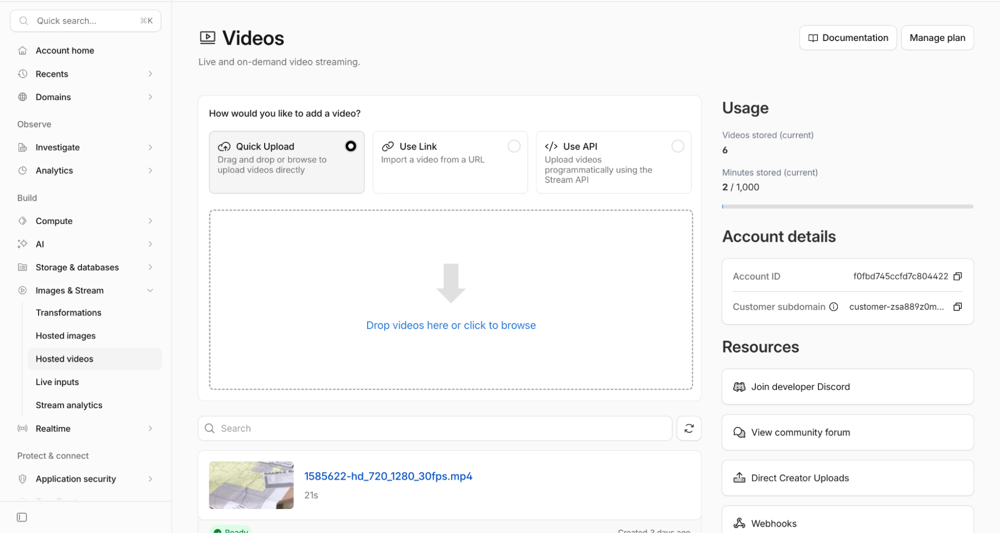
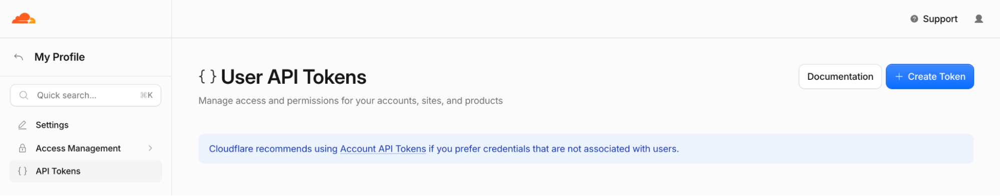
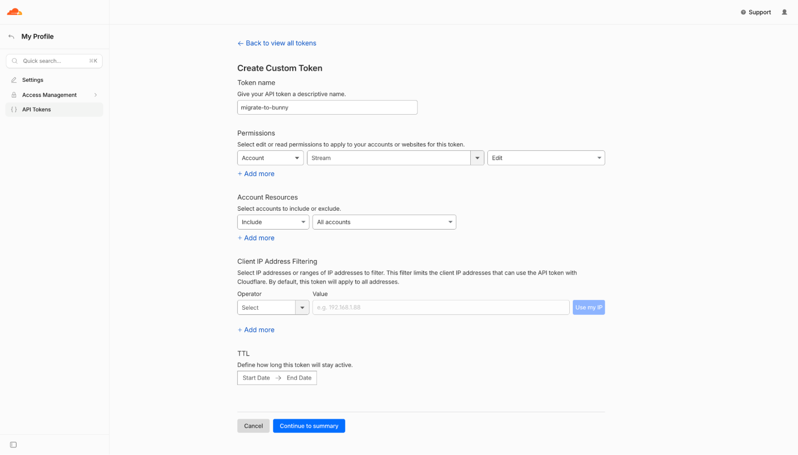
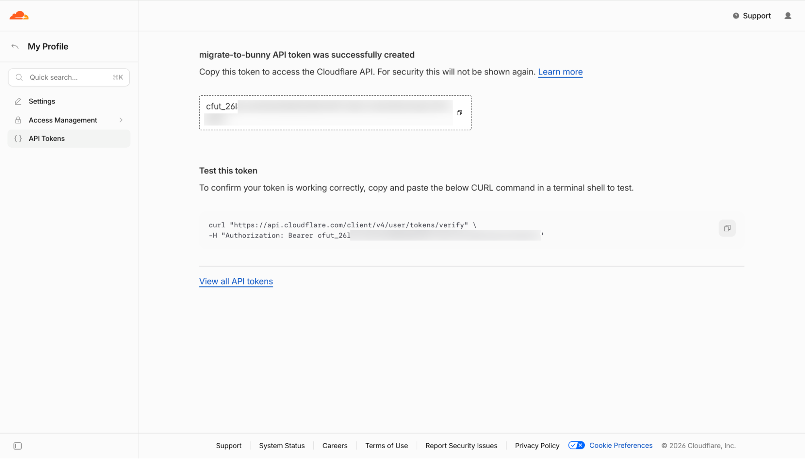
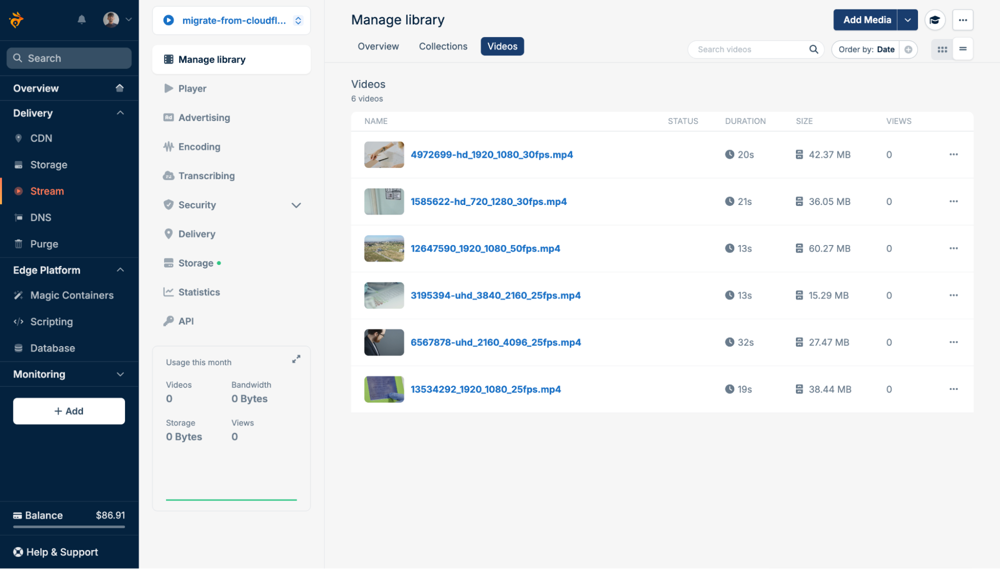

import Intro from "/snippets/stream/migrate/intro.mdx";
import InstallCli from "/snippets/stream/migrate/install-cli.mdx";
import CreateLibrary from "/snippets/stream/migrate/create-library.mdx";
import SaveCredentials from "/snippets/stream/migrate/save-credentials.mdx";
import ImportFlags from "/snippets/stream/migrate/import-flags.mdx";

<Intro provider="Cloudflare Stream" />

[Bunny Stream](https://bunny.net/stream/) bills only for the storage and bandwidth you use. See the [Bunny Stream pricing page](https://bunny.net/pricing/stream/) for current rates.

## Overview

<Frame>
  
</Frame>

The Bunny CLI lists every ready video on your Cloudflare Stream account, asks Cloudflare to generate an MP4 download for each one, and hands that download to Bunny Stream, which fetches the file directly from Cloudflare. Nothing is downloaded to your machine. Each imported video is tagged with its Cloudflare Stream ID under the `cfStreamId` metatag, so running the import again skips videos that are already imported.

## Scope

The import copies the video files, names, and descriptions. Settings that control how and where videos play stay on Cloudflare, so plan to set up their Bunny equivalents.

| Cloudflare Stream item | Migrated | Notes |
| --- | --- | --- |
| Video file | Yes | Copied from an MP4 download that Cloudflare generates for the import. |
| Name | Yes | Taken from the video's `name` metadata. A video without a name keeps its video ID as its title. |
| Description | Yes | Stored in the `description` metatag on the Bunny video, when the video has one. |
| Video ID | Yes | Stored in the `cfStreamId` metatag on the Bunny video. |
| Videos that are not ready to stream | No | Only videos that finished processing on Cloudflare are listed. |
| Videos with `requireSignedURLs` | Not until you change them | They fail the import. See the privacy note below. |
| Signed URLs and allowed origins | No | Use Bunny's library security settings instead. See the privacy note below. |
| Captions | No | Upload them with `bunny stream videos captions add`, or generate new ones with [transcription](/stream/transcribing). |
| Thumbnails | No | Bunny generates new thumbnails when it encodes each video. |
| Watermark profiles | No | They are not carried over as settings. |
| Live inputs | No | Only recorded videos are imported. |
| Analytics | No | Bunny Stream collects its own [statistics](/stream/statistics) from the first view. |

<Warning>
  **Signed URLs and allowed origins are not migrated.** Every imported video follows the security settings of its Bunny library, and a new library allows playback from any site.

  - **`requireSignedURLs`**: The CLI cannot import a video that requires signed URLs, so it fails these videos with an error that names the setting. To import them, turn off **Require Signed URLs** on each one in Cloudflare Stream, run the import, then turn it back on. While it is off, the video plays on Cloudflare without a token, so keep that window short.
  - **Allowed origins**: Cloudflare's per-video allowed origins are not copied. Add the same sites to the library's [Allowed domains](/stream/security-options#domains) on Bunny.

  Before you publish the new URLs, turn on [embed view token authentication](/stream/token-authentication) or [CDN token authentication](/stream/security#cdn-token-authentication) if you signed your Cloudflare playback URLs.
</Warning>

## Prerequisites

- A [bunny.net account](https://dash.bunny.net/auth/register)
- A [Cloudflare](https://dash.cloudflare.com) account with Cloudflare Stream

## Migrate your videos

<Steps>
  <Step title="Install and authenticate the Bunny CLI">
    <InstallCli />
  </Step>

  <Step title="Create a Bunny Stream library">
    Create a library for the imported videos, or skip this step to use an existing one:

    ```sh
    bunny stream libraries create migrate-from-cloudflare-stream --replication-regions NY,SG
    ```

    ```sh
    ✓ Created video library migrate-from-cloudflare-stream (ID: 12345), replicated to DE, NY, SG.
    ```

    <CreateLibrary />
  </Step>

  <Step title="Create a Cloudflare Stream API token">
    The Bunny CLI needs your Cloudflare **Account ID** and an API token with the **Stream:Edit** permission. Edit lets the CLI list your videos and generate an MP4 download for any video that does not already have one.

    To find your Account ID, open the [Cloudflare dashboard](https://dash.cloudflare.com) and go to **Build > Images & Stream > Hosted videos**. The Account ID appears in the sidebar under **Account details**.

    <Frame>
      
    </Frame>

    To create the token, open [User API Tokens](https://dash.cloudflare.com/profile/api-tokens) and click **+ Create Token**.

    <Frame>
      
    </Frame>

    Click **Create Custom Token**, enter a token name, such as migrate-to-bunny, and add the permission **Account > Stream > Edit**. Edit includes read access, so this one permission covers both listing videos and generating their MP4 downloads. Click **Continue to summary**, then **Create Token**.

    <Frame>
      
    </Frame>

    Copy the token. Cloudflare shows it only once.

    <Frame>
      
    </Frame>
  </Step>

  <Step title="Preview the migration with a dry run">
    Run the import with `--dry-run`, using the library ID from step 2:

    ```sh
    bunny stream import --library 12345 --source cloudflare --dry-run
    ```

    `--dry-run` prints the import plan without making any changes to either platform.

    The CLI then prompts for your Cloudflare credentials. Paste the API token at the **API Token** prompt and the Account ID at the **Account ID** prompt:

    ```sh
    Cloudflare Stream credentials
      https://dash.cloudflare.com/profile/api-tokens (permission: Stream:Edit)
    ✔ API Token: … ****************************************
    ✔ Account ID: … your-account-id
    ```

    Once Cloudflare accepts them, the CLI offers to save them so later runs skip these prompts. Press Enter to accept:

    ```sh
    ✔ Save Cloudflare Stream credentials for next time? … yes
    ✓ Saved Cloudflare Stream credentials to the "default" profile.
    ```

    <Accordion title="Where the CLI stores credentials">
      <SaveCredentials provider="Cloudflare" />

      The `CLOUDFLARE_API_TOKEN` and `CLOUDFLARE_ACCOUNT_ID` environment variables always take priority over saved credentials.
    </Accordion>

    The dry run then prints a summary and the import plan:

    ```sh
    Cloudflare Stream to Bunny Stream
     Key                Value
     Library            migrate-from-cloudflare-stream (12345)
     Source             Cloudflare Stream: 6 videos in 0 folders
     Already imported   0
     To import          6
     Duration           2:01
     Size               126 MB

    Import plan
    (no collection) (6 videos)
      - 13534292_1920_1080_25fps.mp4
      - 3195394-uhd_3840_2160_25fps.mp4
      - 6567878-hd_1080_1920_25fps.mp4
      - 4972699-hd_1920_1080_30fps.mp4
      - 12647590_1920_1080_50fps.mp4
      - 1585622-hd_720_1280_30fps.mp4

    ℹ Dry run. Remove --dry-run to import for real.
    ```

    **Already imported** counts videos that are already in the library, and **To import** counts the ones a real run would import. Every video is listed under (no collection), since Cloudflare Stream has no folders.

    Bunny Stream accepts sources up to 2160p (3840x2160, or 2160x3840 in portrait) and up to 72 hours long. The dry run warns about any video beyond those limits, as it will fail on Bunny:

    ```sh
    ⚠ 1 videos are beyond Bunny's limits and will fail:
    ⚠   - 7136213-uhd_4096_2160_25fps.mp4: 4096x2160 is above Bunny's 2160p limit
    ```

    The dry run does not check `requireSignedURLs`. A video with **Require Signed URLs** turned on still appears in the plan and fails during the import, so turn the setting off on those videos first, as described in [Scope](#scope).
  </Step>

  <Step title="Run the import">
    Run the same command without `--dry-run`:

    ```sh
    bunny stream import --library 12345 --source cloudflare
    ```

    The CLI prints the same summary, then asks for confirmation. Type `y` and press Enter to start:

    ```sh
    ? Import 6 videos into migrate-from-cloudflare-stream? › (y/N)
    ```

    The CLI skips videos that are already imported, has Cloudflare generate an MP4 download for each new one, hands those to Bunny three at a time, and tags each video with `cfStreamId`. It returns once every video is queued. Bunny then fetches each file directly from Cloudflare and encodes it.

    ```sh
    ✔ Import 6 videos into migrate-from-cloudflare-stream? … yes
    ✓ Queued 6 videos into migrate-from-cloudflare-stream. Bunny is fetching and encoding them now.
    ℹ Check progress with bunny stream import status --library 12345 --source cloudflare
    ```

    <ImportFlags provider="Cloudflare" />
  </Step>

  <Step title="Watch encoding progress">
    The import returns before Bunny finishes encoding. Check progress with the status command:

    ```sh
    bunny stream import status --library 12345 --source cloudflare
    ```

    It prints one row per queued video, with its status on Bunny, encode percentage, size, and when it was queued:

    ```sh
    Cloudflare Stream to migrate-from-cloudflare-stream
     Video                             Bunny status   Encoded   Size    Queued
     13534292_1920_1080_25fps.mp4      Finished       100%      37 MB   just now
     3195394-uhd_3840_2160_25fps.mp4   Finished       100%      15 MB   just now
     6567878-hd_1080_1920_25fps.mp4    Transcoding    45%               just now
     4972699-hd_1920_1080_30fps.mp4    Transcoding    5%                just now
     12647590_1920_1080_50fps.mp4      Processing     5%                just now
     1585622-hd_720_1280_30fps.mp4     Processing     5%                just now

    ℹ 2 finished, 4 processing, 0 failed.
    ```

    Run it again until the last line reports 0 processing. The command exits with a non-zero code when any video has failed, so you can also use it as a check in scripts.
  </Step>

  <Step title="Verify in the bunny.net dashboard">
    Open the [bunny.net dashboard](https://dash.bunny.net) and go to **Stream > Your library > Manage library** to confirm every video has encoded.

    <Frame>
      
    </Frame>

    Set up the library's [security settings](/stream/security-options) if you have not already, then replace the Cloudflare Stream embed URLs and player references in your site with their Bunny Stream equivalents. See [Embedding videos](/stream/embedding) for the embed and player options.
  </Step>

  <Step title="Clean up the MP4 downloads on Cloudflare">
    The import generates an MP4 download for every video that did not already have one. According to [Cloudflare's documentation](https://developers.cloudflare.com/stream/viewing-videos/download-videos/), MP4 downloads add no storage cost, but Cloudflare bills for the video's duration each time one is downloaded. Bunny's fetch counts as one download per video.

    If you plan to delete your videos from Cloudflare Stream, deleting a video also deletes its downloads, so there is nothing else to do.

    If you are keeping the videos on Cloudflare for now, delete the downloads you do not need through the Cloudflare API:

    ```sh
    curl -X DELETE \
      "https://api.cloudflare.com/client/v4/accounts/$CLOUDFLARE_ACCOUNT_ID/stream/$VIDEO_UID/downloads/default" \
      -H "Authorization: Bearer $CLOUDFLARE_API_TOKEN"
    ```

    `$VIDEO_UID` is the Cloudflare video ID, stored in the `cfStreamId` metatag on each Bunny video. To list the video IDs on the account, run:

    ```sh
    bunny stream import list --source cloudflare --videos
    ```

    The command lists at most 10,000 videos. On a larger account, read the remaining IDs from the `cfStreamId` metatags or the Cloudflare API.

    The CLI reuses MP4 downloads that existed before the migration. If your site already serves some of those downloads, leave them in place.
  </Step>
</Steps>

## Troubleshooting

<AccordionGroup>
  <Accordion title="Some videos failed during the import">
    When videos fail during an interactive import, the CLI lists each failure and offers to retry them:

    ```sh
    ✖ 4972699-hd_1920_1080_30fps.mp4: No download available: the video was not found at the source or has no usable file
    ✖ 12647590_1920_1080_50fps.mp4: Cloudflare video requires signed URLs; turn off Require Signed URLs on it in Cloudflare Stream, then re-run the import
    ℹ Resume with bunny stream import --library 12345 --source cloudflare --resume
    ? 2 videos failed. Retry them now? › (y/N)
    ```

    Answer `y` to retry them in the same run. If the import was interrupted, or you declined the retry, run it again with `--resume`:

    ```sh
    bunny stream import --library 12345 --source cloudflare --resume
    ```

    `--resume` retries failed videos, processes any that were still outstanding, and re-applies the `cfStreamId` tag to videos Bunny fetched before the run stopped. It stops retrying a video after three failed attempts and skips videos that Bunny rejected. To retry those too, add `--clean-failed`, which deletes their Bunny copies first.

    Running the import again is always safe. Videos that already carry the `cfStreamId` tag are skipped, and the CLI reports **Everything is already imported** once nothing is left.
  </Accordion>

  <Accordion title="No download available">
    Cloudflare did not finish generating the MP4 download within five minutes, which can happen with long or high-resolution videos. It can also mean the video was deleted from Cloudflare after the import started.

    Cloudflare keeps generating the download after the CLI stops waiting, so wait a few minutes, then retry. The retry picks up the finished download instead of requesting a new one.
  </Accordion>

  <Accordion title="Cloudflare video requires signed URLs">
    The video has `requireSignedURLs` turned on. Turn off **Require Signed URLs** on it in Cloudflare Stream, retry, then turn it back on. See [Scope](#scope).
  </Accordion>

  <Accordion title="Cloudflare could not generate an MP4 download">
    Cloudflare reported an error while generating the download, and the CLI prints its reason. Check the video in the Cloudflare dashboard. A retry only helps once Cloudflare can generate the download.
  </Accordion>
  <Accordion title="Videos are stuck with no data">
    If `bunny stream import status` reports videos stuck at zero bytes, run the import again with `--retry-stalled` to delete and fetch them again.
  </Accordion>
</AccordionGroup>
