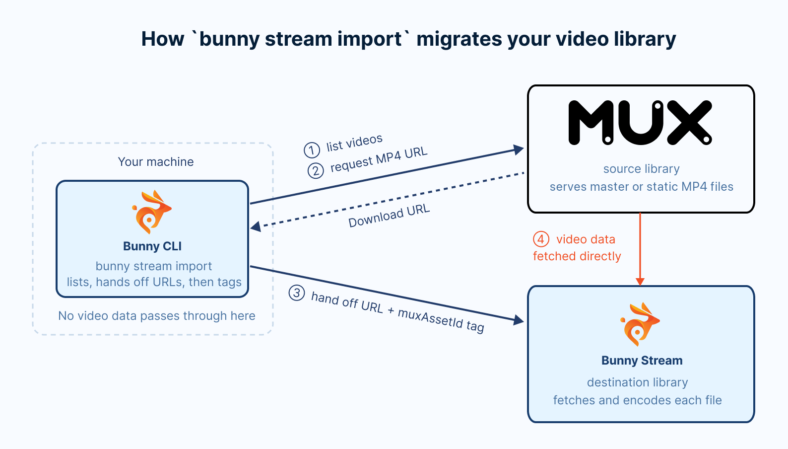
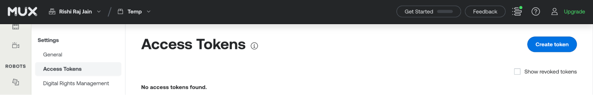
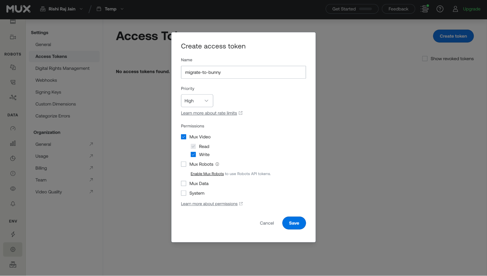
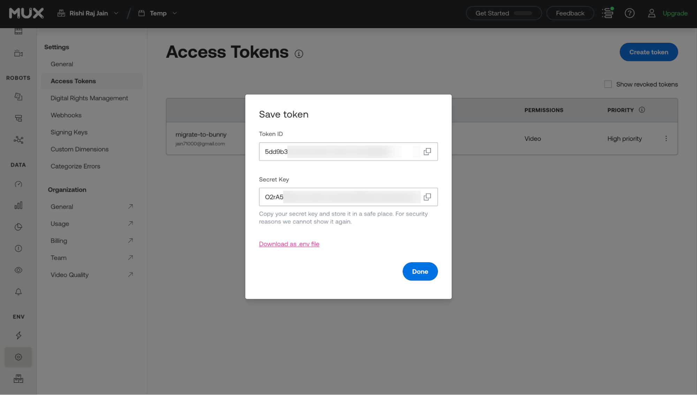
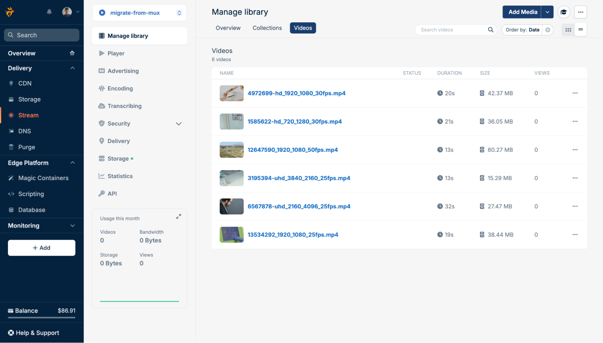

import Intro from "/snippets/stream/migrate/intro.mdx";
import InstallCli from "/snippets/stream/migrate/install-cli.mdx";
import CreateLibrary from "/snippets/stream/migrate/create-library.mdx";
import SaveCredentials from "/snippets/stream/migrate/save-credentials.mdx";
import ImportFlags from "/snippets/stream/migrate/import-flags.mdx";

<Intro provider="Mux" />

[Bunny Stream](https://bunny.net/stream/) bills only for the storage and bandwidth you use. See the [Bunny Stream pricing page](https://bunny.net/pricing/stream/) for current rates.

This guide walks you through how to migrate your video content to Bunny Stream from Mux. Here's what we'll cover:

- Installing and authenticating the [Bunny CLI](/cli)
- Creating a destination Bunny Stream library and a Mux access token
- Making your Mux videos downloadable
- Previewing the migration with a dry run, then running `bunny stream import`
- Monitoring encoding progress and verifying the result in the bunny.net dashboard

## Overview

<Frame>
  
</Frame>

A migration from Mux to Bunny Stream involves the following steps:

- **Discover**: Bunny CLI lists every asset in your Mux environment that is ready and has a video track. Assets that are still preparing, assets that errored, and audio-only assets are left out. Mux has no folder concept, so every video is imported into the root of the destination library.
- **De-duplicate**: Each imported video is tagged with its Mux asset ID under the `muxAssetId` metatag. Before importing a video, the CLI checks whether that tag already exists in the destination library and skips the video if it does.
- **Fetch**: For each new video, the CLI looks up a downloadable file on Mux. It uses the original (master) file when master access is enabled and ready. Otherwise, it uses the best static MP4 rendition on a public playback ID. It then passes that URL to Bunny Stream, which fetches the file directly from Mux. Nothing is downloaded to your machine.

## Scope

The import copies the video files and their titles. Settings that control how and where videos play stay on Mux, so plan to set up their Bunny equivalents.

| Mux item | Migrated | Notes |
| --- | --- | --- |
| Video file | Yes | The master file when it is ready, otherwise the best static MP4 rendition on a public playback ID. |
| Title | Yes | Taken from the asset's title, or from `passthrough` on older assets. An asset with neither keeps its asset ID as its title. |
| Asset ID | Yes | Stored in the `muxAssetId` metatag on the Bunny video. |
| Assets that are preparing or errored | No | Only ready assets are listed. |
| Audio-only assets | No | Bunny Stream imports videos only. |
| Playback IDs and playback policies | No | Bunny creates new playback URLs. See the privacy note below. |
| Captions and subtitle tracks | No | Upload them with `bunny stream videos captions add`, or generate new ones with [transcription](/stream/transcribing). |
| Thumbnails | No | Bunny generates new thumbnails when it encodes each video. |
| Static renditions and HLS outputs | No | Bunny encodes its own renditions from the source file. |
| Mux Data analytics | No | Bunny Stream collects its own [statistics](/stream/statistics) from the first view. |

<Warning>
  **Signed playback policies are not migrated.** Every imported video follows the security settings of its Bunny library, and a new library allows playback from any site. Assets with a signed playback policy on Mux are imported through their master file, but on Bunny they play for anyone with the URL until you protect the library. Before you publish the new URLs, set up [Allowed domains](/stream/security-options#domains), and turn on [embed view token authentication](/stream/token-authentication) or [CDN token authentication](/stream/security#cdn-token-authentication) if you signed your Mux playback URLs.
</Warning>

## Prerequisites

- A [bunny.net account](https://dash.bunny.net/auth/register)
- A [Mux](https://dashboard.mux.com) account
- [Python 3](https://www.python.org/downloads/), to run the helper script in step 4

## Migrate your videos

<Steps>
  <Step title="Install and authenticate the Bunny CLI">
    <InstallCli />
  </Step>

  <Step title="Create a Bunny Stream library">
    <CreateLibrary guide="migrate-from-mux" />
  </Step>

  <Step title="Create a Mux access token">
    The Bunny CLI needs a Mux **Token ID** and **Secret Key** to list your videos and look up their download URLs.

    Open [Settings > Access Tokens](https://dashboard.mux.com/settings/access-tokens) in the Mux dashboard and click **Create Token**.

    <Frame>
      
    </Frame>

    Access tokens are scoped to a Mux environment, so first select the environment that holds the videos you want to migrate. If you have videos in more than one environment, see [Migrate more than one Mux environment](#migrate-more-than-one-mux-environment). Enter a token name, such as migrate-to-bunny, and give it the **Mux Video** permission with both **Read** and **Write** access. The Bunny CLI only needs Read. Write is for the helper script in the next step, which turns on master access for your assets.

    <Frame>
      
    </Frame>

    Copy the Token ID and the Secret Key. Mux shows the Secret Key only once.

    <Frame>
      
    </Frame>
  </Step>

  <Step title="Make your Mux videos downloadable">
    Bunny imports a video by fetching a file from a URL. Mux stores your videos for streaming, so a downloadable file exists only when one of the following is true:

    - [**Master access**](https://www.mux.com/docs/api-reference/video/assets/update-asset-master-access) **is enabled**: Mux prepares a temporary copy of the original upload. The CLI prefers this file because it is the highest quality version of the video, and it also works for videos with signed playback IDs. The master URL expires 24 hours after Mux makes it ready.
    - [**Static MP4 renditions**](https://www.mux.com/docs/guides/enable-static-mp4-renditions) **are ready on a public playback ID**: the CLI picks the first one available in this order: `highest.mp4`, `capped-1080p.mp4`, then the resolution renditions from `2160p.mp4` down. Renditions on signed playback IDs cannot be used, as Bunny cannot supply the signed token those URLs require.

    If your assets already have static MP4 renditions on public playback IDs, skip to the next step.

    Otherwise, enable master access on every asset right before you migrate. The following Python script does that through the [Mux API](https://www.mux.com/docs/api-reference/video/assets/update-asset-master-access). It prompts for your Token ID and Secret Key, requests master access for every ready asset, and waits until Mux has prepared each master file. Save it as `enable_mux_masters.py`:

    ```py enable_mux_masters.py
    """Turns on temporary master access for every ready Mux asset, then waits until each master file is ready."""

    import base64
    import getpass
    import json
    import time
    import urllib.error
    import urllib.request

    API = "https://api.mux.com/video/v1"
    TIMEOUT_HOURS = 6

    token_id = input("Mux Token ID: ").strip()
    token_secret = getpass.getpass("Mux Secret Key: ").strip()
    auth = base64.b64encode(f"{token_id}:{token_secret}".encode()).decode()

    def mux(method, path, body=None):
        request = urllib.request.Request(
            API + path,
            method=method,
            data=json.dumps(body).encode() if body else None,
            headers={"Authorization": f"Basic {auth}", "Content-Type": "application/json"},
        )
        try:
            with urllib.request.urlopen(request) as response:
                return json.load(response)["data"]
        except urllib.error.HTTPError as error:
            raise SystemExit(f"Mux returned {error.code} for {method} {path}. Check the token and its permissions.")

    def request_master(asset_id):
        mux("PUT", f"/assets/{asset_id}/master-access", {"master_access": "temporary"})
        time.sleep(0.2)  # stay under Mux's API rate limit

    # Collect every ready asset, 100 per page.
    assets, page = [], 1
    while True:
        items = mux("GET", f"/assets?limit=100&page={page}")
        assets += [asset["id"] for asset in items if asset["status"] == "ready"]
        if len(items) < 100:
            break
        page += 1

    print(f"Requesting master access for {len(assets)} assets...")
    for asset_id in assets:
        request_master(asset_id)

    # Poll only the assets that are still preparing, so each pass gets shorter.
    print("Waiting for Mux to prepare the master files...")
    pending, ready, errored = set(assets), [], []
    deadline = time.time() + TIMEOUT_HOURS * 3600
    while True:
        for asset_id in list(pending):
            asset = mux("GET", f"/assets/{asset_id}")
            status = (asset.get("master") or {}).get("status")
            if status == "ready":
                pending.discard(asset_id)
                ready.append(asset_id)
            elif status == "errored":
                pending.discard(asset_id)
                errored.append(asset_id)
            elif asset.get("master_access") != "temporary":
                request_master(asset_id)  # the first request did not take, so ask again
            time.sleep(0.2)
        if not pending or time.time() > deadline:
            break
        print(f"{len(pending)} of {len(assets)} master files still preparing...")
        time.sleep(30)

    if errored:
        print(f"Mux could not prepare a master file for {len(errored)} assets: {', '.join(errored)}")
    if pending:
        print(f"Stopped waiting after {TIMEOUT_HOURS} hours with {len(pending)} master files still preparing. Run the script again to check on them.")
    print(f"{len(ready)} master files are ready. Run the import within 24 hours, before the master URLs expire.")
    ```

    Run it and enter your Token ID and Secret Key when prompted:

    ```sh
    python3 enable_mux_masters.py
    ```

    The script reports its progress and finishes once every master file is ready:

    ```sh
    Mux Token ID: your-token-id
    Mux Secret Key:
    Requesting master access for 6 assets...
    Waiting for Mux to prepare the master files...
    4 of 6 master files still preparing...
    6 master files are ready. Run the import within 24 hours, before the master URLs expire.
    ```

    <Tip>
      Bunny must fetch each master file within 24 hours of Mux making it ready. On a large library, run the next two steps as soon as the script finishes, and add `--concurrency 10` (up to 20) to the import so the CLI hands videos to Bunny faster than the default of three at a time.
    </Tip>
  </Step>

  <Step title="Preview the migration with a dry run">
    Run the import with `--dry-run`, using the library ID from step 2:

    ```sh
    bunny stream import --library 12345 --source mux --dry-run
    ```

    `--dry-run` prints the import plan without making any changes to either platform.

    The CLI then prompts for your Mux credentials. Enter the Token ID at the **Token ID** prompt and the Secret Key at the **Token Secret** prompt:

    ```sh
    Mux credentials
      https://dashboard.mux.com/settings/access-tokens
    ✔ Token ID: … ************************************
    ✔ Token Secret: … ***************************************************************************
    ```

    Once Mux accepts them, the CLI offers to save them so later runs skip these prompts. Press Enter to accept:

    ```sh
    ✔ Save Mux credentials for next time? … yes
    ✓ Saved Mux credentials to the "default" profile.
    ```

    <SaveCredentials provider="Mux" />

    The `MUX_TOKEN_ID` and `MUX_TOKEN_SECRET` environment variables always take priority over saved credentials.

    The dry run then prints a summary and the import plan:

    ```sh
    Mux to Bunny Stream
     Key                Value
     Library            migrate-from-mux (12345)
     Source             Mux: 6 videos in 0 folders
     Already imported   0
     To import          6
     Duration           2:01

    Import plan
    (no collection) (6 videos)
      - Product walkthrough
      - Onboarding: getting started
      - Customer story: Acme
      - Release notes, October
      - Webinar recording
      - aB3xK9mQ2pL7vR4tN8wY1zC5dF6gH0jS

    ℹ Dry run. Remove --dry-run to import for real.
    ```

    **Already imported** counts videos that are already in the library, and **To import** counts the ones a real run would import. Mux's asset list does not report file sizes, so the summary has no Size row.

    Every video is listed under (no collection), since Mux has no folders. A video without a title on Mux is listed under its asset ID and keeps that ID as its title on Bunny. You can rename it in the dashboard after the import.

    The dry run does not check whether each asset has a downloadable file. An asset with no ready master file or public static MP4 rendition still appears in the plan, then fails during the import.
  </Step>

  <Step title="Run the import">
    Run the same command without `--dry-run`:

    ```sh
    bunny stream import --library 12345 --source mux
    ```

    The CLI prints the same summary, then asks for confirmation. Type `y` and press Enter to start:

    ```sh
    ? Import 6 videos into migrate-from-mux? › (y/N)
    ```

    The CLI skips videos that are already imported, hands the rest to Bunny three at a time, and tags each one with `muxAssetId`. It returns once every video is queued. Bunny then fetches each file directly from Mux and encodes it.

    ```sh
    ✔ Import 6 videos into migrate-from-mux? … yes
    ✓ Queued 6 videos into migrate-from-mux. Bunny is fetching and encoding them now.
    ℹ Check progress with bunny stream import status --library 12345 --source mux
    ```

    <ImportFlags provider="Mux" />
  </Step>

  <Step title="Watch encoding progress">
    The import returns before Bunny finishes encoding. Check progress with the status command:

    ```sh
    bunny stream import status --library 12345 --source mux
    ```

    It prints one row per queued video, with its status on Bunny, encode percentage, size, and when it was queued:

    ```sh
    Mux to migrate-from-mux
     Video                              Bunny status   Encoded   Size    Queued
     Product walkthrough                Finished       100%      37 MB   just now
     Onboarding: getting started        Finished       100%      15 MB   just now
     Customer story: Acme               Transcoding    45%               just now
     Release notes, October             Transcoding    5%                just now
     Webinar recording                  Processing     5%                just now
     aB3xK9mQ2pL7vR4tN8wY1zC5dF6gH0jS   Processing     5%                just now

    ℹ 2 finished, 4 processing, 0 failed.
    ```

    Run it again until the last line reports 0 processing. The command exits with a non-zero code when any video has failed, so you can also use it as a check in scripts.
  </Step>

  <Step title="Verify in the bunny.net dashboard">
    Open the [bunny.net dashboard](https://dash.bunny.net) and go to **Stream > Your library > Manage library** to confirm every video has encoded.

    <Frame>
      
    </Frame>

    Set up the library's [security settings](/stream/security-options) if you have not already, then replace the Mux playback URLs (stream.mux.com) and Mux Player references in your site with their Bunny Stream equivalents. See [Embedding videos](/stream/embedding) for the embed and player options.
  </Step>
</Steps>

## Troubleshooting

<AccordionGroup>
  <Accordion title="Some videos failed during the import">
    When videos fail during an interactive import, the CLI lists each failure and offers to retry them:

    ```sh
    ✖ Webinar recording: No download available: the video was not found at the source or has no usable file
    ℹ Resume with bunny stream import --library 12345 --source mux --resume
    ? 1 videos failed. Retry them now? › (y/N)
    ```

    Answer `y` to retry them in the same run. If the import was interrupted, or you declined the retry, run it again with `--resume`:

    ```sh
    bunny stream import --library 12345 --source mux --resume
    ```

    `--resume` retries failed videos, processes any that were still outstanding, and re-applies the `muxAssetId` tag to videos Bunny fetched before the run stopped. It stops retrying a video after three failed attempts and skips videos that Bunny rejected. To try those again, run the import without `--resume`, adding `--clean-failed` to delete the rejected Bunny copies first.

    Running the import again is always safe. Videos that already carry the `muxAssetId` tag are skipped, and the CLI reports **Everything is already imported** once nothing is left.
  </Accordion>

  <Accordion title="No download available">
    The video had neither a ready master file nor a usable static MP4 rendition when the CLI looked it up. This happens when you skipped step 4, when a master file was still preparing, or when more than 24 hours have passed since the master files became ready.

    Decline the retry prompt, run the script from step 4 again, then run the import again without `--resume`. Requesting master access again gives each expired master file a fresh URL, and a plain run retries every video that is not yet in the library. Repeat until the import reports that everything is already imported.

    For very large libraries, [static MP4 renditions](https://www.mux.com/docs/guides/enable-static-mp4-renditions) on public playback IDs avoid the 24-hour window, since they do not expire. Check Mux's pricing for static renditions before you enable them.
  </Accordion>

  <Accordion title="The helper script stops with a 401 or 403">
    ```sh
    Mux returned 401 for GET /assets?limit=100&page=1. Check the token and its permissions.
    ```

    A 401 means the Token ID or Secret Key is wrong. A 403 on a master-access request means the token is missing the Write permission from step 3.

    If the script reports that Mux could not prepare a master file for an asset, the import can still use a static MP4 rendition on a public playback ID. Otherwise, that asset fails with **No download available**.
  </Accordion>
</AccordionGroup>

## Migrate more than one Mux environment

Mux access tokens are scoped to a single environment, such as Production or Development. To migrate several environments, repeat steps 3 to 8 for each one, with a token created in that environment.

Import each environment into its own Bunny library. The CLI keeps one saved import per source and library, so a separate library keeps each environment's progress, `--resume`, and `status` apart, and keeps test videos out of your production library.

The CLI saves one set of Mux credentials per Bunny CLI profile, and uses it without prompting for the next environment. Point the CLI at the next environment's token in one of these ways:

- Set `MUX_TOKEN_ID` and `MUX_TOKEN_SECRET` in your shell. Environment variables always take priority over saved credentials.
- Run the import with a different Bunny CLI [profile](/cli/configuration#profiles), using `--profile`.
