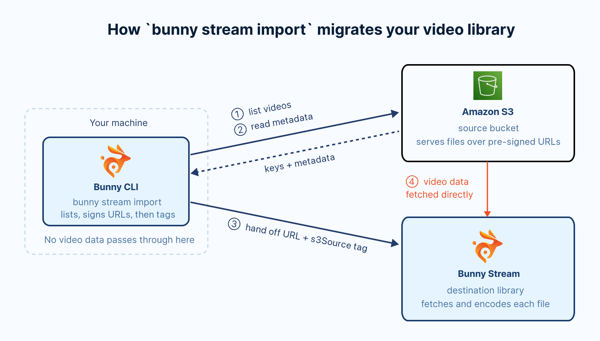
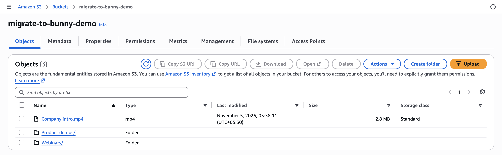
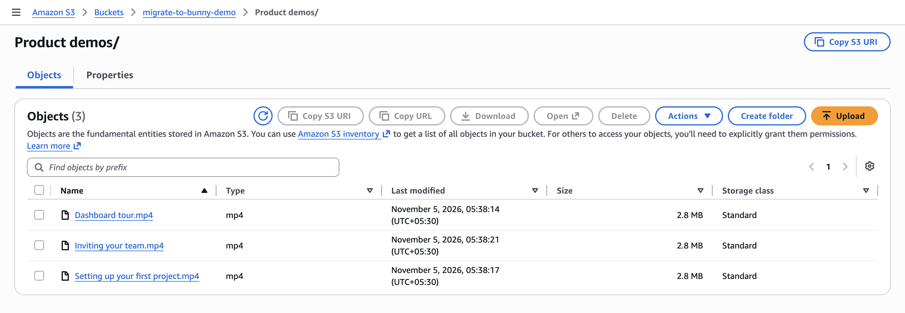
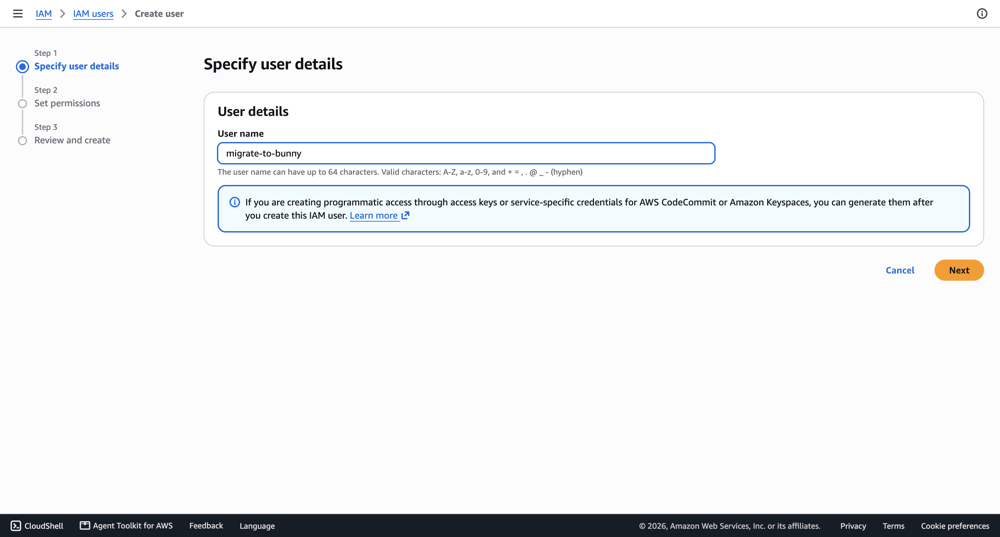
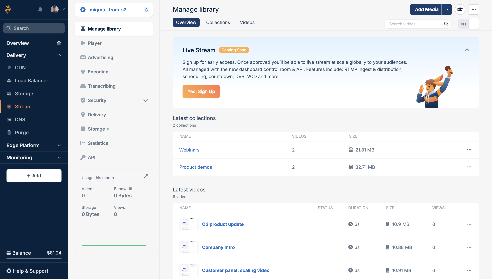

import Intro from "/snippets/stream/migrate/intro.mdx";
import InstallCli from "/snippets/stream/migrate/install-cli.mdx";
import CreateLibrary from "/snippets/stream/migrate/create-library.mdx";
import ImportFlags from "/snippets/stream/migrate/import-flags.mdx";

<Intro provider="AWS S3" />

[Bunny Stream](https://bunny.net/stream/) bills only for the storage and bandwidth you use. See the [Bunny Stream pricing page](https://bunny.net/pricing/stream/) for current rates.

This guide walks you through how to migrate video files stored in an AWS S3 bucket to Bunny Stream. Here's what we'll cover:

- Installing and authenticating the [Bunny CLI](/cli)
- Creating a destination Bunny Stream library and an AWS IAM user with read access to your bucket
- Previewing the migration with a dry run, then running `bunny stream import`
- Monitoring encoding progress and verifying the result in the bunny.net dashboard

## Overview

<Frame>
  
</Frame>

A migration from AWS S3 to Bunny Stream involves the following steps:

- **Discover**: Bunny CLI lists every object in your bucket, or below a prefix you choose, whose file extension marks it as a video. Each top-level folder becomes a Bunny Stream collection with the same name, and videos at the top level of the bucket are imported into the root of the destination library.
- **De-duplicate**: Each imported video is tagged with a SHA-256 hash of its bucket and key under the `s3Source` metatag, so your bucket and file names never appear in public embeds. Before importing a video, the CLI checks whether that tag already exists in the destination library and skips the video if it does.
- **Fetch**: For each new video, the CLI creates a pre-signed download URL and passes it to Bunny Stream, which fetches the file directly from S3. Nothing is downloaded to your machine, and your bucket can stay private. The video's title comes from its file name, and its description and tags come from the object's metadata, when it has them.

S3 has no video catalog, so the CLI works out titles and collections from the object keys. For example, this bucket has one video at the top level and two folders:

<Frame>
  
</Frame>

<Frame>
  
</Frame>

The CLI maps it like this:

```
migrate-to-bunny-demo/
  Company intro.mp4                            → "Company intro" in the library root
  Product demos/Dashboard tour.mp4             → "Dashboard tour" in the Product demos collection
  Product demos/Inviting your team.mp4         → "Inviting your team" in the Product demos collection
  Product demos/Setting up your first project.mp4
  Webinars/Customer panel: scaling video.mp4   → "Customer panel: scaling video" in the Webinars collection
  Webinars/Q3 product update.mp4
```

Folders nested deeper than the top level are not separate collections. A file at `Webinars/2024/Q3 product update.mp4` also lands in the Webinars collection.

## Scope

The import copies the video files, their titles, any description and tags in the object metadata, and your top-level folder structure. Access controls stay on AWS, so plan to set up their Bunny equivalents.

| S3 item | Migrated | Notes |
| --- | --- | --- |
| Video file | Yes | The object as stored in S3. Files with these extensions are imported: `.mp4`, `.mov`, `.avi`, `.mkv`, `.webm`, `.flv`, `.wmv`, `.m4v`, `.mpg`, `.mpeg`, `.3gp`, `.ogv`, `.m2ts`, `.vod`, and `.amv`. |
| Title | Yes | The file name without its extension, so `Product demos/Dashboard tour.mp4` becomes "Dashboard tour". |
| Description | Yes | From the object's `x-amz-meta-description` metadata, stored in the `description` metatag on the Bunny video. |
| Tags | Yes | From the object's `x-amz-meta-tags` metadata, a comma-separated list, stored in the `keywords` metatag on the Bunny video. |
| Folders | Yes | Each top-level folder becomes a collection with the same name. Deeper folders roll up into their top-level collection. An existing collection whose name differs only in case is reused. |
| Object identity | Yes | A SHA-256 hash of `bucket/key`, stored in the `s3Source` metatag on the Bunny video. Renaming or moving an object makes it a new video, which the next run imports again. |
| `.ts` files | Not by default | They are skipped, because HLS output holds thousands of `.ts` segments. Set `S3_INCLUDE_TS=true` to import them as videos. |
| Objects in Glacier, Deep Archive, or an Intelligent-Tiering archive tier | Not until restored | Restore them in S3 first. Objects in Glacier Instant Retrieval import normally. |
| Videos above 2160p or longer than 72 hours | No | Bunny Stream rejects them. S3 does not report resolution or duration, so the dry run cannot warn about them. |
| Bucket policies, presigned links, and CloudFront signed URLs | No | See the privacy note below. |
| Captions and subtitle files | No | Upload them with `bunny stream videos captions add`, or generate new ones with [transcription](/stream/transcribing). |
| Thumbnails | No | Bunny generates new thumbnails when it encodes each video. |

<Warning>
  **Private S3 videos are not private on Bunny.** Your bucket can stay private during the import, because Bunny fetches each file through a pre-signed URL. On Bunny, though, every imported video follows the security settings of its library, and a new library allows playback from any site. A video that only signed-in users could reach on S3 or CloudFront plays for anyone with its URL until you protect the library. Before you publish the new URLs, set up [Allowed domains](/stream/security-options#domains), and turn on [embed view token authentication](/stream/token-authentication) or [CDN token authentication](/stream/security#cdn-token-authentication) for videos that only signed-in viewers should see. If those videos are in their own top-level folders, you can import those folders into a separate library with `--folder` and give that library stricter settings.
</Warning>

## Prerequisites

- A [bunny.net account](https://dash.bunny.net/auth/register)
- An [AWS](https://console.aws.amazon.com) account with an S3 bucket that holds your videos, and permission to create an IAM user

## Migrate your videos

<Steps>
  <Step title="Install and authenticate the Bunny CLI">
    <InstallCli />
  </Step>

  <Step title="Create a Bunny Stream library">
    <CreateLibrary guide="migrate-from-s3" />
  </Step>

  <Step title="Create an IAM user with read access to your bucket">
    The Bunny CLI needs an AWS access key that can list your bucket and read its objects. It never changes anything in S3.

    In the [IAM console](https://console.aws.amazon.com/iam/), go to **Users** and click **Create user**. Enter a user name, such as migrate-to-bunny, leave console access off, and click **Next**.

    <Frame>
      
    </Frame>

    On **Set permissions**, choose **Attach policies directly**, then click **Create policy**. In the policy editor, switch to **JSON** and paste the following policy, replacing `migrate-to-bunny-demo` with your bucket name in both places:

    ```json
    {
      "Version": "2012-10-17",
      "Statement": [
        {
          "Effect": "Allow",
          "Action": "s3:ListBucket",
          "Resource": "arn:aws:s3:::migrate-to-bunny-demo"
        },
        {
          "Effect": "Allow",
          "Action": "s3:GetObject",
          "Resource": "arn:aws:s3:::migrate-to-bunny-demo/*"
        }
      ]
    }
    ```

    Name the policy, such as migrate-to-bunny-demo, and create it. Back on **Set permissions**, refresh the policy list, select the new policy, then click **Next** and **Create user**.

    <Note>
      If your bucket encrypts objects with SSE-KMS, also allow `kms:Decrypt` on the bucket's KMS key. Buckets with the default SSE-S3 encryption need nothing more.
    </Note>

    Open the new user, go to **Security credentials**, and click **Create access key**. Choose **Command Line Interface (CLI)** as the use case, confirm the recommendation, and create the key. Copy the **Access key ID** and the **Secret access key**. AWS shows the secret only once.

    The Bunny CLI does not prompt for AWS access keys. It reads them from the AWS shared credentials file, the same file the AWS CLI uses. Save the access key in `~/.aws/credentials`:

    ```ini ~/.aws/credentials
    [default]
    aws_access_key_id = your-access-key-id
    aws_secret_access_key = your-secret-access-key
    ```

    Then create `~/.aws/config` with your bucket's region:

    ```ini ~/.aws/config
    [default]
    region = your-bucket-region
    ```

    Make the credentials file readable only by your user:

    ```sh
    chmod 600 ~/.aws/credentials
    ```

    If either file already has a `[default]` profile, add a named profile instead, with `[migrate-to-bunny]` in `~/.aws/credentials` and `[profile migrate-to-bunny]` in `~/.aws/config`. Then select it in the shell where you run the import:

    ```sh
    export AWS_PROFILE=migrate-to-bunny
    ```

    The Bunny CLI asks for the bucket's region separately when you run the import, so the region in `~/.aws/config` applies to the AWS CLI and other AWS tools.

    If you sign in to AWS with SSO instead, the Bunny CLI can use that session through the same profiles. Pre-signed URLs made from temporary credentials stop working when the session ends, so use an access key for a large import.
  </Step>

  <Step title="Preview the migration with a dry run">
    Run the import with `--dry-run`, using the library ID from step 2:

    ```sh
    bunny stream import --library 12345 --source s3 --dry-run
    ```

    `--dry-run` prints the import plan without making any changes to either platform.

    The CLI then prompts for your bucket's region and name. The region prompt is filled in with `us-east-1`, so replace it with your bucket's region, which the S3 console shows in the bucket list:

    ```sh
    AWS S3 credentials
    ✔ AWS Region: … your-bucket-region
    ✔ S3 Bucket: … migrate-to-bunny-demo
    ```

    Once S3 accepts them, the CLI offers to save them so later runs skip these prompts. Press Enter to accept:

    ```sh
    ✔ Save AWS S3 credentials for next time? … yes
    ✓ Saved AWS S3 credentials to the "default" profile.
    ```

    The CLI saves the region and bucket for the active Bunny CLI profile in `~/.config/bunnynet/stream-import-credentials.json` (or under `$XDG_CONFIG_HOME/bunnynet/` when it is set). Your access keys are not saved. The `AWS_REGION` and `S3_BUCKET` environment variables, and the `--bucket` flag, always take priority over saved values.

    The dry run then prints a summary and the import plan:

    ```sh
    AWS S3 to Bunny Stream
     Key                Value
     Library            migrate-from-s3 (12345)
     Source             AWS S3: 6 videos in 2 folders
     Already imported   0
     To import          6
     Size               17 MB

    Import plan
    Product demos (3 videos)
      - Dashboard tour
      - Inviting your team
      - Setting up your first project
    Webinars (2 videos)
      - Customer panel: scaling video
      - Q3 product update
    (no collection) (1 videos)
      - Company intro

    ℹ Dry run. Remove --dry-run to import for real.
    ```

    **Already imported** counts videos that are already in the library, and **To import** counts the ones a real run would import. S3 does not know how long a video is, so the summary has no Duration row. It does not report resolution either, so unlike other sources, the dry run cannot warn about videos above Bunny's 2160p or 72-hour limits. Those videos fail when Bunny encodes them.

    The plan groups videos by the collection they will land in, and lists them in alphabetical order of their keys, the order S3 returns them in. Videos at the top level of the bucket are listed under (no collection).

    To import only part of a bucket, add `--prefix` with the path to start from, such as `--prefix videos/2024`, or set `S3_PREFIX`. The top-level folders below that prefix then become the collections.
  </Step>

  <Step title="Run the import">
    Run the same command without `--dry-run`:

    ```sh
    bunny stream import --library 12345 --source s3
    ```

    The CLI prints the same summary, then asks for confirmation. Type `y` and press Enter to start:

    ```sh
    ? Import 6 videos into migrate-from-s3? › (y/N)
    ```

    The CLI creates a collection for each top-level folder, skips videos that are already imported, hands the rest to Bunny three at a time, and tags each video with `s3Source`, along with any description and tags from its metadata. It returns once every video is queued. Bunny then fetches each file directly from S3 and encodes it.

    Collection names match without regard to case, so the S3 folders `Webinars/` and `webinars/` land in one collection, even though S3 treats them as separate folders. Move the objects in one of them to a differently named folder before the import to keep them separate.

    ```sh
    ✔ Import 6 videos into migrate-from-s3? … yes

    ✓ Queued 6 videos into migrate-from-s3. Bunny is fetching and encoding them now.
    ℹ Check progress with bunny stream import status --library 12345 --source s3
    ```

    Each pre-signed URL stays valid for six hours by default, which is long enough for Bunny to fetch the file. Set `S3_PRESIGNED_URL_TTL` to a number of seconds between 3600 and 604800 to change it.

    <ImportFlags provider="S3" />

    To migrate a large bucket one folder at a time, list the folders:

    ```sh
    bunny stream import list --source s3
    ```

    ```sh
     ID              Name            Videos
     Product demos   Product demos   3
     Webinars        Webinars        2
    1 videos are not in a folder.
    Import one folder with bunny stream import --source s3 --folder <id>
    ```

    The ID of a folder is its path in the bucket. Preview a folder's videos with `--folder`, then pass the same ID to the import. Quote the ID when it contains spaces:

    ```sh
    bunny stream import list --source s3 --folder "Product demos"
    bunny stream import --library 12345 --source s3 --folder "Product demos"
    ```

    The import works the same way, limited to that folder's videos and its collection. `--folder` also accepts a deeper path, such as `"Webinars/2024"`. Its videos still land in the top-level collection, Webinars.
  </Step>

  <Step title="Watch encoding progress">
    The import returns before Bunny finishes encoding. Check progress with the status command:

    ```sh
    bunny stream import status --library 12345 --source s3
    ```

    It prints one row per queued video, with its status on Bunny, encode percentage, size, and when it was queued:

    ```sh
    AWS S3 to migrate-from-s3
     Video                           Bunny status   Encoded   Size   Queued
     Dashboard tour                  Processing     5%               just now
     Inviting your team              Processing     5%               just now
     Setting up your first project   Processing     5%               just now
     Customer panel: scaling video   Processing     5%               just now
     Q3 product update               Processing     5%               just now
     Company intro                   Processing     5%               just now

    ℹ 0 finished, 6 processing, 0 failed.
    ```

    Run it again until the last line reports 0 processing. The command exits with a non-zero code when any video has failed, so you can also use it as a check in scripts.
  </Step>

  <Step title="Verify in the bunny.net dashboard">
    Open the [bunny.net dashboard](https://dash.bunny.net) and go to **Stream > Your library > Manage library**. Each top-level S3 folder appears as a collection, and every migrated video is listed under **Latest videos**.

    <Frame>
      
    </Frame>

    Set up the library's [security settings](/stream/security-options) if you have not already, then replace the S3 or CloudFront video URLs in your site with their Bunny Stream equivalents. See [Embedding videos](/stream/embedding) for the embed and player options.

    Once the migration is complete, you can delete the IAM user's access key, or the user itself.
  </Step>
</Steps>

## Troubleshooting

<AccordionGroup>
  <Accordion title="Some videos failed during the import">
    When videos fail during an interactive import, the CLI lists each failure and offers to retry them:

    ```sh
    ✖ Training archive: S3 object is in GLACIER; restore it in S3 before importing
    ℹ Resume with bunny stream import --library 12345 --source s3 --resume
    ? 1 videos failed. Retry them now? › (y/N)
    ```

    Answer `y` to retry them in the same run. If the import was interrupted, or you declined the retry, run it again with `--resume`:

    ```sh
    bunny stream import --library 12345 --source s3 --resume
    ```

    `--resume` retries failed videos, processes any that were still outstanding, and re-applies the `s3Source` tag to videos Bunny fetched before the run stopped. When the interrupted run was limited to one folder, the resume continues that folder. It stops retrying a video after three failed attempts and skips videos that Bunny rejected. To try those again, run the import without `--resume` (with the same `--folder`, if you used one), adding `--clean-failed` to delete the rejected Bunny copies first.

    Running the import again is always safe. Videos that already carry the `s3Source` tag are skipped, and the CLI reports **Everything is already imported** once nothing is left.
  </Accordion>

  <Accordion title="Bucket is in a different region">
    ```sh
    ✖ Bucket "migrate-to-bunny-demo" is in a different region.
    Set AWS_REGION to the bucket's region.
    ```

    The region you entered, or the default `us-east-1`, is not the bucket's region. Find the region in the S3 console's bucket list, then run the command again with it set:

    ```sh
    AWS_REGION=your-bucket-region bunny stream import --library 12345 --source s3 --dry-run
    ```

    `AWS_REGION` takes priority over a saved region. To replace the saved one, answer yes when the CLI offers to save again.
  </Accordion>

  <Accordion title="Access denied to bucket">
    ```sh
    ✖ Access denied to bucket "migrate-to-bunny-demo".
    The credentials need s3:ListBucket and s3:GetObject.
    ```

    The access key works, but its policy does not cover this bucket. Check that the bucket name in the IAM policy from step 3 matches your bucket exactly, in both `Resource` lines.
  </Accordion>

  <Accordion title="Invalid AWS credentials">
    ```sh
    ✖ Invalid AWS credentials.
    ```

    AWS rejected the access key, or the CLI found no credentials at all. Check that `~/.aws/credentials` has the key under the profile the CLI uses, `[default]` or the one `AWS_PROFILE` names, and that the key is still active in the IAM console.
  </Accordion>

  <Accordion title="S3 object is in GLACIER">
    The object is in an archive storage class, which S3 cannot serve until it is restored. Restore it from the S3 console, wait for the restore to finish, then run the import again. Until then, the error says the restore is still in progress.
  </Accordion>
</AccordionGroup>

## Migrate from an S3-compatible provider

The `s3` source also works with S3-compatible storage, such as Cloudflare R2, Wasabi, Backblaze B2, or MinIO. Set `S3_ENDPOINT` to the provider's `https://` endpoint, and use the provider's region name, such as `auto` for R2:

```sh
export S3_ENDPOINT=https://your-account-id.r2.cloudflarestorage.com
export AWS_REGION=auto
bunny stream import --library 12345 --source s3 --dry-run
```

Use an access key from the provider with read access to the bucket. Everything else in this guide works the same way.
