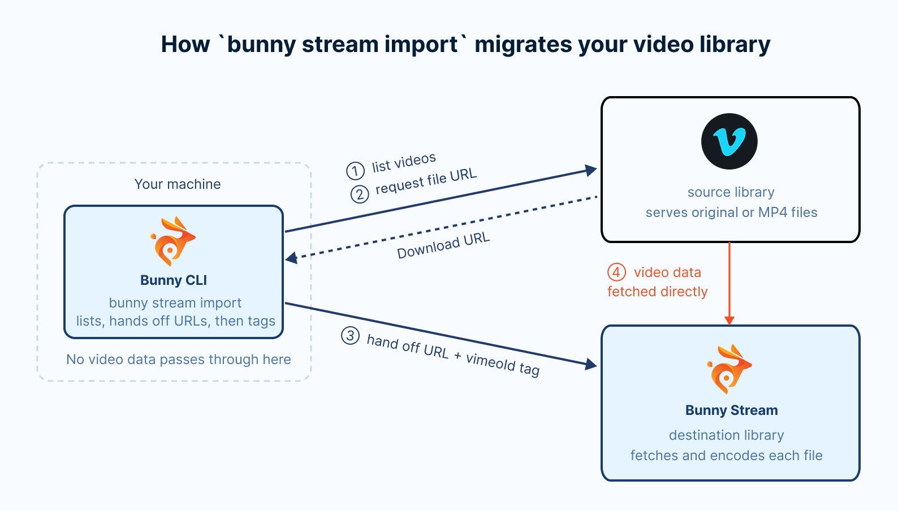
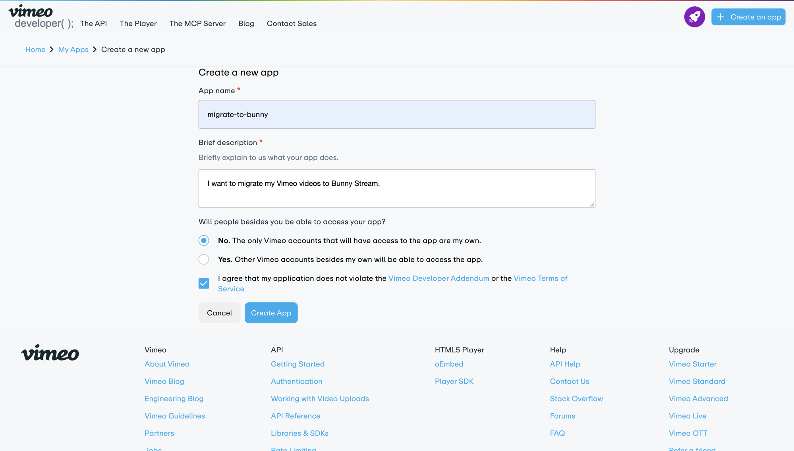
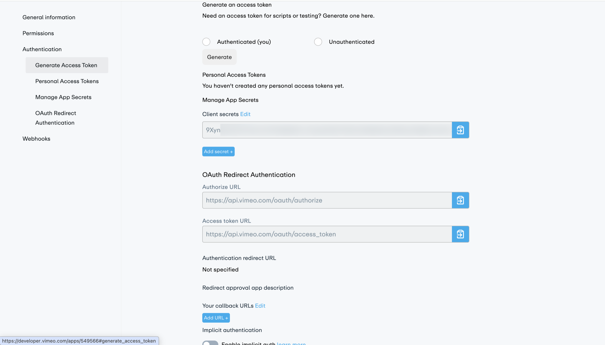
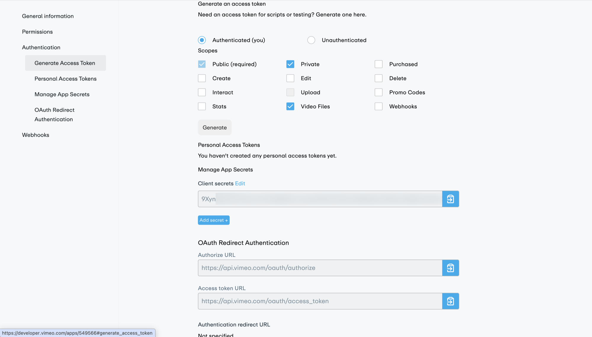
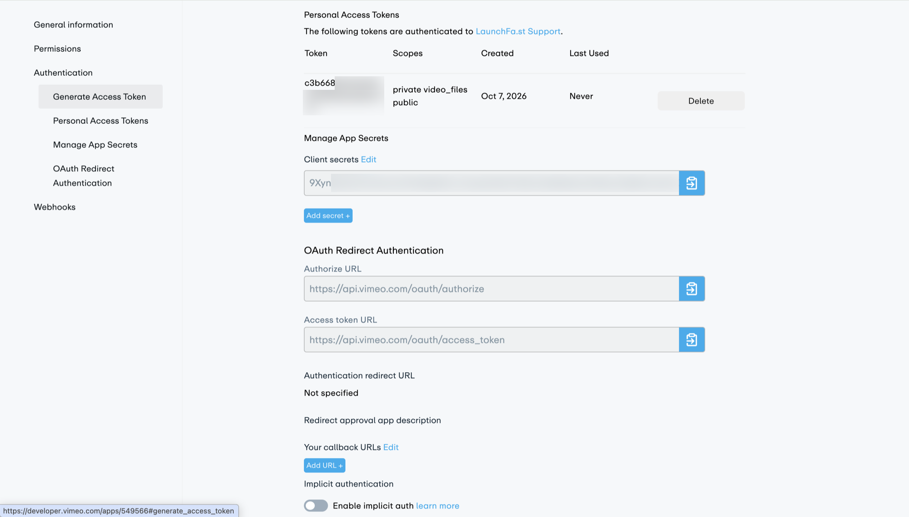
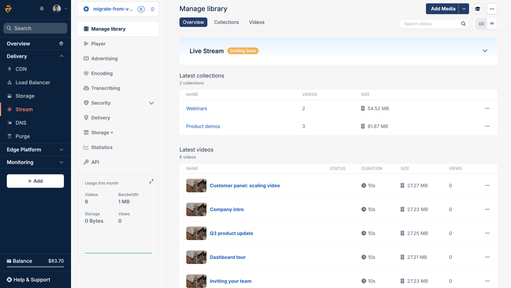

import Intro from "/snippets/stream/migrate/intro.mdx";
import InstallCli from "/snippets/stream/migrate/install-cli.mdx";
import CreateLibrary from "/snippets/stream/migrate/create-library.mdx";
import SaveCredentials from "/snippets/stream/migrate/save-credentials.mdx";
import ImportFlags from "/snippets/stream/migrate/import-flags.mdx";

<Intro provider="Vimeo" />

[Bunny Stream](https://bunny.net/stream/) bills only for the storage and bandwidth you use. See the [Bunny Stream pricing page](https://bunny.net/pricing/stream/) for current rates.

This guide walks you through how to migrate your video content to Bunny Stream from Vimeo. Here's what we'll cover:

- Installing and authenticating the [Bunny CLI](/cli)
- Creating a destination Bunny Stream library and a Vimeo access token
- Previewing the migration with a dry run, then running `bunny stream import`
- Monitoring encoding progress and verifying the result in the bunny.net dashboard

## Overview

<Frame>
  
</Frame>

A migration from Vimeo to Bunny Stream involves the following steps:

- **Discover**: Bunny CLI lists every folder on your Vimeo account, the videos in each folder, and the videos that are not in any folder. Each Vimeo folder becomes a Bunny Stream collection with the same name, and videos outside a folder are imported into the root of the destination library.
- **De-duplicate**: Each imported video is tagged with its Vimeo video ID under the `vimeoId` metatag. Before importing a video, the CLI checks whether that tag already exists in the destination library and skips the video if it does.
- **Fetch**: For each new video, the CLI asks Vimeo for the video's download links and picks the best file: the original upload when Vimeo has it, otherwise the highest resolution download, otherwise the highest resolution MP4 file. It then passes that URL to Bunny Stream, which fetches the file directly from Vimeo. Nothing is downloaded to your machine. The video's title, description, and tags come along with it.

Vimeo download links expire after 24 hours, but the CLI requests a fresh link for each video at the moment it hands that video to Bunny, so you do not need to prepare anything on Vimeo before the import.

## Scope

The import copies the video files, their titles, descriptions, and tags, and your folder structure. Settings that control who can watch your videos and where stay on Vimeo, so plan to set up their Bunny equivalents.

| Vimeo item | Migrated | Notes |
| --- | --- | --- |
| Video file | Yes | The original upload when Vimeo has it, otherwise the highest resolution download or MP4 file. |
| Title | Yes | |
| Description | Yes | Stored in the `description` metatag on the Bunny video. |
| Tags | Yes | Stored in the `keywords` metatag on the Bunny video. |
| Folders | Yes | Each folder becomes a collection with the same name. An existing collection whose name differs only in case is reused. |
| Video ID | Yes | Stored in the `vimeoId` metatag on the Bunny video. |
| Videos above 2160p or longer than 72 hours | No | Bunny Stream rejects them. The dry run warns about them before you import. |
| Privacy settings (private, unlisted, password) | No | See the privacy note below. |
| Embed settings and domain restrictions | No | Use Bunny's library security and [player settings](/stream/player-settings) instead. |
| Captions and subtitles | No | Upload them with `bunny stream videos captions add`, or generate new ones with [transcription](/stream/transcribing). |
| Custom thumbnails | No | Bunny generates new thumbnails when it encodes each video. |
| Chapters | No | |
| Showcases | No | Folders are imported as collections, but showcases are not. |
| Comments, likes, and analytics | No | Bunny Stream collects its own [statistics](/stream/statistics) from the first view. |

<Warning>
  **Private and unlisted videos are not private on Bunny.** The import copies every video your token can read, including private, unlisted, and password-protected ones, but not their privacy settings. Every imported video follows the security settings of its Bunny library, and a new library allows playback from any site. On Bunny, a video that was private or unlisted on Vimeo plays for anyone with its URL until you protect the library. Before you publish the new URLs, set up [Allowed domains](/stream/security-options#domains) to replace Vimeo's embed domain restrictions, and turn on [embed view token authentication](/stream/token-authentication) or [CDN token authentication](/stream/security#cdn-token-authentication) for videos that only signed-in viewers should see. If the videos that need protection are in their own Vimeo folders, you can import those folders into a separate library with `--folder` and give that library stricter settings.
</Warning>

## Prerequisites

- A [bunny.net account](https://dash.bunny.net/auth/register)
- A [Vimeo](https://vimeo.com) account on a plan that allows video file access: Standard, Advanced, or Enterprise, or a legacy Plus, Pro, Business, or Premium plan. Free and Starter plans cannot download video files through the API.

## Migrate your videos

<Steps>
  <Step title="Install and authenticate the Bunny CLI">
    <InstallCli />
  </Step>

  <Step title="Create a Bunny Stream library">
    <CreateLibrary guide="migrate-from-vimeo" />
  </Step>

  <Step title="Create a Vimeo access token">
    The Bunny CLI needs a Vimeo personal access token with these scopes:

    - **Public** and **Private**: to read every video on your account, including private and unlisted ones
    - **Video Files**: to read the download links for each video

    Open [My Apps](https://developer.vimeo.com/apps) on the Vimeo developer site. If you don't have an app yet, click **Create an app**. Enter an app name, such as migrate-to-bunny, and a brief description, select **No** for whether people besides you will access the app, accept the Vimeo terms, and click **Create App**.

    <Frame>
      
    </Frame>

    On the app's page, select **Generate Access Token** under **Authentication** in the left-hand navigation:

    <Frame>
      
    </Frame>

    Choose **Authenticated (you)**, so the token can read the private videos on your account. Under **Scopes**, **Public** is already checked, so also check **Private** and **Video Files**. Click **Generate**.

    <Frame>
      
    </Frame>

    The new token appears under **Personal Access Tokens** with the scopes private, video_files, and public. Copy the value from the **Token** column.

    <Frame>
      
    </Frame>
  </Step>

  <Step title="Preview the migration with a dry run">
    Run the import with `--dry-run`, using the library ID from step 2:

    ```sh
    bunny stream import --library 12345 --source vimeo --dry-run
    ```

    `--dry-run` prints the import plan without making any changes to either platform.

    The CLI then prompts for your Vimeo access token. Paste it at the **Access Token** prompt:

    ```sh
    Vimeo credentials
      https://developer.vimeo.com/apps (scopes: public, private, video_files)
    ✔ Access Token: … ********************************
    ```

    Once Vimeo accepts the token, the CLI offers to save it so later runs skip this prompt. Press Enter to accept:

    ```sh
    ✔ Save Vimeo credentials for next time? … yes
    ✓ Saved Vimeo credentials to the "default" profile.
    ```

    <SaveCredentials provider="Vimeo" />

    The `VIMEO_ACCESS_TOKEN` environment variable always takes priority over a saved token.

    The dry run then prints a summary and the import plan:

    ```sh
    Vimeo to Bunny Stream
     Key                Value
     Library            migrate-from-vimeo (12345)
     Source             Vimeo: 6 videos in 3 folders
     Already imported   0
     To import          6
     Duration           1:06
     Size               21 MB

    Import plan
    Product demos (3 videos)
      - Dashboard tour
      - Setting up your first project
      - Inviting your team
    Webinars (2 videos)
      - Q3 product update
      - Customer panel: scaling video
    (no collection) (1 videos)
      - Company intro

    ℹ Dry run. Remove --dry-run to import for real.
    ```

    **Already imported** counts videos that are already in the library, and **To import** counts the ones a real run would import. The size comes from Vimeo's download links, so if the summary has no Size row, check that your plan allows video file access and that the token has the Video Files scope.

    The plan groups videos by the collection they will land in. Each Vimeo folder maps to a collection of the same name, and videos outside any folder are listed under (no collection).

    Bunny Stream accepts sources up to 2160p (3840x2160, or 2160x3840 in portrait) and up to 72 hours long, while Vimeo hosts videos up to 8K. The dry run warns about any video beyond those limits, as it will fail on Bunny:

    ```sh
    ⚠ 1 videos are beyond Bunny's limits and will fail:
    ⚠   - Drone flyover: 7680x4320 is above Bunny's 2160p limit
    ```
  </Step>

  <Step title="Run the import">
    Run the same command without `--dry-run`:

    ```sh
    bunny stream import --library 12345 --source vimeo
    ```

    The CLI prints the same summary, then asks for confirmation. Type `y` and press Enter to start:

    ```sh
    ? Import 6 videos into migrate-from-vimeo? › (y/N)
    ```

    The CLI creates a collection for each folder, skips videos that are already imported, hands the rest to Bunny three at a time, and tags each video with `vimeoId`, along with its Vimeo description and tags. It returns once every video is queued. Bunny then fetches each file directly from Vimeo and encodes it.

    Collection names match without regard to case, so Vimeo folders named `Webinars` and `webinars` land in one collection. Rename one of them in Vimeo before the import to keep them separate.

    ```sh
    ✔ Import 6 videos into migrate-from-vimeo? … yes
    ✓ Queued 6 videos into migrate-from-vimeo. Bunny is fetching and encoding them now.
    ℹ Check progress with bunny stream import status --library 12345 --source vimeo
    ```

    <ImportFlags provider="Vimeo" />

    To migrate a large account one folder at a time, list the folders and their IDs:

    ```sh
    bunny stream import list --source vimeo
    ```

    ```sh
     ID         Name            Videos
     18273645   Product demos   3
     18273699   Webinars        2

    1 videos are not in a folder.
    Import one folder with bunny stream import --source vimeo --folder <id>
    ```

    Preview a folder's videos with `--folder`, then pass the same ID to the import:

    ```sh
    bunny stream import list --source vimeo --folder 18273645
    bunny stream import --library 12345 --source vimeo --folder 18273645
    ```

    The import works the same way, limited to that folder's videos and its collection.
  </Step>

  <Step title="Watch encoding progress">
    The import returns before Bunny finishes encoding. Check progress with the status command:

    ```sh
    bunny stream import status --library 12345 --source vimeo
    ```

    It prints one row per queued video, with its status on Bunny, encode percentage, size, and when it was queued:

    ```sh
    Vimeo to migrate-from-vimeo
     Video                           Bunny status   Encoded   Size    Queued
     Dashboard tour                  Transcoding    55%               1m ago
     Setting up your first project   Transcoding    55%               1m ago
     Inviting your team              Transcoding    5%                1m ago
     Q3 product update               Finished       100%      26 MB   1m ago
     Customer panel: scaling video   Transcoding    65%               1m ago
     Company intro                   Transcoding    55%               1m ago

    ℹ 1 finished, 5 processing, 0 failed.
    ```

    Run it again until the last line reports 0 processing. The command exits with a non-zero code when any video has failed, so you can also use it as a check in scripts.
  </Step>

  <Step title="Verify in the bunny.net dashboard">
    Open the [bunny.net dashboard](https://dash.bunny.net) and go to **Stream > Your library > Manage library**. Each Vimeo folder appears as a collection, and every migrated video is listed under **Latest videos**.

    <Frame>
      
    </Frame>

    Set up the library's [security settings](/stream/security-options) if you have not already, then replace the Vimeo embeds (player.vimeo.com iframes) and links in your site with their Bunny Stream equivalents. See [Embedding videos](/stream/embedding) for the embed and player options.
  </Step>
</Steps>

## Troubleshooting

<AccordionGroup>
  <Accordion title="Some videos failed during the import">
    When videos fail during an interactive import, the CLI lists each failure and offers to retry them:

    ```sh
    ✖ Company intro: No download available: the video was not found at the source or has no usable file
    ℹ Resume with bunny stream import --library 12345 --source vimeo --resume
    ? 1 videos failed. Retry them now? › (y/N)
    ```

    Answer `y` to retry them in the same run. If the import was interrupted, or you declined the retry, run it again with `--resume`:

    ```sh
    bunny stream import --library 12345 --source vimeo --resume
    ```

    `--resume` retries failed videos, processes any that were still outstanding, and re-applies the `vimeoId` tag to videos Bunny fetched before the run stopped. When the interrupted run was limited to one folder, the resume continues that folder. It stops retrying a video after three failed attempts and skips videos that Bunny rejected. To try those again, run the import without `--resume` (with the same `--folder`, if you used one), adding `--clean-failed` to delete the rejected Bunny copies first.

    Running the import again is always safe. Videos that already carry the `vimeoId` tag are skipped, and the CLI reports **Everything is already imported** once nothing is left.
  </Accordion>

  <Accordion title="No download available">
    Vimeo returned no downloadable file for that video. This happens when your Vimeo plan does not allow video file access, when the token is missing the Video Files scope, or when the video was deleted from Vimeo after the import started.
  </Accordion>

  <Accordion title="Invalid Vimeo access token">
    ```sh
    ✖ Invalid Vimeo access token.
    Create one at https://developer.vimeo.com/apps with the public, private and video_files scopes.
    ```

    Vimeo rejected the token. Check that you copied the whole value, then run the command again to re-enter it.
  </Accordion>

  <Accordion title="Videos are stuck with no data">
    If `bunny stream import status` reports videos stuck at zero bytes, run the import again with `--retry-stalled` to delete and fetch them again.
  </Accordion>
</AccordionGroup>
