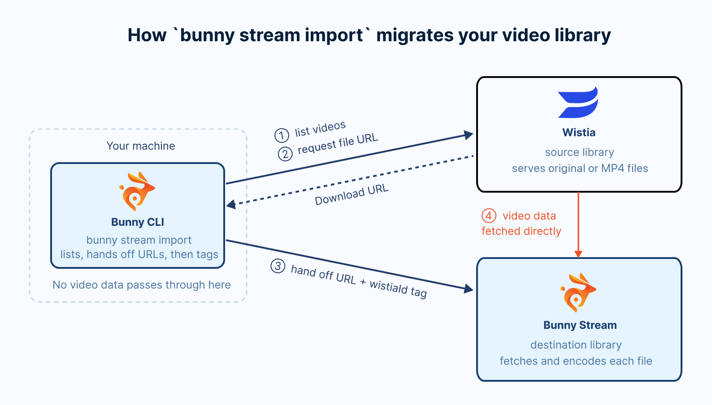
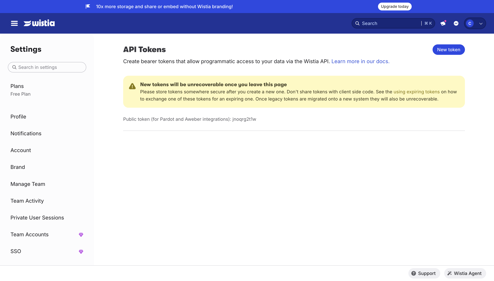
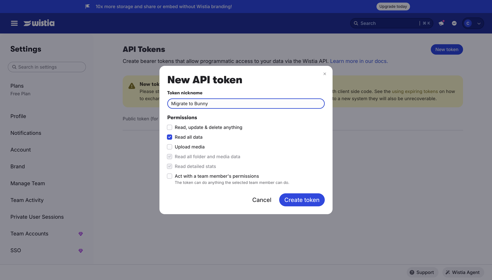
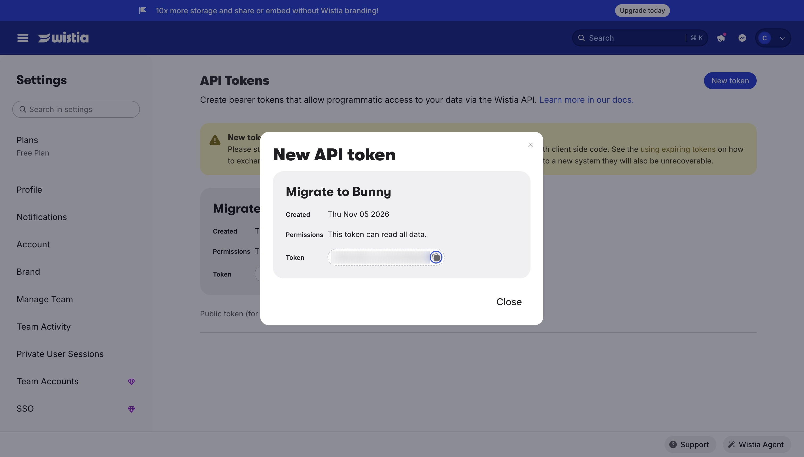
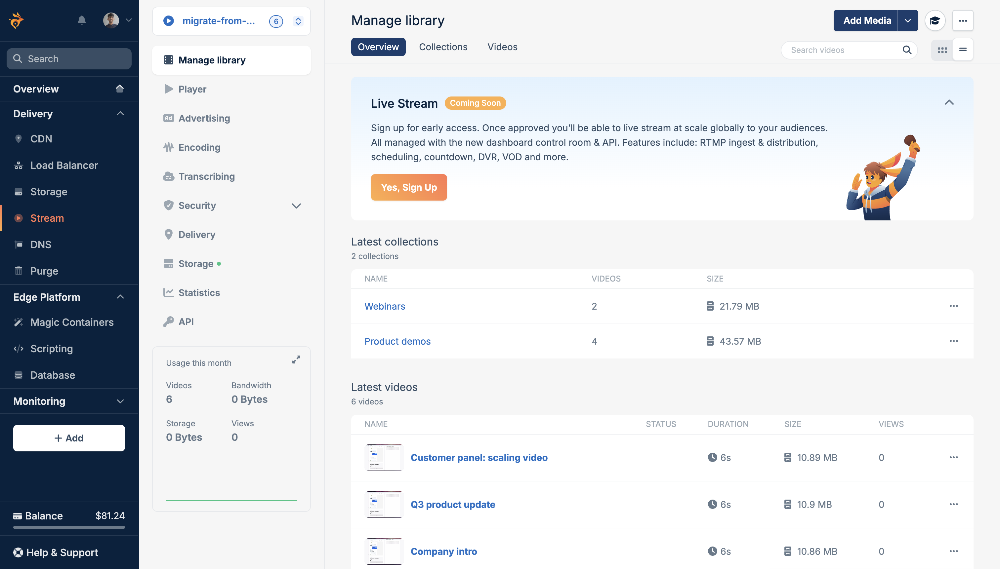

import Intro from "/snippets/stream/migrate/intro.mdx";
import InstallCli from "/snippets/stream/migrate/install-cli.mdx";
import CreateLibrary from "/snippets/stream/migrate/create-library.mdx";
import SaveCredentials from "/snippets/stream/migrate/save-credentials.mdx";
import ImportFlags from "/snippets/stream/migrate/import-flags.mdx";

<Intro provider="Wistia" />

[Bunny Stream](https://bunny.net/stream/) bills only for the storage and bandwidth you use. See the [Bunny Stream pricing page](https://bunny.net/pricing/stream/) for current rates.

## Overview

<Frame>
  
</Frame>

The Bunny CLI lists every video in your Wistia folders and hands each one to Bunny Stream, which fetches the best available file directly from Wistia. Nothing is downloaded to your machine. Each Wistia folder becomes a Bunny Stream collection with the same name. Each imported video is tagged with its Wistia media ID under the `wistiaId` metatag, so running the import again skips videos that are already imported.

## Scope

The import copies the video files, their names and descriptions, and your folder structure. Settings that control who can watch your videos and how the player looks stay on Wistia, so plan to set up their Bunny equivalents.

| Wistia item | Migrated | Notes |
| --- | --- | --- |
| Video file | Yes | The original upload when Wistia has it, otherwise the best MP4 rendition, from HD down. |
| Name | Yes | |
| Description | Yes | Stored in the `description` metatag on the Bunny video. |
| Tags | No | |
| Folders | Yes | Each folder becomes a collection with the same name. An existing collection whose name differs only in case is reused. |
| Media ID | Yes | Stored in the `wistiaId` metatag on the Bunny video, as the media's hashed ID, the short code in its Wistia URL. |
| Videos still processing or failed on Wistia | No | They appear in the plan but fail during the import. See [Troubleshooting](#troubleshooting). |
| Videos above 2160p or longer than 72 hours | No | Bunny Stream rejects them. The dry run warns about them before you import. |
| Images and audio files | No | Only video media are imported. |
| Privacy settings, passwords, and domain restrictions | No | See the privacy note below. |
| Player customizations, chapters, calls to action, and Turnstile | No | Use Bunny's [player settings](/stream/player-settings) instead. |
| Captions | No | Upload them with `bunny stream videos captions add`, or generate new ones with [transcription](/stream/transcribing). |
| Thumbnails | No | Bunny generates new thumbnails when it encodes each video. |
| Channels | No | Folders are imported as collections, but channels are not. |
| Stats | No | Bunny Stream collects its own [statistics](/stream/statistics) from the first view. |

<Warning>
  **Protected Wistia videos are not protected on Bunny.** The import copies every video your token can read, but not its privacy settings. Every imported video follows the security settings of its Bunny library, and a new library allows playback from any site. On Bunny, a video that was password protected or restricted to certain domains on Wistia plays for anyone with its URL until you protect the library. Before you publish the new URLs, set up [Allowed domains](/stream/security-options#domains) to replace Wistia's domain restrictions, and turn on [embed view token authentication](/stream/token-authentication) or [CDN token authentication](/stream/security#cdn-token-authentication) for videos that only signed-in viewers should see. If the videos that need protection are in their own Wistia folders, you can import those folders into a separate library with `--folder` and give that library stricter settings.
</Warning>

## Prerequisites

- A [bunny.net account](https://dash.bunny.net/auth/register)
- A [Wistia](https://wistia.com) account on any plan, including the Free plan. Only the Account Owner can create API tokens, so ask them for a token if you are not the owner.

## Migrate your videos

<Steps>
  <Step title="Install and authenticate the Bunny CLI">
    <InstallCli />
  </Step>

  <Step title="Create a Bunny Stream library">
    Create a library for the imported videos, or skip this step to use an existing one:

    ```sh
    bunny stream libraries create migrate-from-wistia --replication-regions NY,SG
    ```

    ```sh
    ✓ Created video library migrate-from-wistia (ID: 12345), replicated to DE, NY, SG.
    ```

    <CreateLibrary />
  </Step>

  <Step title="Create a Wistia API token">
    The Bunny CLI needs a Wistia API token with the **Read all data** permission, which lets it list your folders and videos and read the file URLs for each video. The CLI never changes anything on Wistia.

    In Wistia, open **Settings** and go to **API Tokens**, at `https://<account_slug>.wistia.com/account/api`, where `<account_slug>` is your Wistia account's subdomain. Click **New token**.

    <Frame>
      
    </Frame>

    Enter a token nickname, such as Migrate to Bunny, and under **Permissions** check **Read all data**. Wistia checks **Read all folder and media data** and **Read detailed stats** along with it. Click **Create token**.

    <Frame>
      
    </Frame>

    Copy the token with the copy button next to it. Wistia shows a token only once, so if you leave or refresh the page before copying it, create a new one.

    <Frame>
      
    </Frame>
  </Step>

  <Step title="Preview the migration with a dry run">
    Run the import with `--dry-run`, using the library ID from step 2:

    ```sh
    bunny stream import --library 12345 --source wistia --dry-run
    ```

    `--dry-run` prints the import plan without making any changes to either platform.

    The CLI then prompts for your Wistia API token. Paste it at the **API Token** prompt:

    ```sh
    Wistia credentials
      Wistia > Account > API Access
    ✔ API Token: … ****************************************************************
    ```

    Once Wistia accepts the token, the CLI offers to save it so later runs skip this prompt. Press Enter to accept:

    ```sh
    ✔ Save Wistia credentials for next time? … yes
    ✓ Saved Wistia credentials to the "default" profile.
    ```

    <Accordion title="Where the CLI stores credentials">
      <SaveCredentials provider="Wistia" />

      The `WISTIA_ACCESS_TOKEN` environment variable always takes priority over a saved token.
    </Accordion>

    The dry run then prints a summary and the import plan:

    ```sh
    Wistia to Bunny Stream
     Key                Value
     Library            migrate-from-wistia (12345)
     Source             Wistia: 6 videos in 2 folders
     Already imported   0
     To import          6
     Duration           0:37
     Size               17 MB

    Import plan
    Product demos (4 videos)
      - Dashboard tour
      - Setting up your first project
      - Inviting your team
      - Company intro
    Webinars (2 videos)
      - Q3 product update
      - Customer panel: scaling video

    ℹ Dry run. Remove --dry-run to import for real.
    ```

    **Already imported** counts videos that are already in the library, and **To import** counts the ones a real run would import. The plan groups videos by the collection they will land in, and each Wistia folder maps to a collection of the same name.

    Bunny Stream accepts sources up to 2160p (3840x2160, or 2160x3840 in portrait) and up to 72 hours long. Wistia reports the resolution of each original upload, so the dry run warns about any video beyond those limits, as it will fail on Bunny:

    ```sh
    ⚠ 1 videos are beyond Bunny's limits and will fail:
    ⚠   - Drone flyover: 7680x4320 is above Bunny's 2160p limit
    ```

    The dry run does not check whether Wistia has finished processing each video. A video that is still queued, processing, or failed on Wistia appears in the plan and fails during the import, so let Wistia finish processing recent uploads before you run it.
  </Step>

  <Step title="Run the import">
    Run the same command without `--dry-run`:

    ```sh
    bunny stream import --library 12345 --source wistia
    ```

    The CLI prints the same summary, then asks for confirmation. Type `y` and press Enter to start:

    ```sh
    ? Import 6 videos into migrate-from-wistia? › (y/N)
    ```

    The CLI creates a collection for each folder, skips videos that are already imported, hands the rest to Bunny three at a time, and tags each video with `wistiaId`, along with its Wistia description. It returns once every video is queued. Bunny then fetches each file directly from Wistia and encodes it.

    Collection names match without regard to case, so Wistia folders named `Webinars` and `webinars` land in one collection. Rename one of them in Wistia before the import to keep them separate.

    ```sh
    ✔ Import 6 videos into migrate-from-wistia? … yes

    ✓ Queued 6 videos into migrate-from-wistia. Bunny is fetching and encoding them now.
    ℹ Check progress with bunny stream import status --library 12345 --source wistia
    ```

    <ImportFlags provider="Wistia" />

    To migrate a large account one folder at a time, list the folders and their IDs:

    ```sh
    bunny stream import list --source wistia
    ```

    ```sh
     ID           Name            Videos
     5zxldselh1   Product demos   4
     lizwn9zmxq   Webinars        2
    Import one folder with bunny stream import --source wistia --folder <id>
    ```

    The ID is the folder's hashed ID, the same one that appears in the folder's Wistia URL. The **Videos** column is Wistia's media count for the folder, so it also counts images and audio files that the import skips.

    Preview a folder's videos with `--folder`, then pass the same ID to the import:

    ```sh
    bunny stream import list --source wistia --folder 5zxldselh1
    bunny stream import --library 12345 --source wistia --folder 5zxldselh1
    ```

    The import works the same way, limited to that folder's videos and its collection.
  </Step>

  <Step title="Watch encoding progress">
    The import returns before Bunny finishes encoding. Check progress with the status command:

    ```sh
    bunny stream import status --library 12345 --source wistia
    ```

    It prints one row per queued video, with its status on Bunny, encode percentage, size, and when it was queued:

    ```sh
    Wistia to migrate-from-wistia
     Video                           Bunny status   Encoded   Size   Queued
     Dashboard tour                  Processing     5%               just now
     Setting up your first project   Processing     5%               just now
     Inviting your team              Processing     0%               just now
     Company intro                   Created        0%               just now
     Q3 product update               Processing     0%               just now
     Customer panel: scaling video   Processing     0%               just now

    ℹ 0 finished, 6 processing, 0 failed.
    ```

    Run it again until the last line reports 0 processing. The command exits with a non-zero code when any video has failed, so you can also use it as a check in scripts.
  </Step>

  <Step title="Verify in the bunny.net dashboard">
    Open the [bunny.net dashboard](https://dash.bunny.net) and go to **Stream > Your library > Manage library**. Each Wistia folder appears as a collection, and every migrated video is listed under **Latest videos**.

    <Frame>
      
    </Frame>

    Set up the library's [security settings](/stream/security-options) if you have not already, then replace the Wistia embeds (embed codes and iframes loaded from fast.wistia.com or fast.wistia.net) and links in your site with their Bunny Stream equivalents. See [Embedding videos](/stream/embedding) for the embed and player options.
  </Step>
</Steps>

## Troubleshooting

<AccordionGroup>
  <Accordion title="Some videos failed during the import">
    When videos fail during an interactive import, the CLI lists each failure and offers to retry them:

    ```sh
    ✖ Customer panel: scaling video: Wistia media is processing, not ready for download
    ℹ Resume with bunny stream import --library 12345 --source wistia --resume
    ? 1 videos failed. Retry them now? › (y/N)
    ```

    Answer `y` to retry them in the same run. If the import was interrupted, or you declined the retry, run it again with `--resume`:

    ```sh
    bunny stream import --library 12345 --source wistia --resume
    ```

    `--resume` retries failed videos, processes any that were still outstanding, and re-applies the `wistiaId` tag to videos Bunny fetched before the run stopped. When the interrupted run was limited to one folder, the resume continues that folder. It stops retrying a video after three failed attempts and skips videos that Bunny rejected. To retry those too, add `--clean-failed`, which deletes their Bunny copies first.

    Running the import again is always safe. Videos that already carry the `wistiaId` tag are skipped, and the CLI reports **Everything is already imported** once nothing is left.
  </Accordion>

  <Accordion title="Wistia media is not ready for download">
    Wistia has not finished processing the video, or processing failed. The error names the status Wistia reports: queued, processing, or failed. Wait until the video plays in Wistia, then retry. A video that failed on Wistia needs to be uploaded to Wistia again, or uploaded to Bunny directly with `bunny stream videos upload`.
  </Accordion>

  <Accordion title="No download available">
    Wistia returned no file for that video, or the video was deleted from Wistia after the import started. Check that the video still exists in Wistia and plays there, then retry.
  </Accordion>

  <Accordion title="Invalid Wistia access token">
    ```sh
    ✖ Invalid Wistia access token.
    Create one under Account > API Access in Wistia.
    ```

    Wistia rejected the token. Check that you copied the whole value, then run the command again to re-enter it. If Wistia answers with `Wistia refused the access token (403)` instead, the token exists but lacks the **Read all data** permission. Edit the token's permissions on the **API Tokens** page of your Wistia Settings, or create a new one.
  </Accordion>

  <Accordion title="No Wistia project with ID">
    ```sh
    ✖ No Wistia project with ID 11085551.
    Use the project's hashed ID instead: 5zxldselh1.
    ```

    `--folder` takes the folder's hashed ID, not its numeric ID. Use the ID the error suggests, or the one in the **ID** column of `bunny stream import list --source wistia`.
  </Accordion>
  <Accordion title="Videos are stuck with no data">
    If `bunny stream import status` reports videos stuck at zero bytes, run the import again with `--retry-stalled` to delete and fetch them again.
  </Accordion>
</AccordionGroup>

## Migrate more than one Wistia account

Wistia API tokens belong to a single account. To migrate several accounts, repeat steps 2 to 7 for each one, with a token created in that account.

Import each account into its own Bunny library. The CLI keeps one saved import per source and library, so a separate library keeps each account's progress, `--resume`, and `status` apart.

The CLI saves one Wistia token per Bunny CLI profile, and uses it without prompting for the next account. Point the CLI at the next account's token in one of these ways:

- Set `WISTIA_ACCESS_TOKEN` in your shell. Environment variables always take priority over saved credentials.
- Run the import with a different Bunny CLI [profile](/cli/configuration#profiles), using `--profile`.
