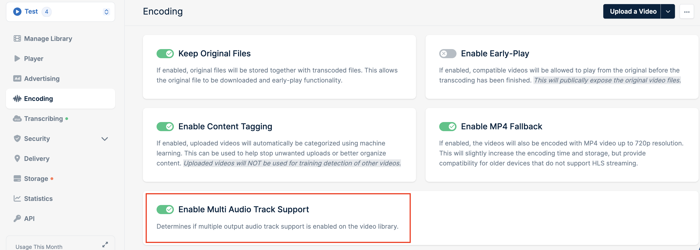

title: "Multi-audio" description: "Multi-audio track support allows you to make your videos accessible to a broader audience by incorporating additional audio tracks into your video player. This new capability enables you to include multi-language or descriptive audio, commentary tracks, and more, further customizing the viewer experience and reaching more people."

## Why Multiple Audio Track Support

Multiple audio track support opens up a myriad of possibilities for video content creators. By adding different audio tracks, you can:

Reach a Global Audience by including multiple language tracks to cater to a diverse audience. Enhance Accessibility by providing descriptive audio for visually impaired viewers. Add Versatilityby including commentary tracks or alternate audio for special editions or director’s cuts.

## How it works

### Separate audio streams

When encoding your video, our system allows the audio stream to be encoded as a separate stream of chunks. This approach is highly recommended as it ensures the audio is in a separate stream and is loaded independently. This separation not only improves loading times but also ensures a seamless and flexible viewer experience.

### Respecting original files

If your original file already contains multiple audio streams, our system will respect this and display the available audio tracks in the player. This means viewers can easily switch between different audio tracks, such as different languages or dubbing options, enhancing the flexibility and accessibility of your content.

### Automatic HLS output format

The entire process, from encoding to playback, is streamlined and efficient. All audio tracks and their associated descriptions are automatically transferred to the HLS (HTTP Live Streaming) output format, which is the format we support. This ensures a smooth and consistent viewer experience across all devices and platforms.

## Enabling multi-audio support

You can enable multiple audio track support on encoding tab of library settings by toggling **Enable Multi Audio Track Support**:

## Need help or encountered issues?

If you encounter any difficulties or have questions while following this guide, our support team is here to assist you. Please don't hesitate to contact us via the support request form for prompt assistance. Our dedicated support team is ready to help you resolve any issues you might face during the deployment process, provide additional guidance, or answer your questions.

There are three other things to check:

Wording: I wrote “audio tracks” rather than “audio channels” to match the rest of the page. “Channels” usually means stereo or surround channels within one track, which could confuse readers. Second sentence: The note says that with Basic DRM enabled, playback will only have a single audio track. Please confirm that’s how it actually behaves. If it doesn’t, cut that sentence. Typo: I fixed “Versatilityby” to “Versatility by.” Multi audio MDX

## Claude is AI and can make mistakes. Multi audio · MDX

## title: "Multi-audio" description: "Multi-audio track support allows you to make your videos accessible to a broader audience by incorporating additional audio tracks into your video player. This new capability enables you to include multi-language or descriptive audio, commentary tracks, and more, further customizing the viewer experience and reaching more people."

## Why Multiple Audio Track Support

Multiple audio track support opens up a myriad of possibilities for video content creators. By adding different audio tracks, you can:

- Reach a Global Audience by including multiple language tracks to cater to a diverse audience.
- Enhance Accessibility by providing descriptive audio for visually impaired viewers.
- Add Versatility by including commentary tracks or alternate audio for special editions or director’s cuts.

## How it works

### Separate audio streams

When encoding your video, our system allows the audio stream to be encoded as a separate stream of chunks. This approach is highly recommended as it ensures the audio is in a separate stream and is loaded independently. This separation not only improves loading times but also ensures a seamless and flexible viewer experience.

### Respecting original files

If your original file already contains multiple audio streams, our system will respect this and display the available audio tracks in the player. This means viewers can easily switch between different audio tracks, such as different languages or dubbing options, enhancing the flexibility and accessibility of your content.

### Automatic HLS output format

The entire process, from encoding to playback, is streamlined and efficient. All audio tracks and their associated descriptions are automatically transferred to the HLS (HTTP Live Streaming) output format, which is the format we support. This ensures a smooth and consistent viewer experience across all devices and platforms.

## Enabling multi-audio support

You can enable multiple audio track support on encoding tab of library settings by toggling **Enable Multi Audio Track Support**:

<Note>
  MediaCage Basic DRM does not support multiple audio tracks. If MediaCage Basic DRM is enabled on your library, only a single audio track will be available during playback.
</Note>

## Need help or encountered issues?

If you encounter any difficulties or have questions while following this guide, our support team is here to assist you. Please don't hesitate to contact us via the [support request form](https://bunny.net/contact/) for prompt assistance. Our dedicated support team is ready to help you resolve any issues you might face during the deployment process, provide additional guidance, or answer your questions.

Claude finished the response
