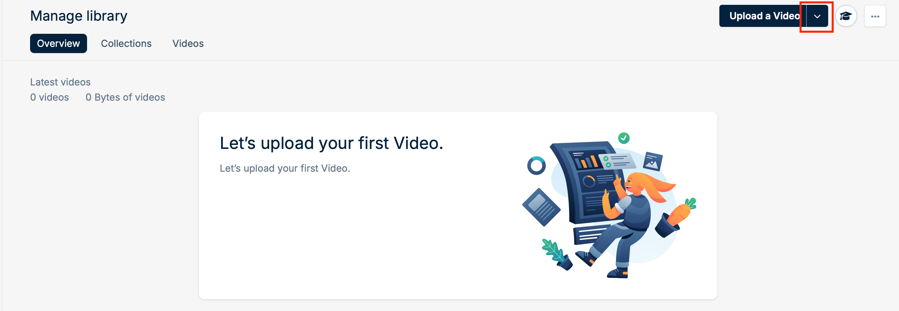
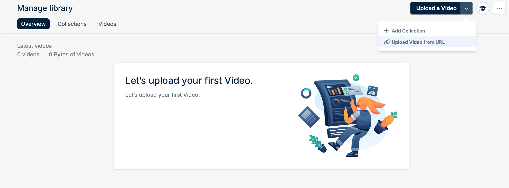
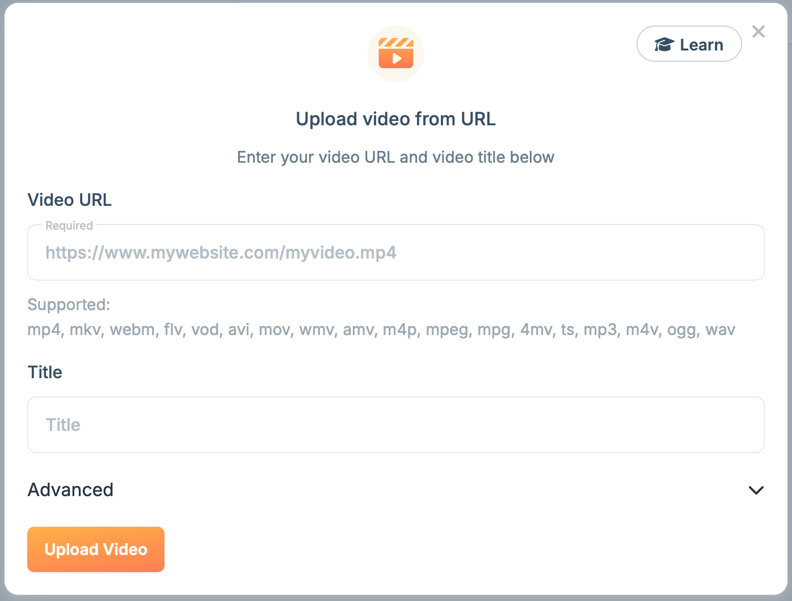
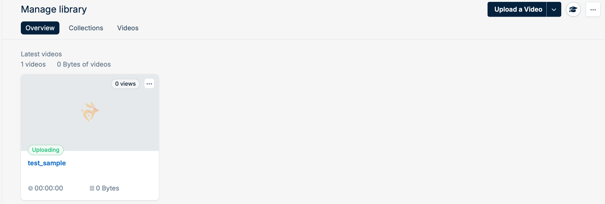
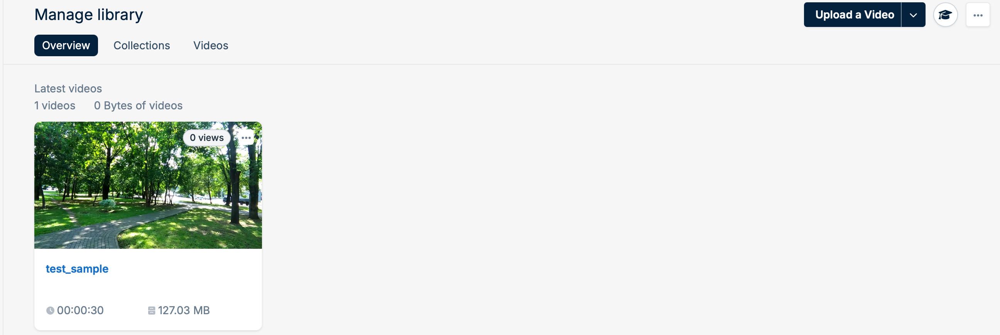

If your source video is already hosted at a public URL, you can pull it into your Bunny Stream library directly. There's no need to download it and upload it again.

## Fetch a video from the dashboard

<Steps>
  <Step title="Open the upload menu">
    In your video library, click the arrow next to **Upload a Video**.

    <Frame>
      
    </Frame>
  </Step>
  <Step title="Choose Upload Video from URL">
    Select **Upload Video from URL** from the dropdown menu.

    <Frame>
      
    </Frame>
  </Step>
  <Step title="Enter the video URL and title">
    Paste the **Video URL**, enter a **Title**, and click **Upload Video**.

    If the source needs authentication, expand **Advanced** to add the HTTP headers sent with the download request.

    <Frame>
      
    </Frame>
  </Step>
  <Step title="Wait for the upload and encoding">
    The dialog closes and the video starts uploading to your library. Once uploaded, it's transcoded. This takes longer for larger and longer videos.

    <Frame>
      
    </Frame>
  </Step>
  <Step title="Play your video">
    When encoding finishes, the video is ready for playback.

    <Frame>
      
    </Frame>
  </Step>
</Steps>

## Fetch a video with the CLI

[`bunny stream videos fetch`](/cli/commands/stream#bunny-stream-videos-fetch) starts the same fetch:

```bash
bunny stream videos fetch https://example.com/video.mp4 --title "Launch keynote"
```

## Troubleshooting

If a fetch fails, check the authentication token in the URL, any header values, and the URL syntax. Requirements vary between platforms.

<Info>
  Set any `AuthorizationExpire` timestamp to at least 1 hour (3600 seconds) so the upload completes before authorization expires.
</Info>

<AccordionGroup>
  <Accordion title="Upload from Dropbox">
    You must own the Dropbox account and the rights to the video.

    <Steps>
      <Step title="Copy the file link">
        In Dropbox, open the video file and click the **Copy link** icon next to **Share**.
      </Step>
      <Step title="Change dl=0 to dl=1">
        Edit the end of the link so Dropbox serves the file directly:

        ```text
        https://www.dropbox.com/scl/fi/k0nr5njo8hxjv31ez7hx9/example.mp4?rlkey=28mheq7emsr4tgptrc1t9e6lr&st=g611dzo4&dl=1
        ```
      </Step>
      <Step title="Fetch the video">
        Paste the link into the **Video URL** field of the **Upload video from URL** dialog and click **Upload Video**.
      </Step>
    </Steps>
  </Accordion>
  <Accordion title="Upload from Vimeo">
    You must own the Vimeo account and the rights to the video.

    <Steps>
      <Step title="Open the download options">
        In your Vimeo library, open the video, click the **Share** dropdown arrow, and select **Download**.
      </Step>
      <Step title="Copy the download link">
        Right-click the resolution you want and select **Copy link address**.
      </Step>
      <Step title="Fetch the video">
        Paste the link into the **Video URL** field of the **Upload video from URL** dialog and click **Upload Video**.
      </Step>
    </Steps>

    To move a whole Vimeo library, see [Migrate from Vimeo](/stream/migrate-from-vimeo).
  </Accordion>
</AccordionGroup>
